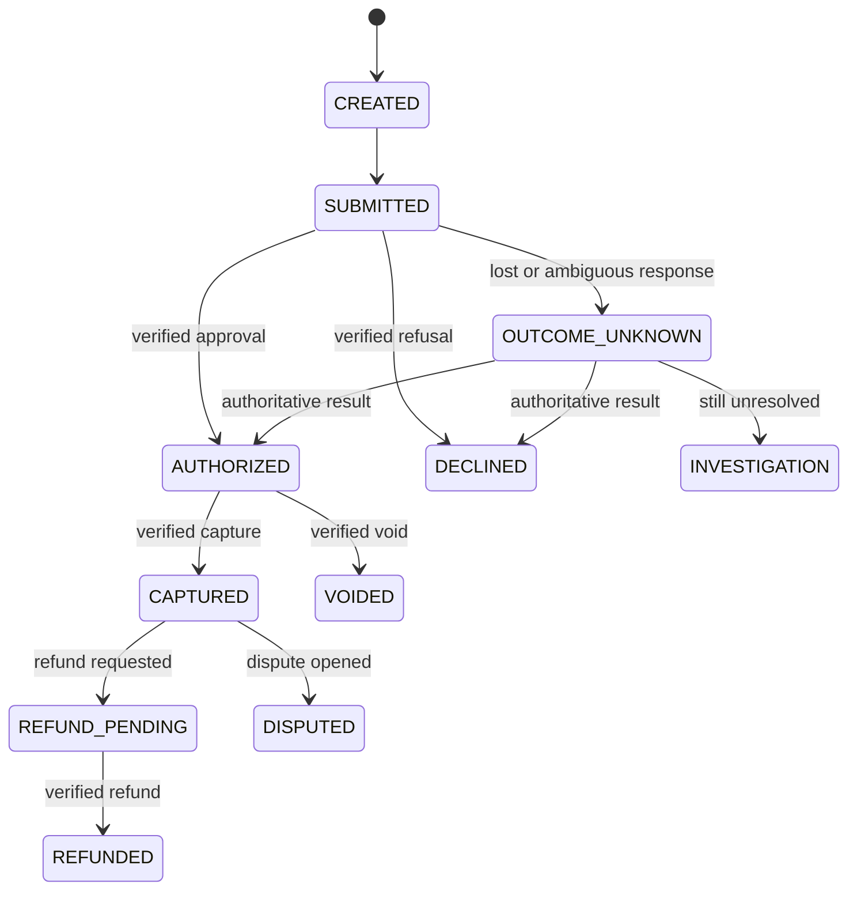

# Artifact — Payment API and State-Machine Requirements Checklist

**Status:** Adaptable specification checklist · Cross references: [Chapter 10](../book/part-3/10-checkout-and-payment-state.md), [Chapter 16](../book/part-4/16-three-way-reconciliation.md), [Chapter 17](../book/part-4/17-reliability-and-payment-operations.md)

A PM need not design the transport protocol, but must make *business invariants and financial consequences testable*. Engineering and provider specialists finalize API contracts.

## Required behavior before implementation

| Dimension | Questions to answer | Example test |
| --- | --- | --- |
| Business identity | What is the unique order/payment-operation ID? Which retries share it? | Double-click Pay does not create two paid orders |
| Authorization semantics | Do `approved`, `declined`, `unknown`, `voided` and `expired` have distinct states? | Lost response yields pending, not hard decline |
| Authentication | How are 3DS redirects, challenges and callbacks linked to one operation? | Late challenge result cannot resurrect canceled order |
| Capture/refund | Which amounts and partial operations are supported? How are multiple captures linked to order? | Two identical capture callbacks produce one effect |
| Amount/currency | Minor units, supported currency exponents, rounding, FX rate/quote and value time | Total signed captured amount does not exceed permitted amount |
| Idempotency | Scope, key generation, retention, provider semantics, replay handling | Timeout + same key does not create unintended new money movement |
| Webhooks | Signature validation, duplicate/out-of-order delivery, persisted processing ID, event version | Replay and late event don't regress authoritative state |
| Routing/failover | Provider eligibility, token portability, auth unknowns, alternative rail handling | Unresolved request on PSP A is never blindly retried on PSP B |
| Customer UX | Pending/recoverable states, retry permissions, support references | UI never asserts failure without evidence |
| Finance | Capture ID, settlement journal, fees, payout ID, bank reconciliation, refunds, disputes | Every signed financial event is traceable end-to-end |
| Risk/compliance | Required approvals for auth policy, data handling, retries, merchant status | Missing required control approval blocks launch |
| Observability | Event-time, ingestion-time, trace IDs, coherent denominator, data classification | Metrics distinguish order success from attempt approval |
| Versioning/rollback | API schema compatibility, feature flags, migration and incident fallback | Rollback maintains existing financial state and idempotency |

## Reference state model (illustrative)

**Caution:** This is a simplified business status model, not a universal PSP specification. Settlement, payout, multi-capture and partial-refund events should usually be represented as related financial entities, not destructive updates of this single status.

## Sign-offs and acceptance criteria

- PM: user-visible behavior, metrics, customer-support operational contract and permitted recovery.
- Engineering/SRE: transport, race conditions, idempotency boundary, retries, security and rollback.
- Finance: ledger event mapping, recon, payout and refund/chargeback representations.
- Risk/compliance/legal: controls and payment/jurisdiction rules where applicable.
- Provider owner: API semantic evidence, callback guarantees, cutoffs and escalation routes.

**Do not call an API “done” until negative-state acceptance tests and finance close procedures are ready.**
