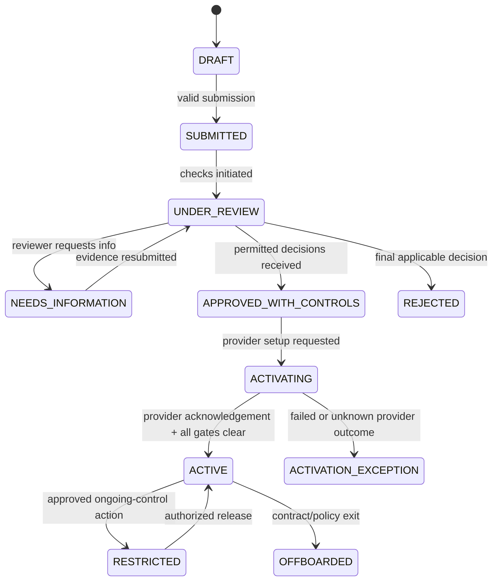

# Example PRD — Merchant onboarding with compliance and underwriting gates

**Status:** Fictional teaching PRD · **Owner:** Acquiring/PayFac PM · **Market:** Singapore example only · **Last edited:** 16 November 2026  
**Prerequisites:** [Merchant acquiring](../book/part-2/05-merchant-acquiring.md), [compliance and control ownership](../book/part-3/13a-compliance-and-control-ownership.md)

> **Disclaimer:** Fictional product behavior, not a recommended compliance procedure. The licensed entity, legal and compliance teams must define applicable KYC/KYB/AML checks and data retention. A PayFac structure does not automatically remove PCI, AML or acquiring responsibilities.

## 1. Problem, customer and JTBD

HarborCart Marketplace wants to let legitimate sellers begin receiving card payments while preventing prohibited/unsupported seller activation and preserving exposure and payout controls. Today applicants repeat document uploads, cannot tell whether the application is awaiting review, and some newly activated sellers lack clear reserve and payout information.

**Seller job:** “Help me provide the information needed to accept payments, know what happens next, and understand any restrictions before I trade.”  
**Operations job:** “Give me verifiable evidence and review workflows without approving an applicant by accident.”

## 2. Scope and boundaries

**In scope:** application capture and resume, business/owner information status, screening and underwriting decision states, request-for-information workflow, controlled activation, merchant limits/hold notifications, audit history, exception queue, API/event tracking and analytics.

**Out of scope:** deciding who qualifies under law, setting AML risk thresholds, building a sanctions engine, choosing scheme registration, changing legal payout terms or making automatic credit decisions without approved risk design.

## 3. Actors and decisions

| Function | Decision | Product interface |
| --- | --- | --- |
| Seller | Submits permitted data and follows application status | Web/app onboarding and support |
| Compliance | Applicable CDD/screening decisions and communication constraints | Restricted reviewer console / audit trail |
| Underwriting | Merchant exposure, reserves, payout timing, limits | Risk decision service and reviewer console |
| Finance/treasury | Reserve accounting, payout allocation and ledger integrity | Financial event export and reconciliation |
| PSP/acquirer operations | Merchant/processing account activation and provider errors | Provisioning API and exception queue |
| PM/engineering | Required journey, product behavior, API states and launch assurance | PRD, implementation, metrics, controlled rollout |

## 4. Merchant lifecycle and state diagram

Persist **compliance status, underwriting status, activation status and settlement capability** separately; do not overwrite them with a single unqualified `approved=true`.

## 5. Critical requirements

| ID | Requirement | Acceptance criterion |
| --- | --- | --- |
| OB-01 | Separate decisions | Compliance and underwriting approvals are independently versioned, with approved owners; activation only after all required gates |
| OB-02 | Pending state | External screening timeouts remain `UNDER_REVIEW`/exception, never interpreted as pass |
| OB-03 | Request more info | Seller sees permissible missing-field request, due date where applicable, history and secure upload path |
| OB-04 | Restricted logging | PAN/CVV, internal suspicious-activity details and sensitive documents do not enter generic product analytics logs |
| OB-05 | Exposure controls | Limits/reserves/holds store policy version, effective date and reviewer, and flow into payout/accounting separately |
| OB-06 | Provider provisioning | Timeout after account-creation request triggers status query/idempotent recovery, not duplicate merchant accounts |
| OB-07 | Merchant communication | Seller receives approved explanation of activation and payout/hold status; no confidential risk rules disclosed |
| OB-08 | Ongoing monitoring | Material merchant changes and review triggers have a named work queue, event and audit trail |
| OB-09 | Exception handling | Each failed external API response is assigned to operation, owner, next retry/check and closure evidence |
| OB-10 | Rollback | Account restriction/stop-processing actions are supported without deleting historical finance events |

## 6. Metrics and guardrails

**Primary:** Eligible merchants reaching **first confirmed successful payment** within a fixed window after submission, stratified by segment/market.  
**Diagnostic:** completion rate by information step, time in `NEEDS_INFORMATION`, time from all approvals to active processing, provider activation error rate, requests for support, 30-day merchant payment activity.  
**Guardrails:** incorrect activation count, unresolved screening/status exceptions, manual overrides without approved author, payout/reserve reconciliation breaks, privacy exposure incidents and finance exception aging.

**Important:** Faster activation is not proof of better onboarding if unsuitable merchants bypass checks. Report compliance rejection and underwriting referral as **separate approved business outcomes**, not indiscriminately as funnel failures.

## 7. Launch and rollback

Pilot one supported low-risk merchant segment, using approved compliance and risk policies. Validate every state through synthetic applications and provider sandbox; complete review of legal entity, license applicability, PCI/card-data boundaries and merchant consent/contract. Measure from submission to first payment; reconcile initial fee/hold/payout events. Escalate failed provider provisioning, non-approvable applicants and restricted-merchant refunds to assigned owners.

**Kill switch:** Stop creating new merchant acceptance capabilities while leaving existing transaction history and refund/dispute servicing accessible to authorized operators. No unapproved deletion of evidence or money events.

## 8. Open questions requiring sign-off

1. Which Singapore payment services and licensed parties, if any, are in scope for this specific contract and flow?
2. What actual CDD and beneficial-owner requirements, limits and periodic review apply to each applicant group?
3. Which provider error codes represent a definitive rejection versus uncertain provisioning?
4. Which reserves, holds, transaction limits and payout cycles are contractually permitted?
5. What seller disclosure can be shown for restrictions without exposing sensitive screening details?
6. Which approvals, evidence stores and retention periods are needed before public launch?

**No feature team may self-approve these obligations simply because this fictional PRD contains the questions.**

## References

- [MAS — Payment services regulation](https://www.mas.gov.sg/regulation/payments)
- [MAS — Notice PSN01 for specified payment services](https://www.mas.gov.sg/regulation/notices/psn01-aml-cft-notice---specified-payment-services)
- [FATF — Recommendations](https://www.fatf-gafi.org/en/publications/Fatfrecommendations/Fatf-recommendations.html)
