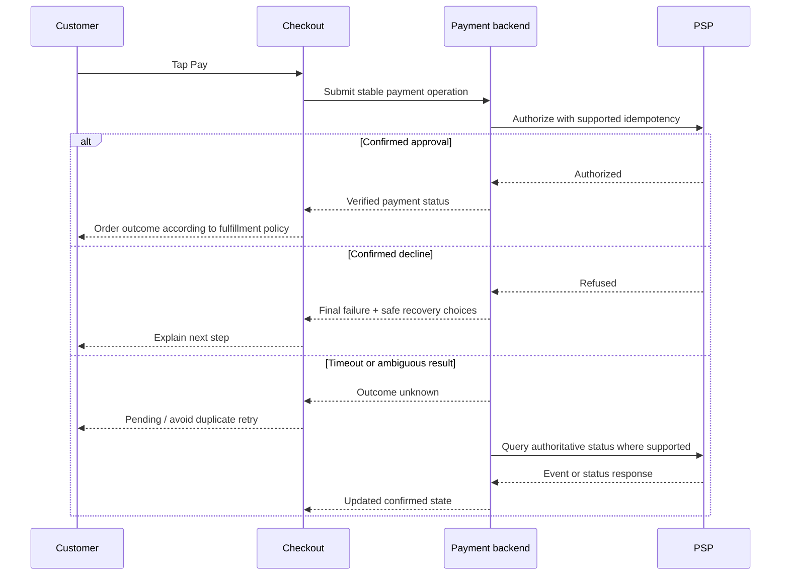

# Example PRD — Safe recovery from uncertain payment outcomes

**Status:** Teaching example · **Owner:** Payments PM (fictional) · **System:** Merchant ecommerce checkout with one PSP · **Last updated:** 15 November 2026

> All data, references and acceptance criteria here are **illustrative**, not production-ready integration guidance. Validate your PSP's documented state transitions, idempotency behavior, scheme rules, security obligations and actual business requirements.

## 1. Problem

Some shoppers receive a generic "payment failed" message when checkout does not get a timely result. A subset may already have an approved authorization. Immediate resubmission can create another payment attempt, confusion, support demand or duplicate financial operations.

**Customer job:** "When I pay, tell me reliably whether the order succeeded, and let me recover without risking an accidental duplicate charge."

## 2. Goals and non-goals

**Goals**

- Give customers a truthful **pending** state when the payment outcome is unknown.
- Resolve uncertainty through supported PSP status retrieval and/or verified callbacks.
- Prevent duplicate application-side authorization initiation for one unresolved payment operation.
- Make unresolved cases visible to support and reconciliation teams.

**Non-goals for first release**

- Guarantee instantaneous final status for asynchronous payment methods.
- Automatically retry every decline.
- Change issuer approval logic or fraud policy.
- Redesign refunds, payouts or chargebacks.

## 3. Users and stakeholders

- **Primary:** Shopper completing an order.
- **Secondary:** Customer support, operations, finance and reconciliation teams.
- **Dependencies:** Payments backend, checkout frontend, PSP integration, risk, security, analytics and SRE.

## 4. Critical behavioral rules

| Requirement | Expected behavior | Why it matters |
| --- | --- | --- |
| R1 — Stable identity | Repeated clicks for one checkout operation reuse a durable order/payment-operation reference, subject to provider semantics | Prevent unintended duplicate payment creation |
| R2 — Unknown is not failed | A network or gateway timeout results in `OUTCOME_UNKNOWN`, not a definitive issuer decline | Avoid false failure messaging |
| R3 — Status resolution | Server queries the PSP or ingests authenticated events and advances state only on valid, verified transitions | Avoid guessing about finality |
| R4 — Guarded retry | Do not initiate a **new** authorization until status is resolved or a reviewed recovery policy specifically permits it | Reduce duplicate-charge exposure |
| R5 — Safe idempotency | Use provider-specific idempotency keys correctly; protect against repeated calls and events | Handle clicks, timeouts and duplicate delivery |
| R6 — Customer messaging | Show pending text, available help, and verified confirmation/failure without revealing raw refusal reasons | Trust and privacy |
| R7 — Traceability | Support can search order, payment, attempt and provider references and see event history | Reconciliation and diagnosis |
| R8 — Financial safety | Fulfillment, capture, refunds and ledger updates are guarded by their own confirmed business states | Prevent double fulfillment or ledger errors |

### UI copy (illustrative)

- **Outcome unknown:** "We're checking your payment. Please don't try again yet. You can safely leave this screen; we'll update your order status."
- **Confirmed authorization, order pending:** "Your payment was authorized. We're confirming your order."
- **Confirmed decline:** "This payment wasn't approved. Try a different payment method or contact your bank if needed."

Messaging must reflect verified backend capabilities. Do not promise a notification or timeout guarantee until the implementation supports it.

## 5. Simplified customer and system flow

This does **not** assume all providers implement the same status lookup, idempotency or webhook semantics.

## 6. Acceptance criteria

1. **Double tap:** Given two rapid Pay presses, the backend does not create two independent payment operations for the same intended purchase.
2. **Client disconnect:** If the app disconnects after sending a payment request, opening the order page reflects the durable payment state without forcing a new authorization.
3. **Backend timeout:** If a PSP call times out, the merchant does **not** store `DECLINED` unless a trustworthy final refusal was received.
4. **Late success:** If an authenticated PSP event later confirms approval, the internal payment state can advance without triggering a second authorization or duplicate fulfillment.
5. **Duplicate callback:** Replaying the same PSP event has no second business side effect.
6. **Out-of-order event:** Older or incompatible events cannot roll a verified payment state backward.
7. **Mismatch:** If payment and order state remain inconsistent beyond an operationally agreed threshold, an exception appears in monitoring with responsible owner and trace IDs.8. **Reconciliation:** Captured funds and refund operations retain their own event identities, not inferred from the authorization alone.
9. **Support:** Support can see the latest verified status and reference IDs without seeing sensitive credentials.
10. **Recovery:** A final decline offers only permitted next actions; non-retryable responses do not trigger repeated automatic attempts.

## 7. Measurement plan

**Primary:** Number of customer-visible unresolved payment outcomes per 1,000 orders initiating payment, measured after the defined resolution window.

**Secondary:** Median/p95 time to trustworthy status; unique-order paid success; support contacts about charged-but-failed outcomes; repeat taps and attempted retries; proportion of unresolved outcomes later verified.

**Guardrails:** Duplicate authorizations/captures, fraud losses, reconciliation exceptions, failed fulfillment, payment latency and processing cost per paid order.

**Instrumentation needed:** `order_id`, `payment_id`, `operation_id`, `attempt_id`, provider reference, event ID, normalized outcome, raw provider status where permitted, timestamps, status source and versioned transition logic.

## 8. Delivery plan

**Phase 0:** Map PSP guarantees, API/webhook semantics, failure taxonomy, and financial exception-handling ownership. Test in provider sandbox with simulated delays and duplicate callbacks.

**Phase 1:** Internal canary with pending state, status reconciliation and support observability; do not enable unreviewed automatic retries.

**Phase 2:** Limited customer rollout with defined rollback thresholds, incident on-call, and operational follow-up for unresolved cases.

**Stop immediately for:** Duplicate captures or material evidence of double charging, incorrect final states, inability to trace money movement, or a significant rise in unresolved exceptions.

## 9. Questions requiring sign-off

- Which PSP responses and events are authoritative? How are they verified?
- What idempotency guarantees apply, and for how long?
- What changes when authorization succeeds but capture or fulfillment fails?
- Who owns status mismatches and what is the agreed resolution SLA?
- Which payment types are asynchronous or require a different journey?
- What regulations, security and scheme restrictions apply in each market?

## Sources

- [Stripe — Payment Intents](https://docs.stripe.com/payments/payment-intents)
- [Stripe — Idempotent requests](https://docs.stripe.com/api/idempotent_requests)
- [Adyen — Payments lifecycle](https://docs.adyen.com/account/payments-lifecycle)

**Related reading:** [Chapter 3](../book/part-1/03-card-payment-lifecycle.md) and [Chapter 12](../book/part-3/12-authorization-optimization.md).
