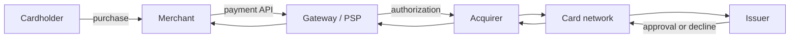

# 2. The payments ecosystem: who does what, who takes risk?

**Part I — Understanding Payments** · Prerequisites: Chapter 1

## Learning outcomes

Identify the major actors in a card payment and in account-to-account transfers, distinguish service providers from regulated roles, and map the commercial, technical, and risk boundaries for a particular payment product.

## 2.1 Begin with the end users

The **payer** wants to discharge an obligation with predictable cost and clear confirmation. The **merchant/payee** wants to accept payment, know when to release goods, receive funds, and handle adjustments. Those are distinct jobs. A merchant might tolerate a two-day payout to reduce fees; the customer may want immediate notification. A marketplace adds platform, seller, and recipient-of-funds roles to an already complex picture.

In a four-party card model, the familiar actors are cardholder, merchant, **issuer** (the institution providing the card account), and **acquirer** (the institution enabling merchant acceptance). The **network/scheme** defines operational rules and facilitates exchange of messages between participating institutions. The merchant can also use a **gateway**, **PSP**, **processor**, **fraud provider**, **token vault**, or **orchestrator**. One company may provide several of these capabilities; never assume each box means a separate vendor or legal entity.

The diagram is conceptual. An integrated acquirer-processor may collapse multiple stages. Risk screening and 3DS authentication may add additional interactions.

## 2.2 A participant map

| Actor | What it normally contributes | Where it may take risk | PM dependency |
|---|---|---|---|
| Merchant | Sells goods/services; defines fulfillment | Goods, service, refund, some fraud/dispute exposure | Order identity, amount, customer messaging |
| Gateway | Secure integration and message handling | Operational failure, subject to contract | API reliability, latency, idempotency, webhooks |
| PSP / processor | Processing, reporting and often merchant tools | Service, operational and sometimes financial exposure | State model, dispute tooling, reporting |
| Acquirer | Merchant acceptance and scheme-facing obligations | Merchant credit, fraud, chargebacks, settlement | KYB/underwriting, pricing, reserves, payouts |
| Card network | Network connectivity and rules | Scheme-specific rule/operating exposures | Rules, data fields, network services |
| Issuer | Card issuance, authorization and cardholder servicing | Credit, account fraud and scheme-defined liability | Approval behavior, declines, card lifecycle |
| Bank-transfer operator | Clearing/transfer infrastructure | Varies by system design and rulebook | Availability, finality, returns, participant access |
| Regulator | Supervises covered activities under applicable law | Not an operator's commercial risk counterparty | Licensing, controls, consumer protection |

**Responsibility is not the same as liability.** A customer may see a single payment brand while contracts allocate duties among several firms. A PM should request a RACI and a funds-flow diagram, not infer legal responsibility from a product screen.

## 2.3 Issuing and acquiring are mirror-image businesses

An **issuer PM** might design card provisioning, account controls, wallet tokenization, approval policy, authorization alerts and disputes. An **acquiring PM** might design merchant onboarding, payment acceptance, risk controls, reserve management, payout schedules and merchant analytics. Their incentives can conflict: an issuer may decline a risky transaction to protect its cardholder and losses, while the merchant and acquirer want the sale accepted. The card network provides shared rules but does not erase those differences.

The gateway itself need not be the acquirer. In an orchestration arrangement, the merchant might integrate once and route transactions to multiple processors. That creates a new problem: how do we normalize identifiers, statuses, costs and incident responses when providers disagree?

## 2.4 Account-to-account payments use different infrastructure

For a bank transfer, the payer's and recipient's financial institutions connect through clearing/transfer systems. Some rails use **proxy addressing** to translate a phone number or merchant identifier into an account destination. Some operate in real time; others process in batches. Clearing, liquidity, settlement finality, and recall rules differ across systems.

**Singapore example:** PayNow is a proxy-addressing service built on FAST infrastructure; FAST enables near-immediate SGD transfers among participating institutions. SGQR provides a common QR display framework and is not itself a universal funds-settlement rail. Different QR apps may ride different payment arrangements. [MAS e-payments](https://www.mas.gov.sg/development/e-payments) is the starting point for local specifics.

## 2.5 Who gets paid, when?

A shopper buying a S$50 item is not paying S$50 directly into the merchant's bank account in every model. A provider may deduct processing fees before payout; a payment facilitator may aggregate merchants' flows; refunds, reserves, rolling balances and chargebacks may change net payouts. Funds flow must be drawn separately from the **API flow**. A merchant-facing "payment successful" event and a bank-credit notification answer different questions.

### Worked product situation: a startup chooses its payment stack

A marketplace wants card checkout, seller onboarding, split funds and next-day payouts. Before selecting a provider, the PM maps: **merchant of record**, seller identity and KYB responsibilities, whose legal entity contracts for acquiring, who holds funds, conditions for disbursement, dispute liability, fee incidence, tax responsibility, and support access. A feature checklist that only says "supports split payments" does not resolve these choices.

The result should be three diagrams: (1) customer journey; (2) API / event interaction; (3) money and liability flow. Put the contract owner beside each arrow.

## 2.6 PM field checklist

Ask a candidate provider: Are you the gateway, acquirer, processor, or some combination? Which entity signs the merchant contract? Who files scheme disputes? What happens if the merchant has insufficient balance for refunds? How are payouts financed and reconciled? What constitutes a final payment outcome? Which system exposes issuer decline codes? Which capabilities vary by country?

## Check your understanding

1. Can a PSP be both a gateway and an acquirer? Give one integration implication.
2. Why might a merchant and issuer disagree about an optimal risk threshold?
3. What would be misleading about describing SGQR as the payment rail?
4. Draw separate sequence and funds-flow diagrams for a marketplace with two sellers.

**Exercises:** [Worked solutions](../../answers/chapter-exercises.md#02-players-in-the-payments-ecosystem) (companion answer key; review your reasoning before opening).

**Next:** [3. The card payment lifecycle](03-how-card-payments-work.md).

## Further reading

- [Visa Accept — merchant acceptance context](https://developer.visa.com/capabilities/visa-accept/overview)
- [MAS — Development of e-payments](https://www.mas.gov.sg/development/e-payments)
- [Adyen — Payment lifecycle](https://docs.adyen.com/account/payments-lifecycle)
