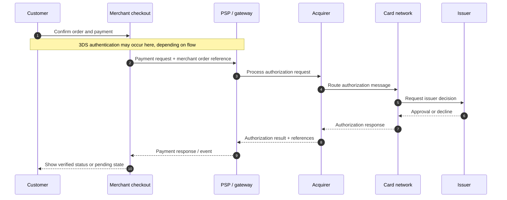
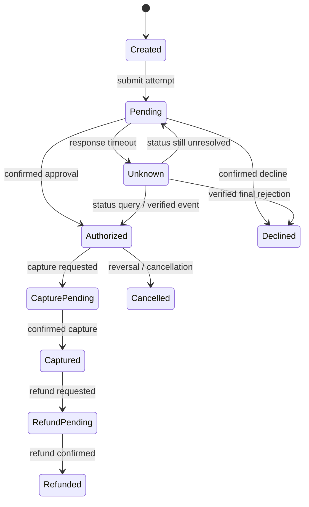

# 3. How a card payment works, end to end

**Estimated study time:** ~20 minutes · **Prerequisites:** [Chapter 1](01-understanding-a-payment.md) and [Chapter 2](02-players-in-the-payments-ecosystem.md)

## Learning objectives

By the end, you should be able to:

1. Identify the players in a card-not-present transaction and distinguish authentication from authorization.
2. Explain why an **approved authorization** is not the same as captured funds, settled funds, or a merchant payout.
3. Sketch a product-level state machine that handles timeouts, asynchronous callbacks, duplicates, cancellation, and refunds.
4. Identify the questions a PM should ask before promising "instant success" or "automatic retry."

## The first distinction: approving a purchase is not moving the money

Imagine a customer orders groceries online. They choose a card, complete any required authentication, and tap **Pay**. The issuer approves the transaction. The merchant now usually has a valid **authorization**, but the financial lifecycle has additional stages.

- **Authentication:** Establishes evidence that the person using the payment method is legitimate or satisfies a required authentication step. In e-commerce, EMV 3-D Secure may support this. It is not identical to bank approval of the charge.
- **Authorization:** The issuer or relevant financial institution decides whether to approve the payment request. In common card flows, the approved amount is reserved or made unavailable to the cardholder.
- **Capture:** The merchant or PSP submits the authorized transaction for financial processing; this may happen automatically or later, depending on configuration and the payment method.
- **Clearing and settlement:** Financial messages and obligations are processed between relevant network/acquiring/issuing participants. Exact timing and model vary.
- **Merchant payout:** The acquirer/PSP pays the merchant according to contractual payout terms and after relevant adjustments. A PSP's **Settled** status does **not** always mean money has reached the merchant's bank account.

**PM implication:** A product cannot use one Boolean `paid=true` to represent all business, payment, and financial outcomes.

## 1. Meet the participants

| Participant | Main responsibility in a typical card purchase | What a PM needs to know |
| --- | --- | --- |
| Cardholder | Initiates purchase and may authenticate | Clear status, trust, recovery, consent |
| Merchant | Sells the goods/services | Order, amount, fulfillment, refund rules |
| Gateway | Connects merchant checkout to payment-processing interfaces | APIs, error handling, tokens, status events |
| PSP / processor | Processes transactions and may offer many capabilities | Provider-specific states, SLAs, reports, fees |
| Acquirer | Contracts to accept card transactions for a merchant | Merchant risk, acceptance, settlement obligations |
| Card network / scheme | Provides network rules and connectivity | Messaging, eligibility, rule constraints, fees |
| Issuer | Issues the card and makes authorization decisions | Approvals/declines, customer/card controls |

**A useful caveat:** Companies can play several roles. A PSP may provide gateway, processing, acquiring, fraud tools and reporting together. A diagram is a *conceptual model*, not a claim that seven separate vendors exist in every integration.

## 2. An illustrative online card authorization



### What this simplifies

- Fraud screening may occur at the merchant, PSP, acquirer, issuer, or multiple locations.
- 3DS can involve a 3DS Server, Directory Server and issuer Access Control Server (ACS); it is not a mandatory step for every payment. See EMVCo's [3DS overview](https://www.emvco.com/emv-technologies/3-d-secure/).
- A provider can combine gateway and acquirer, so the internal handoffs may not match the conceptual arrows.
- A timeout at the merchant does **not** imply issuer decline. The issuer may have approved while the merchant missed the response.
- Card-present EMV/contactless transactions involve additional device and terminal flows; this chapter focuses on **online card-not-present** payments.
## 3. What happens next?

A common two-step card flow is:

1. **Authorize:** Reserve the amount subject to issuer/network/payment-method rules.
2. **Capture:** Initiate completion for some or all of the authorized amount. Capture might occur immediately or when the item ships, depending on business and provider setup.

After capture, clearing and settlement take place according to scheme and processor rules, with merchant payouts on their own schedule. Some payments have partial capture, multiple capture, incremental authorization, reversals, or expiry possibilities; do not assume universal support.

### Grocery-specific example

A customer authorizes **S$85** for a delivery basket. Before fulfillment, one item is unavailable and the final payable amount becomes **S$79**. The merchant needs a policy for whether the platform can capture a lower amount, whether the authorization must be adjusted, when to release the unused amount, and how the receipt reflects the difference. This is a product/finance/integration decision—not merely a button-label change.

### Refund is not a reversal and neither is a dispute

- **Authorization reversal/cancellation:** Releases or cancels an authorization when possible before capture. Availability of the held funds depends on provider and issuer behavior.
- **Refund:** Returns funds for a payment that has already progressed financially; refund timing and available balance depend on the payment method and provider.
- **Dispute/chargeback:** A separate scheme- or provider-governed process initiated through the cardholder/issuer; it may involve evidence, fees, liability and deadlines.

A PM must design different customer messaging and support paths for these events.

## 4. Model the order and payment separately

An **order** represents the commercial agreement and fulfillment. A **payment attempt** represents an effort to pay. A **payment** may be a provider object with multiple attempts. A **capture** and **refund** are additional financial operations. Their relationships are not universally one-to-one.

A useful internal model might include:

```text
order_id             ORD-1042
payment_id           PAY-6781
payment_attempt_id   ATT-0003
provider_reference   PSP-... (example only)
authorization_id     AUTH-...
capture_id           CAP-... (when applicable)
amount_minor         7900
currency             SGD
payment_state        AUTHORIZED
order_state          AWAITING_FULFILLMENT
```

Identifiers and fields above are **illustrative internal data**, not a standard provider contract. Amounts in minor units should be used only where supported for the given currency and provider; currencies differ in decimal structure.

A simplified *merchant-side* state model:



This chart is intentionally incomplete. Expiry, partial capture, multiple captures, partial refunds, disputes, async payment methods and reconciliation exceptions require additional entities and states. In particular, **`Unknown` is not equivalent to `Declined`**.

### Why a PM should care about unknown outcomes

A customer taps Pay and their network disconnects. The issuer approves, but the merchant times out before receiving the response. If the checkout immediately creates a second payment attempt, the customer may see two authorizations or charges.

A safer product design typically needs:

- A durable merchant order/payment reference and appropriate **provider-supported idempotency**.
- A way to query/receive authoritative status rather than guessing from HTTP timeouts.
- A bounded **pending** experience with a recovery route and truthful messaging.
- Duplicate-event handling, observability and reconciliation for transactions that cannot be resolved synchronously.
- A clear distinction between **retrying the same request safely** and **initiating a new authorization**.

Provider semantics matter. For example, Stripe documents idempotency keys and recommends reusing a PaymentIntent for a cart/session where appropriate. This does not imply the same behavior at every PSP. See [Stripe's idempotency documentation](https://docs.stripe.com/api/idempotent_requests) and [Payment Intents overview](https://docs.stripe.com/payments/payment-intents).

## 5. A callback is an event, not a complete truth model

Webhooks/events can be delayed, repeated, or arrive in an order the merchant did not expect. The internal system should use event identity, provider references, state transition guards and verification where supported. The product specification should answer:

- When can a customer be told the purchase is confirmed?
- Does an approved authorization trigger fulfillment, or is capture required?
- Which status is presented when the provider result and local order state disagree?
- What is the escalation path for unresolved `Unknown` outcomes?
- What happens if a refund succeeds but its UI confirmation fails?

These are product requirements because they affect customer trust and financial correctness.

## 6. Authentication and security: the PM's boundary

EMV 3DS can use **frictionless** authentication or **challenge** flows in applicable e-commerce transactions. A challenge might require an OTP or bank-app approval. Whether the system uses a challenge involves issuer risk assessment, market requirements, data quality and program behavior. A PM should measure step-up rate, abandonment, fraud and authorization separately.

Payment-card data security is also not optional. Minimize sensitive-data exposure and use compliant provider components where appropriate. Consult the [PCI Security Standards Council](https://www.pcisecuritystandards.org/document_library/) and your security/compliance teams for your actual scope; **do not treat this textbook as a PCI compliance determination**.

## 7. Worked product example: an ambiguous success screen

**Scenario:** 2% of Android customers see "Payment failed" after an 8-second PSP timeout. Support reports occasional complaints that the card was charged.

**Weak requirement:** "Increase the HTTP timeout to 20 seconds."

**Stronger PM framing:** "Customers must not receive a final failed status while payment outcome is unknown, and must have a way to recover without duplicate charges."

**Discovery questions:**

1. Are these server timeouts, provider timeouts, client disconnects, or explicit declines?
2. Does the PSP support status retrieval and idempotent operation semantics?
3. How long can payments legitimately remain pending?
4. What source confirms authorization, capture and merchant-credited funds?
5. When should support or reconciliation investigate an exception?
6. What does the customer do if they must leave the app now?

**Acceptance criteria:** See the [payment-recovery PRD](../../artifacts/sample-prd-payment-recovery.md). The point is to specify **correct behavior under uncertainty**, not just improve average response time.

## 8. Exercises

1. For `Order 123`, the issuer approved S$50, but capture failed. Is it safe to label the order "paid"? What could the customer see, and what does finance need?
2. A payment callback arrives twice. What prevents duplicate fulfillment, duplicate ledger entries and duplicate messages?
3. A grocery basket drops in value after one item is unavailable. What options should the PM investigate with the PSP and fulfillment teams?
4. Explain authentication, authorization, capture and payout to a nontechnical merchant without calling any two of them the same event.
5. Design three states for the customer: **confirmed success**, **confirmed failure** and **outcome unknown**. For each, specify the next safe action.

### Self-check

A strong answer says **"we need to verify the outcome"** when the state is uncertain, keeps order and payment state distinct, and avoids promising provider capabilities or settlement timing without checking.

## Sources and further reading

- [Adyen — Payments lifecycle](https://docs.adyen.com/account/payments-lifecycle)
- [Adyen — Payment result codes](https://docs.adyen.com/online-payments/build-your-integration/payment-result-codes/)
- [Stripe — Payment Intents](https://docs.stripe.com/payments/payment-intents)
- [Stripe — Idempotent requests](https://docs.stripe.com/api/idempotent_requests)
- [EMVCo — EMV 3-D Secure](https://www.emvco.com/emv-technologies/3-d-secure/)
- [PCI SSC — Document Library](https://www.pcisecuritystandards.org/document_library/)

**Exercises:** [Worked solutions](../../answers/chapter-exercises.md#03-how-card-payments-work) (companion answer key; review your reasoning before opening).

**Next:** [4. Payment economics](04-payment-fees-interchange-and-mdr.md). For an optional applied case, see [authorization optimization](../03-checkout-authorization-and-fraud/12-improving-payment-authorization-rates.md)

## Continue into operational depth

For the issuer authentication decision, continue with [3-D Secure](../03-checkout-authorization-and-fraud/11-3d-secure-and-customer-authentication.md). For after-sale financial reversals, read [chargebacks](../04-disputes-reconciliation-and-operations/15-chargebacks-and-dispute-management.md); for merchant/provider/bank matching, read [three-party reconciliation](../04-disputes-reconciliation-and-operations/16-payment-reconciliation-and-payouts.md).
