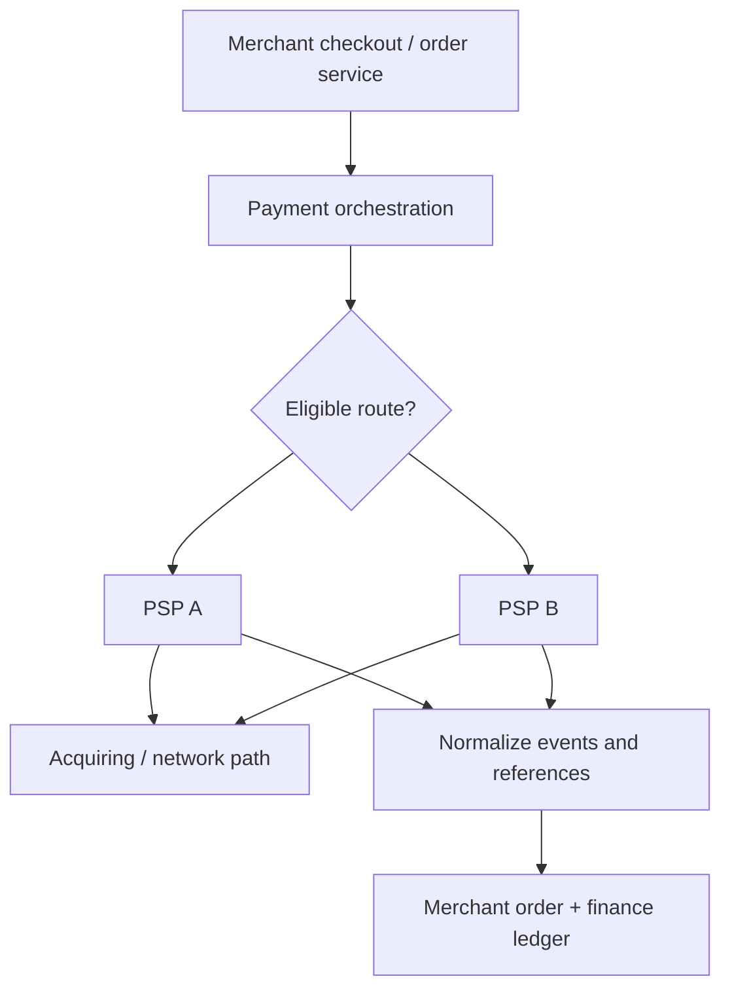

# 6. Payment gateways, processors and orchestration

**Part II — Payment Products & Infrastructure** · Prerequisites: Chapters 2–3

## Learning outcomes

Understand how a payment gateway differs from an acquirer, what an orchestration layer can and cannot solve, and how to assess routing, fallbacks, retries and observability across PSPs.
## 6.1 A gateway is an integration product

A **gateway** exposes interfaces that allow a merchant application to submit payment requests and receive outcomes. It may tokenize credentials, manage client-side components, normalize payment methods, and provide webhooks, reconciliation exports and operational tooling. A **processor** handles transactions; an **acquirer** enables scheme-backed merchant acceptance. Their capabilities may come from one provider but are not conceptually identical.

A merchant usually wants a durable abstraction: create or confirm payment, inspect state, capture, cancel, refund, and retrieve associated records. The gateway's API hides much of the complexity but does not eliminate network-specific constraints.

## 6.2 A simplified gateway request

```json
{
  "order_id": "ORD-1042",
  "amount_minor": 7900,
  "currency": "SGD",
  "payment_method_token": "tok_example_only",
  "merchant_reference": "basket_845",
  "idempotency_key": "pay-ORD-1042-v1"
}
```

This is a **fictional internal API**, not a Stripe or Adyen schema. Never send raw PAN or sensitive authentication data through a generic backend unless the architecture and compliance controls explicitly permit it. Your real contract needs constraints around currency minor units, allowed transitions, idempotency scope, authentication redirects, timeout handling and correlation identifiers.

## 6.3 Orchestration coordinates several providers

An orchestration layer may let a merchant select among several PSP/acquirer connections based on geography, card capability, availability, cost, contractual constraints and observed performance. It typically needs a normalized transaction model, configurable routing logic, connection health, unified payment-method support, token strategy, reconciliation mapping and operational dashboards.



**Important constraint:** failover is not equivalent to "retry at another PSP." A first attempt may be approved while the merchant timed out; blindly creating a second charge through PSP B can duplicate the financial effect. Many card retries also face scheme/provider limitations. Only retry after an appropriately verified state and within applicable rules. See [Chapter 10](../03-checkout-authorization-and-fraud/10-checkout-and-payment-status-design.md).

## 6.4 A good routing decision considers eligibility first

An example decision order:

1. **Capability:** Is this card/payment method/country/currency/merchant legal and supported on the route?
2. **Risk and compliance:** Does this combination satisfy SCA, token and scheme requirements?
3. **Business and customer constraints:** Is the route allowed for this merchant, order and amount?
4. **Health:** Is the provider operational for this segment?
5. **Expected outcome:** Among eligible routes, what are the expected approved-order probability, latency, cost and dispute risk?

Optimizing the cheapest transaction first is often a poor strategy because ineligible or unreliable routes can destroy conversion or customer trust. Conversely, chasing the last percentage point of authorization can be uneconomic.

## 6.5 The hidden complexity of multi-PSP operations

Provider A might send `AUTHORIZED`; Provider B might have separate `processing`, `requires_action` and `captured` states. One gateway may support multiple partial captures while another does not. Failure codes may have different semantics. A common internal state machine must preserve all material distinctions, including **unknown outcome**, refund pending, partial capture and disputed states.

Other cross-provider issues include: token portability (gateway vault tokens often are not portable); inconsistent BIN/issuer metadata; FX conversion and currency support; reconciliation file timing; reporting cutoffs; retries after timeout; API version migration; status webhook ordering; and support traceability.

### Worked case: PSP incident at checkout

At 10:05, the primary provider times out for 20% of transactions. At 10:08, the team proposes routing all failures to the backup PSP. The PM must demand two categories: **new payment attempts not yet sent** can often be routed to a healthy path if eligible; **already-submitted but ambiguous attempts** require status resolution, not blind replay. Product copy should say "We're checking your payment" where appropriate. Finance monitors duplicate authorizations and captures; support receives a traceable incident queue.

## 6.6 PM scorecard

Track unique orders successfully paid (not just attempts approved), routing share, authorization by eligible cohort, provider error/timeout share, p95/p99 latency, recovery latency for ambiguous states, duplicate-capture incidents, cost per successful order, unmatched settlement items and incident minutes. A routing experiment must compare equivalent cohorts and watch risk.

**Operational case lab:** [PSP A timed out; should checkout fail over to PSP B?](../../cases/02-ambiguous-authorization-routing.md) Work through the provider-scoped idempotency problem and design a safe pending state before changing routing policy.


## 6.7 Merchant payment orchestration strategy: resilience, success and cost

**Merchant perspective:** A merchant usually does not need to build a new gateway network. It needs a dependable way to choose, integrate and operate eligible PSP/acquirer routes while protecting customers and financial correctness. An orchestrator may be internal, third-party or partly configured through provider routing. Adding a second PSP is not automatically the best economic or reliability decision.

### 6.7.1 Three outcomes, but one decision hierarchy

| Strategy pillar | What the merchant is optimizing | Metrics and non-negotiable countermetrics |
|---|---|---|
| **Resilience** | Keep customers able to pay when providers, acquirers or dependencies fail or slow down | Eligible-provider availability, timeout/technical-failure rate, p95/p99 end-to-end payment latency, recovery time, unknown-operation age, proportion of volume safely rerouted; **guardrails:** duplicate captures, unresolved charges, settlement/reporting integrity |
| **Payment success** | Maximize legitimate orders that achieve authoritative payment completion, not merely more submitted authorizations | First-attempt issuer approval on comparable card cohorts, unique paid-order success, 3DS completion, payment recovery, captured/fulfilled orders; **guardrails:** mature fraud loss, chargebacks, customer friction and cost |
| **Cost** | Minimize total cost of successful, legitimately fulfilled merchant orders, net of additional conversion value and operating burden | Merchant discount rate, blended or interchange++ fees, fixed per-attempt cost, cross-border/FX fees, retry and 3DS costs, operational costs, refunds/dispute fees, cash-flow impact; **guardrails:** success and reliability cannot fall below approved floors |

This is not a naive equal-weight score where a cheap but incompatible route can compensate for missing 3DS, poor fund traceability or PCI requirements. Apply **hard gates first**, then compare outcomes **within eligible and healthy routes**.

1. **Capability and contract gate:** Confirm scheme, payment method, MID/legal entity, region, currencies, card type, credential/token domain, required authentication, capture/refund operations, payouts and partner contract.
2. **Security and financial-integrity gate:** Confirm approved risk/compliance posture, safe idempotency semantics, recovery of uncertain outcomes, customer refund support, reporting and finance reconciliation. A route that cannot safely represent the product's money state is not eligible.
3. **Real-time health gate:** Check provider/API error rates and latency **by affected operation and segment**, not just a global PSP status page. Health includes 3DS, capture, status queries, webhooks and relevant downstream dependencies; some failures are shared across PSPs.
4. **Choose among eligible healthy routes:** Compare expected legitimate *paid-order* success and **incremental contribution after variable payment, fraud and operational costs**, with traffic/issuer-mix adjustment. For resilience, retain a working backup with tested support, credentials and financial reporting.

### 6.7.2 Define the merchant's decision objective

For a comparable segment, define estimated **net contribution per initiated order** as:

**P(legitimate, successfully paid and fulfilled order) × expected order contribution before payment costs − expected PSP/authentication/retry cost − expected fraud/dispute loss − attributable variable operational cost.**

The expression is deliberately a product decision model, not a generally applicable accounting formula. Distinguish *order contribution* from GMV or revenue, exclude double counting where costs already sit inside the margin, and state settlement/funding costs separately when relevant. Approval probability alone cannot stand in for paid-and-fulfilled probability. Do not compare historical provider A and B rates without adjusting for geography, issuer, amount band, device, new/stored credentials, risk and method mix.

**Fictional decision example** (one comparable cohort of 10,000 intended orders, S$20 contribution before payment costs on a paid good order):

| Input | PSP A | PSP B |
|---|---:|---:|
| Legitimate paid-and-fulfilled orders per 10,000 intended orders | 9,000 | 9,200 |
| Total payment + expected loss + attributable operating cost per initiated order | S$0.45 | S$0.65 |
| Expected contribution per initiated order | 0.90 × S$20 − S$0.45 = **S$17.55** | 0.92 × S$20 − S$0.65 = **S$17.75** |

PSP B's higher per-order cost is outweighed by more good orders **under these invented assumptions**. The S$0.20 difference per initiated order would mean S$2,000 of modeled contribution for 10,000 intended orders. Real data needs experiment-valid cohorts, costs at the correct billing grain, mature loss outcomes, uncertainty ranges, and engineering/contract migration costs. A tiny modeled edge may not justify switching.

### 6.7.3 Three different meanings of "move from A to B"

| Scenario | Merchant action | What must never be assumed |
|---|---|---|
| **Planned volume rebalancing** to improve outcomes or costs | Move a **small proportion of new eligible attempts**, compare matched cohorts, ramp with guardrails, keep finance/ops visibility per PSP | Provider B's better blended approval rate necessarily causes better paid-order conversion |
| **Resilience failover** after A has degraded | Stop sending *new eligible operations* through A; use B where token, method, routing and finance prerequisites are ready | Every technical timeout is a definitive decline |
| **Recovering one attempted transaction** | If not yet submitted, choose B; if submitted and definitively declined, evaluate whether a fresh attempt is allowed; if submitted and outcome unknown, resolve original PSP operation first | An order ID or idempotency key deduplicates across PSPs |

**Do not mix transaction-level retry with traffic failover.** A PSP can approve an authorization despite the merchant seeing a timeout. Replaying that operation at B can create two real authorizations. Status query, verified callbacks, provider operations and reconciliation may be needed before a new money-moving operation is permitted; actual retry permissions and recovery timelines are network/provider/market specific.

### 6.7.4 Migration playbook for a merchant Payments PM

**Phase 0 — Map the baseline.** Inventory all methods, geographies, merchants, MIDs, issuer/BIN cohorts, customer-initiated versus stored-credential recurring payments, funding/capture models, refunds, chargebacks, token dependencies, settlement cutoffs, provider costs and contracts. Agree on **unique paid orders per payment-started order**, not only raw authorization rate, as an outcome where appropriate. Establish a holdout/control and finance-approved success/exception definitions.

**Phase 1 — Make B genuinely production-eligible.** Validate merchant underwriting/onboarding, required local methods, app/web 3DS, credentials and portability, multi-capture/pre-authorization and refund support, error/status mapping, provider-specific idempotency and webhook semantics, reporting/settlement/chargebacks, support escalation and device/POS needs if applicable. Network tokens and PSP vault tokens are *not universally portable*. Decide how existing stored credentials and historical refunds/disputes on A remain serviced if future new traffic uses B.

**Phase 2 — Prove negative paths.** Before meaningful traffic, run a representative matrix of success, issuer decline, interrupted 3DS, status-unknown timeout, delayed/out-of-order webhook, duplicate delivery, partial capture, refund, chargeback, stale token, payout mismatch and provider outage. Verify no double charge or double fulfillment and no orphaned settlement event. Ensure finance can close **both** providers' batches in parallel.

**Phase 3 — Controlled traffic ramp.** Start with a low-risk, small, eligible *new-transaction* cohort. Increase traffic only after verifying order-level conversion, adjusted provider performance, 3DS p95/p99, fraud/complaints, unmatched financial events and provider reconciliation freshness. Use a measured fallback and explicit abort/rollback conditions rather than instant 100% migration. Randomized comparison or careful causal controls matter because route distribution can shift the apparent approval rate.

**Phase 4 — Operate and optimize.** Monitor live route health, segregate gateway technical failure from issuer decline and authentication abandonment, use circuit breakers for proven route degradation, review cost per genuinely paid/fulfilled order and mature risk results, and keep a fallback route warm with regular drills. Separate provider-facing technical alerts from merchant/customer financial-integrity alarms.

**Phase 5 — Exit or retain redundancy deliberately.** Decide whether to maintain dual processing, restrict one PSP to certain markets/methods or retire a provider. Plan outstanding auth/capture/refund/dispute servicing, credential migration where permitted, record exports, reserves, payout reconciliation, contract commitments and long-tail chargebacks. A migrated checkout does **not** eliminate the obligation to service historical transactions at A.

### 6.7.5 One diagnostic matrix before choosing a lever

| Symptom | First hypothesis to test | Plausible action |
|---|---|---|
| PSP timeout/errors spike only in one region | Provider-specific technical or integration failure | Route *new eligible traffic* away; reconcile ambiguous submitted operations before any retry |
| A's raw approval rate is below B's | Different issuer/traffic mix, routing, authentication or risk decisions | Compare equivalent cohorts and paid orders; test targeted routing rather than wholesale switch |
| Card approvals improve but checkout conversion falls | More 3DS abandonment, order failures, duplicate/late events | Trace the order-to-payment funnel, not just PSP authorizations |
| A is cheaper by 15 bps but slower | Price difference may be offset by paid-order abandonment or support overhead | Model incremental good-order contribution and latency by cohort |
| B cannot process existing stored PSP tokens | Provider-bound vault and credential portability | Design approved token migration, network-token eligibility or gradual migration of new credentials |
| B reports success but payouts cannot reconcile | Missing report/journal mapping or settlement semantics | Treat finance traceability as launch gate; do not optimize headline approval at expense of money integrity |
| Both A and B fail simultaneously | Shared acquirer, scheme, cloud, DNS, issuer or merchant-layer dependency | Trace dependency concentration; a second PSP is not true resilience unless failure domains differ |

### 6.7.6 Product deliverables and operating cadence

The PM owns: a **routing eligibility matrix**, partner/dependency map, hypothesis and expected-contribution model, traffic migration plan, safe transaction-state contract, negative-path acceptance tests, dashboard/alerts, provider and finance runbooks, and a go/no-go decision record with Risk/Finance/Engineering approvals where required.

**Daily:** provider health and route allocation; unknowns, double-charge/customer issues, paid-order conversion and recent bank/PSP report freshness. **Weekly:** issuer/method/market diagnostics, economic/risk-adjusted route evaluation and experiments. **Monthly:** real provider invoices versus modeled costs, chargebacks and disputes as labels mature, contractual SLA performance, fallback drill results and vendor concentration risk.

**Practical exercise:** PSP A has 92% card approval and lower MDR; B has 94% approval but higher fees. One B region uses a different issuer/3DS mix, B cannot read A's proprietary stored-card tokens, and A has occasional unknown-result timeouts. Specify: which traffic you may compare, whether to move 5% of *new eligible* attempts, what to do with timed-out A operations, the minimum finance go-live gates, and the evidence that would justify continuing the migration.

**Companion:** [Merchant routing and PSP migration decision worksheet](../../artifacts/merchant-psp-routing-and-migration-playbook.md). See the [PSP timeout lab](../../cases/02-ambiguous-authorization-routing.md) for the critical difference between moving *future traffic* and replaying an already-submitted payment.

## Practice

Compare two strategies: (A) route purely by lowest processing cost; (B) route by expected contribution from successfully fulfilled orders minus payment and operational costs. What additional data does B require?

**Exercises:** [Worked solutions](../../answers/chapter-exercises.md#06-payment-gateways-routing-and-orchestration) (companion answer key; review your reasoning before opening).

**Next:** [7. Issuing and tokenization](07-card-issuing-and-tokenization.md).

## Further reading

- [Adyen — Payments lifecycle](https://docs.adyen.com/account/payments-lifecycle)
- [Adyen — Tokenization](https://docs.adyen.com/online-payments/tokenization)
