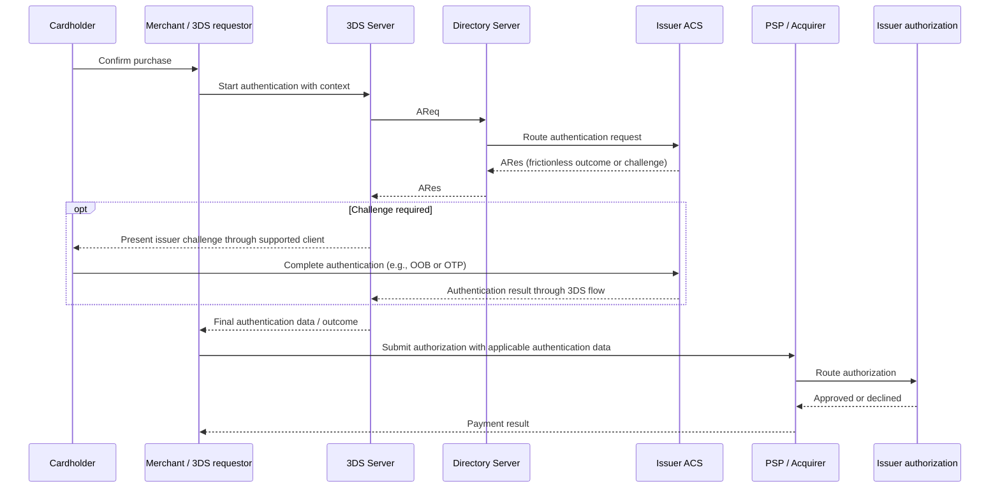

# 11. EMV 3-D Secure: authentication, friction and liability

**Part III — Building Payment Products** · Prerequisites: Chapters 2, 3, 5, and 6

> **Central idea:** 3-D Secure (3DS) helps a card issuer authenticate the cardholder in an online transaction. It is not the same as issuer authorization, and it does not guarantee that the payment will succeed or that the merchant cannot receive a chargeback.

## Learning outcomes

After this chapter, you should be able to:

1. Separate **authentication** from **authorization**, **risk screening**, **capture**, and **settlement**.
2. Draw the participants and describe frictionless and challenged 3DS journeys.
3. Explain what a Payments PM can influence, what the issuer controls, and when rules vary by geography or card scheme.
4. Select useful metrics and guardrails for a proposed 3DS change.
5. Diagnose a high challenge-abandonment rate without disabling necessary authentication.

## 11.1 The problem 3DS solves

In a card-present transaction, the cardholder can authenticate using methods supported by the device and terminal. In an online purchase, the merchant may have card credentials but less certainty that the person using them is authorized. EMV 3DS provides an issuer-facing authentication exchange for card-not-present use cases. It sends relevant transaction, merchant, cardholder, and device/context information through a 3DS infrastructure, and the issuer's access control server (ACS) determines the authentication outcome.

There are three distinct decisions:

| Decision | Question | Typical owner or system |
|---|---|---|
| Merchant fraud screening | Should the merchant accept the order / attempt a payment? | Merchant's or PSP's risk systems |
| 3DS authentication | Has the cardholder been authenticated to the issuer's requirements? | Issuer ACS using 3DS participants |
| Authorization | Will the issuer approve the requested amount against the card account? | Issuer authorization decisioning |

A cardholder can authenticate successfully and still receive an authorization decline (insufficient funds, card restrictions, suspected fraud). Conversely, some eligible transactions can obtain authorization without a 3DS challenge. A successful HTTP API response tells you which system responded, not that every stage succeeded.

## 11.2 The participants

- **3DS Requestor:** Merchant or service initiating authentication.
- **3DS Server:** Handles protocol messages on behalf of the requestor.
- **Directory Server (DS):** Network/scheme-side routing and coordination to the issuer's ACS.
- **Access Control Server (ACS):** Issuer or issuer-service provider system that authenticates the cardholder and may require a challenge.
- **3DS SDK/browser client:** Enables device-data collection and shopper challenge interaction where relevant.
- **Gateway/acquirer:** Subsequent payment authorization processing; can be the same commercial provider as the 3DS service, but the functions are distinct.

*Simplified teaching diagram; exact messaging and routing depend on EMV 3DS version, channel and integration.*

## 11.3 Frictionless and challenge flows

**Frictionless:** The ACS evaluates the request and authenticates the cardholder without a separate interactive step. The merchant still went through a 3DS authentication exchange; **frictionless does not mean “3DS off.”** Accurate contextual data can help the ACS decide. This does not grant merchants control over issuer risk models.

**Challenge:** The ACS requires an additional interaction, for example an OTP or approval in the bank's app (out-of-band authentication). Challenges can be due to issuer risk assessment, regulatory requirements or insufficient context. A challenge adds opportunities for failure: the screen can fail to render, the app may time out, the OTP can be delayed, or the customer can abandon.

**Other patterns:** 3DS supports additional methods and transaction types, including decoupled authentication and specific recurring-transaction flows. These require version- and programme-specific handling rather than a generic “always show OTP” rule.

## 11.4 Request, response, and state handling

In a typical EMV 3DS 2.x implementation, the **Authentication Request (AReq)** reaches the ACS through the 3DS infrastructure. The **Authentication Response (ARes)** provides the initial outcome or requests a challenge. When challenged, additional challenge and result exchanges complete the authentication. The merchant then submits applicable authentication data with the authorization. A 3DS result is not a capture or a settlement record.

A PM must specify what the UI and backend do for: `frictionless_authenticated`, `challenge_required`, `challenge_in_progress`, `authentication_failed`, `authentication_unavailable`, `authentication_timed_out`, `authorization_approved`, `authorization_declined`, and `authorization_unknown`. These are **illustrative internal states**, not official EMV message-status codes. Avoid mapping heterogeneous provider statuses to a single ambiguous `failed` field.

A change to the 3DS flow requires testing browser redirects, iOS/Android app switching, background/foreground transitions, challenge cancellation, webhook ordering, stale sessions and repeated callbacks. Never re-authorize just because the customer returned from an authentication screen; verify the payment attempt's state.

## 11.5 Regulation, exemptions, and liability shift

In jurisdictions such as the European Economic Area, Strong Customer Authentication (SCA) requirements can apply to eligible electronic payments; accepted exemptions and out-of-scope transactions have specific rules. A merchant or acquirer may request a permitted exemption, but acceptance, authentication and liability consequences are not universally under merchant control. Requirements differ across countries and transaction types.

**Liability shift** means that, under applicable scheme rules, liability for certain *fraud-related* chargebacks may move from the merchant/acquirer side to the issuer. It is **not** blanket immunity from disputes: merchandise-not-received, processing-error and other disputes can still occur. Whether shift applies depends on brand, geography, authentication result, authorization data, transaction type and scheme rules. Record the actual shift result when available rather than deriving it from “3DS was attempted.”

Example: a merchant requests an eligible transaction-risk-analysis exemption; authorization succeeds. This may offer a smoother customer journey, but the merchant should not assume the issuer now bears fraud chargeback liability. Compare the PSP's and scheme's specific exemption/liability treatment.

## 11.6 Product trade-offs: optimize successful good orders
A naive optimization is to minimize challenges. A better outcome measure is **good orders successfully paid and ultimately fulfilled** at an acceptable fraud, liability, cost and customer-experience level.

| Lever | Why it might help | What to watch |
|---|---|---|
| Improve data completeness and accuracy | Better issuer risk context; fewer avoidable challenges | Consent, privacy, false/missing device data |
| Improve challenge rendering / OOB return | Reduce abandonment | App compatibility, timeouts, accessibility |
| Review authentication preferences by segment | Balance friction with risk | Local rules, issuer discretion, exemptions |
| Preserve payment-session state | Avoid double submission or abandoned orders | Unknown authorization outcomes, duplicate captures |
| Optimize credential/token quality | Improve payment continuity; issuer risk signals | Not a substitute for 3DS or authorization |

**Diagnostic funnel (fictional):** 10,000 checkout payment intents → 9,600 initiate 3DS → 6,500 frictionless, 3,100 challenged → 2,325 challenges completed (75%) → 8,825 authenticated outcomes, before issuer authorization. If authorization approval among these outcomes is 95%, approximately 8,384 payment attempts are approved. This is not an end-to-end order-success rate: it omits other outcomes, attempts per order and later captures/refunds. The 775 challenge losses warrant investigation, but forcing fewer challenges may increase fraud and violate requirements.

## 11.7 A Payments PM's investigation

**Scenario:** Mobile-app challenge completion falls from 88% to 64% after a release. Desktop conversion is unchanged.

1. **Verify measurement.** Are the denominators challenge-started vs challenge-required? Was an SDK callback or event name changed?
2. **Locate the break.** Break down by OS/app version, issuer ACS, challenge method, market, device, redirect/OOB versus in-app, and session age.
3. **Separate issuer behavior from merchant errors.** Did challenge rate change, or only challenge completion? Did a new app release break resume-from-background?
4. **Protect payment integrity.** Check whether failed UI returns lead to unknown authorizations, retries, duplicate captures or stuck orders.
5. **Test a bounded repair.** Fix deep links, callback state restoration, customer guidance or accessibility rather than bypassing required authentication.
6. **Measure after release.** Authentication completion, issuer approval after authentication, paid orders, fraud-related disputes over a matured window, and support tickets.

**Product requirements sample:** Persist a single `payment_attempt_id` across app-switching; treat callbacks idempotently; expose an explicit `authentication_pending` state; query PSP status after ambiguous returns; never present “payment declined” solely because the customer closed an intermediate page.

**Applied case:** [Authorization after a 3DS challenge is a separate event](../../cases/02-ambiguous-authorization-routing.md). Use O104 to test whether your product confuses successful authentication with a paid order.

## Check your understanding

1. A customer passes a 3DS challenge, but the issuer declines the payment. Did authentication fail?
2. An issuer returns a frictionless outcome. Did 3DS definitely not run?
3. A risk team proposes eliminating challenges for high-value first-time users. Which regulatory, scheme and economic questions come first?
4. A 3DS test shows better conversion today. What delayed financial outcome could reverse the decision?
5. Which product event keys prevent double authorization when the browser redirects twice?

**Answer guidance:** (1) No, authentication and authorization differ. (2) No. (3) Eligibility, issuer discretion, fraud, liability, market and rules. (4) Matured fraud/chargebacks. (5) Stable attempt and order identifiers, idempotency and authoritative PSP state.

**Exercises:** [Worked solutions](../../answers/chapter-exercises.md#11-3d-secure-and-customer-authentication) (companion answer key; review your reasoning before opening).

> **Draft-versus-production note (16 November 2026):** EMVCo lists a **draft** 3DS v2.4.0.0 protocol published 4 November 2026. A published draft is not evidence that an issuer ACS, merchant PSP or card network implements it. Confirm actual supported versions and network rules. [EMVCo listings](https://www.emvco.com/emv-technologies/3-d-secure/).

**Next:** [12. Authorization optimization](12-improving-payment-authorization-rates.md).

## Further reading

- [EMVCo — EMV 3-D Secure white paper](https://www.emvco.com/dynamic/emv-3-d-secure-whitepaper-v2/introduction/)
- [EMVCo — Frictionless flow](https://www.emvco.com/dynamic/emv-3-d-secure-whitepaper-v2/improving-risk-emv-3-d-secure-whitepaper-v2-analysis-and-frictionless-flow/business-overview/)
- [EMVCo — Challenge flow technical features](https://www.emvco.com/dynamic/emv-3-d-secure-whitepaper-v2/challenge-flow/technical-features/)
- [Adyen — 3DS and regulation / liability-shift nuances](https://docs.adyen.com/online-payments/3d-secure-for-regulation-compliance/)
- [Adyen — SCA exemptions](https://docs.adyen.com/online-payments/psd2-sca-compliance-and-implementation-guide/sca-options/)
