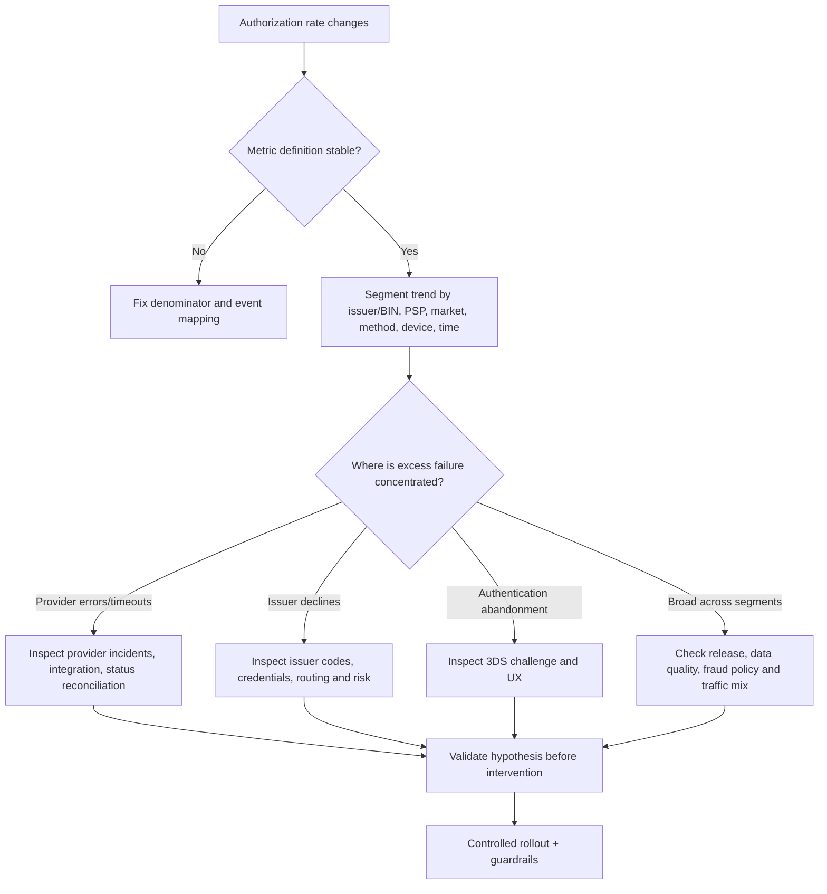

# 12. Improving payment authorization rates

**Estimated study time:** ~20 minutes · **Prerequisites:** [Chapter 3](../01-how-payments-work/03-how-card-payments-work.md)

## Learning objectives

By the end, you should be able to:

1. Define authorization rate using an explicit numerator and denominator.
2. Distinguish attempt-based approval, unique-order payment success and checkout conversion.
3. Diagnose declines without assuming every failed payment is recoverable.
4. Evaluate interventions against fraud, processing cost, customer experience and operational guardrails.
5. Write a measurable, safely staged product experiment.

## 1. Start with a measurement contract

A dashboard says "Authorization rate: 89%." Is that good or bad? Before answering, ask **89% of what?**

A useful attempt-based measure is:

$$
\text{Attempt authorization rate} = \frac{\text{Approved authorization attempts}}{\text{Eligible submitted authorization attempts}}
$$

But teams differ in how they treat reversals, zero-value verification, asynchronous payments, repeated attempts, pre-PSP rejections, offline approvals or timeouts. Write the inclusion and exclusion rules before comparing providers.

### Three metrics that must not be confused

| Metric | Example definition | What it tells you |
| --- | --- | --- |
| **Attempt authorization rate** | Approved card authorization attempts / eligible submitted card authorization attempts | How individual attempts perform |
| **Unique-order payment success** | Orders with at least one confirmed successful payment / orders that initiated payment | Whether shoppers eventually paid, including recovery attempts |
| **Checkout conversion** | Completed purchases / eligible checkout sessions | End-to-end customer outcome, including non-payment friction |

**Illustrative example:** 1,000 orders initiate payment. They generate 1,100 authorization attempts, of which 900 are approved. If each approval belongs to a different order, the attempt authorization rate is **81.8%** (`900/1100`) while unique-order success is **90.0%** (`900/1000`). Multiple failed attempts against the same orders explain the different rates; if multiple *approvals* belong to one order, investigate duplicate-authorizations risk.

**PM takeaway:** An increase in attempts can decrease an attempt-based rate while increasing recovered orders—or the reverse. Track both.

## 2. Distinguish four classes of failure

| Category | Illustrative signal | Product question |
| --- | --- | --- |
| **Pre-authorization** | Form validation, unsupported method, token missing | Did the request ever reach authorization? |
| **Authentication** | 3DS challenge abandoned or failed | Did shoppers abandon, or did the issuer require a step-up? |
| **Issuer/network/acquirer refusal** | Refusal reason or decline category | Is there an issuer decision, invalid credential, risk block or unsupported transaction? |
| **Technical or ambiguous** | Timeout, missing response, provider error | Is the result actually unknown, or definitely not authorized? |

Don't interpret `HTTP 200` from a PSP as issuer approval. For example, Adyen notes that an API request can return HTTP 200 while the transaction itself is refused; read the payment `resultCode` and related fields. [Adyen refusal-reason documentation](https://docs.adyen.com/development-resources/refusal-reasons).

## 3. The PM diagnostic sequence



### Step A — Verify the change is real

Check instrumentation releases, event timestamps, missing provider webhooks, denominators, deduplication, and whether the period has the same traffic mix. Look at order-based success alongside attempts.

### Step B — Segment before prescribing a fix

At minimum: date/time, country, card brand, BIN/issuer segment (handled securely), funding type, currency, PSP/acquirer route, saved/new credentials, device/app version, 3DS result, decline category, amount band and merchant/business unit where relevant.

Keep privacy and contractual limits in mind. A PM often needs aggregated issuer/BIN cohorts, not raw PAN or unnecessary personal data.

### Step C — Map the failing segment to a plausible mechanism

- A single PSP route deteriorates following a release: investigate route, integration, provider health and traffic selection.
- Cross-border issuer declines increase: check issuer mix, currency, authentication, merchant data, credentials and changed risk decisions.
- Challenge abandonment rises: inspect 3DS step-up frequency, rendering and timeouts; do not assume challenges are optional in every market.
- Technical failures rise but issuer approvals may still occur: prioritize trustworthy status resolution before increasing retry traffic.

### Step D — Define a hypothesis with falsification criteria

Weak: "Add smart routing to improve authorization."

Strong: "The decrease is concentrated in the cross-border card cohort recently moved to PSP B. If provider routing caused the loss, a controlled eligible-cohort comparison using the prior route should show better confirmed order success without worse fraud, latency or cost."

You may need to adjust for issuer mix, traffic quality and selection effects. **Correlated segments are not proof of causality.**

## 4. What levers might a Payments PM consider?

| Lever | Possible upside | Important constraint |
| --- | --- | --- |
| Better request data / credential freshness | Fewer avoidable invalid/expired credentials | Provider/network rules and customer consent |
| Network tokens or account updater | Reduced lifecycle breakage in eligible use cases | Issuer, network, provider and geographic coverage |
| Smart routing | Better route availability, cost or success by segment | Historical uplift may be confounded; provider obligations and fees |
| 3DS configuration and UX | Authentication completion and fraud-risk balance | Issuer behavior, regulatory requirements and liability rules |
| Selective recovery or retry | Recovers some genuinely transient failures | Scheme guidance, provider retry rules, idempotency and duplicates |
| Better payment error UX | Helps users choose an appropriate next action | Must not expose sensitive refusal details or falsely claim failure |
| Alternative payment methods | Resilience and customer choice | Additional integration, reconciliation, refund and risk complexity |

**Crucial:** A PM should not propose retrying all declines. Certain declines are final or must not be retried under provider/network rules; other outcomes are ambiguous and should first be resolved using a status query/event where supported. A 3DS challenge is not simply a friction knob the merchant can turn freely.

## 5. Choose metrics and guardrails before launch

**Primary outcome:** Unique orders with confirmed successful payment, or a suitably defined attempt approval measure for the intervention.

**Supporting measures:** Payment attempts per successful order, timeout/unknown-state rate, time to payment confirmation, 3DS completion, share of customers taking a successful recovery action.

**Guardrails:** Fraud loss/chargebacks, duplicate authorization or capture incidents, payment processing cost per successful order, customer support contact rate, latency, reconciliation exception volume, and provider/network rule compliance.

### A simple economic check

Suppose a hypothetical experiment recovers 100 additional **valid orders**. Average contribution margin *after product costs but before incremental payment costs* is S$12 each, for **S$1,200** in incremental contribution before payment-related effects. If additional processing fees cost S$250, extra fraud losses S$150 and extra support S$100, the illustrative net incremental contribution is **S$700**.

This is **not** the same as gross merchandise value or revenue. Validate the meaning of contribution margin, attribution, incremental costs and fraud measurement horizon with finance.

## 6. Basic data contract for analytics

A product spec should clarify at least these event/field relationships:

```text
order_id                  stable commercial order identifier
payment_id                logical payment identifier
attempt_id                each submitted payment attempt
created_at, resolved_at   timezone-aware event times
psp, acquirer_route       processing path; may be abstracted
payment_method_type       card, wallet, local method...
issuer_cohort             appropriately aggregated issuer/BIN group
amount_minor, currency    normalized, supported currency units
3ds_status                if relevant, with distinct not-applicable state
authorization_status      submitted, approved, declined, unknown
response_category         normalized, source retained separately
provider_reference        PSP's unique transaction/reference identifier
risk_decision             if permitted, without sensitive data leakage
```

Define whether attempts are counted at submission, provider acceptance or issuer response. Store raw provider codes where permissible and a documented normalized category; never silently conflate them. Ensure data transformations are versioned.

### Illustrative SQL: authorization by processing route

```sql
-- Dialect-neutral illustration; adapt to your warehouse and schema.
SELECT
  DATE(created_at) AS payment_date,
  psp,
  COUNT(*) AS eligible_attempts,
  SUM(CASE WHEN authorization_status = 'APPROVED' THEN 1 ELSE 0 END)
    AS approved_attempts,
  1.0 * SUM(CASE WHEN authorization_status = 'APPROVED' THEN 1 ELSE 0 END)
    / NULLIF(COUNT(*), 0) AS attempt_authorization_rate
FROM payment_attempts
WHERE eligible_for_auth_rate = TRUE
  AND payment_method_type = 'CARD'
GROUP BY DATE(created_at), psp;
```

For a production dashboard: explicitly handle unresolved outcomes, late events, retries, deduplication, timezone boundaries and cohort comparability. `eligible_for_auth_rate` is a proposed contract field, not a universal database column.

## 7. Experiment design that respects payment risk

**Hypothesis:** For a specified cross-border issuer cohort, a different route produces more confirmed paid orders.

**Eligibility:** A documented subset of transactions for which both routes are contractually, technically and scheme-eligible.

**Unit of randomization:** Prefer a stable customer/order-level assignment where feasible to prevent a single order's repeated attempts from crossing treatments unpredictably. Validate with risk/analytics specialists.

**Rollout:** Historical replay / offline analysis → sandbox and integration testing → limited live canary → gradual expansion, with incident rollback controls.

**Success criteria:** Higher unique-order confirmed payment success, no material deterioration in defined risk/cost/latency guardrails, and reconciled outcomes after a suitable maturation window.

**Stop conditions:** Evidence of duplicate charges, materially increased fraud, growing unknown states, reconciliation gaps or breached partner requirements.

**Never optimize on an "instant" dashboard alone:** Chargebacks and some financial outcomes mature later than authorization responses.

## 8. Worked case and exercises

Work through the [94% → 89% authorization drop case](../../cases/01-authorization-rate-drop.md). The dataset contains four synthetic cohorts and is checked by a small Python script.

1. Show how an increase in retries can make attempt-based approval fall while order-based success improves.
2. A route change appears correlated with poorer cross-border approval. Name three confounders and one controlled test.
3. An issuer provides a definitive non-retryable decline. What customer recovery action might be better than another same-card attempt?
4. Design a metric that catches customers receiving "payment failed" when authorization actually succeeded.
5. Identify two product changes that can reduce customer friction without altering issuer approval logic.

### Self-check

A strong answer starts with denominator, eligibility, segment, provider status semantics and risk guardrails. It avoids prescribing an indiscriminate routing change or retry loop.

## Sources and further reading

- [Adyen — Refusal reasons](https://docs.adyen.com/development-resources/refusal-reasons)
- [Adyen — Response handling](https://docs.adyen.com/development-resources/overview-response-handling/)
- [Adyen — Payments lifecycle](https://docs.adyen.com/account/payments-lifecycle)
- [Stripe — Payment Intents](https://docs.stripe.com/payments/payment-intents)
- [Stripe — Idempotent requests](https://docs.stripe.com/api/idempotent_requests)
- [EMVCo — EMV 3-D Secure](https://www.emvco.com/emv-technologies/3-d-secure/)

**Applied case:** [Ambiguous authorization and unsafe cross-PSP failover](../../cases/02-ambiguous-authorization-routing.md). Compare the attempt-based and paid-order denominators before proposing any retry intervention.

**Exercises:** [Worked solutions](../../answers/chapter-exercises.md#12-improving-payment-authorization-rates) (companion answer key; review your reasoning before opening).

**Next:** [13. Payment fraud, risk and controls](13-payment-fraud-and-risk-controls.md). Practice with the [worked diagnostic case](../../cases/01-authorization-rate-drop.md)
