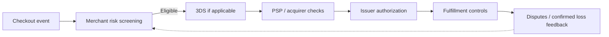

# 13. Payment fraud, risk decisions and controls

**Part III — Building Payment Products** · Prerequisites: Chapters 3, 5, 10, 11 and 12

> **Central idea:** A risk engine should reduce expected losses without rejecting too many legitimate customers. A Payments PM rarely owns the fraud model in isolation but must own the product consequences of its decisions.

## Learning outcomes

Build a merchant risk framework around **customer behavior**, **transaction behavior** and **transaction context**, distinguish merchant decisions from 3DS/issuer authorization and post-transaction disputes, and govern false positives, matured fraud losses and safe rollouts.

## 13.1 Several layers, several decision makers

Merchant-side risk checks may occur before payment, after authorization but before fulfillment, or during account activity. Acquirers and PSPs may apply their own acceptance and monitoring rules. 3DS gives the issuer authentication context for online payments; issuer authorization uses account, network, velocity and risk signals. Subsequent chargebacks or account abuse provide feedback—but with a delay.

*A teaching simplification; screening order and ownership vary by provider, merchant model and geography.*

## 13.2 What risk rules might observe

Examples include unusually high transaction amount, multiple new cards used from one account, rapid payment retries, unfamiliar geography or device, inconsistent address data, account age and abnormal voucher redemption. These are **risk signals, not proof of wrongdoing**. The same signal can describe legitimate travel, family accounts, promotion spikes or a system retry loop.

Possible actions include allowing, requiring an eligible authentication step, manually reviewing, delaying fulfillment, declining under approved policy or requesting more information. The PM should document which actor may make each decision and under what regulatory, network, privacy and internal-risk constraints.

## 13.3 Why approval rate alone is dangerous

Suppose an extra filter prevents S$8,000 of modeled fraud loss monthly but blocks S$50,000 of legitimate expected gross margin. Without considering costs, recovery pathways, customer lifetime value and confidence in the loss model, calling the filter a success is misleading.

A high-level decision framework compares expected value across **legitimate approvals**, **fraud losses**, **operational review costs**, **customer friction** and **downstream disputed transactions**. Fraud labels mature slowly and can be biased by which transactions were allowed to proceed. “Blocked orders had no chargebacks” is not evidence that all blocked orders were fraudulent.

## 13.4 Rule experimentation and governance

A safe rollout plan specifies: target cohorts, eligibility constraints, approval owner, start and stop dates, expected incremental risk, protected user groups, monitoring, escalation, and rollback criteria. Test in shadow mode where meaningful, compare like-for-like segments and keep a rollback path. Avoid exposing detailed rules to attackers through error messages or customer support templates.

Useful measures: confirmed fraud loss per value and per transactions, review precision where labels exist, false-decline proxies, manual review latency, 3DS challenge share and completion, issuer approval rate, successful paid orders, chargebacks after maturity, repeat customer contacts, and support escalations.

## 13.5 The merchant fraud framework: customer, transaction and context

A merchant's objective is **reduce fraud-adjusted loss without needlessly losing legitimate orders**. The merchant does not replace issuer authorization, PSP risk controls, network monitoring or EMV 3DS; it controls its own order acceptance, risk-screening integration, eligible authentication requests, customer communication and fulfillment decisions, within risk/legal/provider constraints.

Start by defining the threat: stolen-card purchase, account takeover, card testing, promotion/voucher abuse, refund/returns abuse, first-party misuse, or fraudulent fulfilment/delivery claims. Do not collapse these into one fraud label. Authorized-payment scams, issuer declines, technical timeouts and merchant fraud blocks are also distinct categories.

**Three complementary signal pillars:**

| Pillar | Signals a merchant can assess where legitimately available | What might falsely appear suspicious |
|---|---|---|
| **Customer behavior: who is acting?** | Account age, prior order/return history, device/account changes, login anomalies, new stored cards, new delivery addresses, voucher habits, familiar basket categories | First-time buyers, travel, gifts, shared devices, legitimate account recovery |
| **Transaction behavior: what are they attempting?** | Order value relative to account/market baseline, number of cards and distinct attempts, retry velocity, many low-value attempts, rapid repeat orders, resalable items, atypical split payment, refund frequency | A PSP outage producing repeated failed attempts; a genuine seasonal shopping spree; legitimate multiple household orders |
| **Transaction context: what surrounds this order?** | Local time, order channel, mobile/app version, sale campaign, currency, shipping vs billing information where lawful, card issuer geography, delivery or pickup/drop-off patterns, known provider incident | A shopper at night or abroad; a promotion spike; legitimate change in travel plans; a terminal outage |

A single risk signal is **not a verdict**. Evaluate signal freshness, accuracy, purpose limitation and combinations within comparable cohorts. Time, geography or customer demographics alone must never be treated as proof of fraud. Do not collect raw PAN, sensitive authentication data or unnecessary personal information to power a merchant rule.

### 13.5.1 Turn signals into a governed decision

The product needs a policy decision **and** an observable customer state:

| Candidate outcome | Merchant control and PM implications |
|---|---|
| Allow | Continue eligible checkout, retain decision/version for monitoring, measure downstream loss and fulfilment |
| Request eligible authentication | Where method, market and PSP support it, attempt 3DS/step-up with clear UI, timeout and abandonment handling; issuer decides authentication and authorization |
| Review or hold fulfilment | Hold dispatch (not necessarily the payment) under approved policy, with review SLA, support visibility and safe customer communication |
| Reject/limit under approved policy | Apply risk-approved restrictions for corroborated abuse; provide safe appeal/recovery without disclosing exploitable rules |
| Unknown/missing data | Fall back to explicitly approved behavior; do not turn a missing signal or PSP timeout into an automatic fraud conviction |

**Illustrative combined-signal scenario:** A previously active account has a recent password reset, a new delivery address and device, and attempts several unusually expensive electronics purchases with two new cards. Customer history is one pillar, card/order velocity another, and location/channel/time context the third. A high-risk interpretation requires additional evidence and a **reversible** action: review or bounded fulfilment hold where authorized, not an irreversible blanket rejection. Compare against similar legitimate customers and account-recovery events.

**Counterexample:** Payment failures surge during a PSP incident. Failed attempt velocity is elevated, but the cause may be merchant retry logic and unknown authorization outcomes. Before labeling card testing, distinguish unique order IDs, distinct credentials, signed payment events, PSP timeouts and issuer responses. A real PSP failure must not punish legitimate customers through the fraud engine.

### 13.5.2 Event data and feature integrity

Record a merchant risk decision ID linked to order/payment/attempt IDs, merchant account, pseudonymous customer/session identifiers where permitted, amount and currency, market/channel, signal and rule/model versions, event/ingestion time, outcome, reviewer override, fulfilment decision and later evidence label. Preserve *raw provider statuses* separately from the merchant risk decision. Deduplicate repeated webhooks; count truly distinct cards/attempts through appropriately authorized tokens, not raw card numbers; version velocity windows and fallback for missing features.

A useful signal contract specifies: business hypothesis, event source, authorized use/retention, identity grain, time window, segment baseline, allowable missingness, decision latency budget, known false-positive patterns, owner and review date.

### 13.5.3 Measure the trade-off correctly

| Metric | Correct use and limitation |
|---|---|
| Confirmed fraud loss basis points | Confirmed fraud principal / matched **mature cohort** captured value × 10,000, not current-month GMV against unrelated historical losses |
| Pre-PSP merchant block rate | Distinct risk-rejected orders / eligible evaluated orders; separate from issuer decline rate and 3DS failure |
| Manual review rate and SLA | Reviewed/held order count, age, overturn rate, fulfilment delays and support impact |
| False-positive proxy | Verified legitimate appeals, overturned reviews or controlled shadow/holdout estimates; blocked transactions have no subsequent chargeback outcome, so no chargeback does **not** prove the block was correct |
| Authentication friction | 3DS challenge volume, completion, p95 latency, customer abandonment and valid liability treatment, by segment |
| Loss-adjusted contribution | Legitimate successfully fulfilled margin less payment fees, expected matured fraud/chargebacks and review/servicing costs |
| Disputes and scheme programs | Use relevant current network-defined numerators, denominators, windows and region-specific thresholds, not merchant-defined fraud loss bps as a substitute |

### 13.5.4 Merchant PM rollout sequence

1. **Threat and baseline:** Identify attack path and financially exposed actor; segment historic mature fraud outcomes and quantify legitimate funnel and review cost before proposing a rule.
2. **Evidence and policy:** Review customer/transaction/context signals for data quality, seasonality, privacy and fairness; Risk owns thresholds, loss appetite and allowable actions. PM owns product-state and communication requirements.
3. **Shadow mode:** Run candidate logic without blocking eligible traffic when safe, check signal availability, coverage and false-positive patterns. Beware selection bias: blocked orders do not later receive fraud labels.
4. **Controlled release:** Decide eligible cohort, risk-approved comparison/holdout if appropriate, kill switch, decision latency SLO, reviewer capacity, rollback trigger and customer appeal. Do not relax mandatory controls for conversion.
5. **Mature review:** Compare paid orders, legitimate customers harmed, manual workload, complaints and confirmed fraud/chargeback losses after labels mature. Track rule version, owner, overrides and the next review date.

**Practice:** A returning customer buys expensive items at 2 a.m., after changing password and shipping address. The provider simultaneously has elevated timeouts. Separate the three signal pillars, identify what is *not* evidence of fraud, propose a reversible response with customer notice, and define the metric that would convince you the rule is damaging good orders.

**Practical worksheet:** [Merchant fraud control framework](../../artifacts/merchant-fraud-control-framework.md) captures threats, signals, actions, responsibilities, guardrails and review.

## 13.6 Case: sudden spike in failed payments

The commerce team sees a higher decline rate after a risk rules release. Investigation should distinguish: blocked *before* PSP submission, 3DS challenges abandoned, PSP/acquirer rejections, issuer declines and unknown technical outcomes. A single “payment failure” category collapses distinct causes and makes rollback unsafe. The PM should request a segmented event map and data-quality verification before changing policy.

**Exercise:** Propose a review policy for a first-time, high-value cross-border card payment. Identify eligible actions, required collaboration with risk and compliance, two user-experience guardrails, and how you'd measure false-positive harm over time.

### Dated Singapore case — Shared Responsibility Framework (effective 16 December 2024)

The [MAS/IMDA Shared Responsibility Framework guidelines](https://www.imda.gov.sg/-/media/imda/files/regulations-and-licensing/regulations/consultations/2024/shared-responsibility-framework-for-phishing-scams/guidelines-on-shared-responsibility-framework.pdf) set out duties for specified banks/payment-account issuers and telecom providers relating to defined **seemingly authorised phishing-scam transactions**. Their loss-responsibility model is **not a blanket rule for every scam or every payment rail**. The guidelines specifically state that the SRF liability-sharing framework does **not** apply to transactions using credit, charge and debit cards issued in Singapore, which have other protections.

**Product implications:** define scam type, protected-account eligibility, event audit trail, customer-reporting and blocking paths, notification controls, and specialist review of any responsibility/allocation policy. **Do not** map a card chargeback rule onto bank transfer scam remediation simply because both involve losses. Source checked 16 November 2026; consult MAS/IMDA for current updates.

**Exercises:** [Worked solutions](../../answers/chapter-exercises.md#13-payment-fraud-and-risk-controls) (companion answer key; review your reasoning before opening).

**Next:** [13A. Compliance and control ownership](13a-compliance-pci-kyc-aml-and-ownership.md).

## Further reading

- [EMVCo — 3-D Secure](https://www.emvco.com/emv-technologies/3-d-secure/)
- [Adyen — Risk management overview](https://docs.adyen.com/risk-management/)
- [Stripe — Radar documentation](https://docs.stripe.com/radar)
