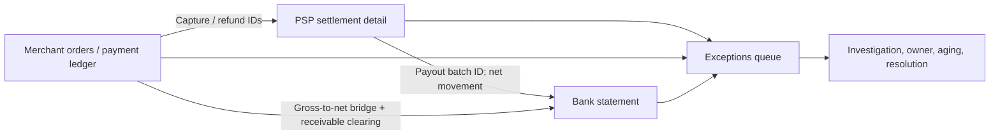

# 16. Three-party payment reconciliation: merchant, provider and bank

**Part IV — Operating and Scaling Payments** · Prerequisites: Chapters 3, 4, 5 and 15

> **Central idea:** A green checkout success screen is not proof that every financial ledger agrees. Reconciliation compares independent records, explains timing/fee differences, and identifies missing, duplicated or incorrectly posted money movements.

## Learning outcomes

Explain merchant-side order-to-payment, payment-to-PSP financial-event and PSP-to-bank reconciliation across online cards, POS, QR and other methods; design normalized source data; diagnose mismatches; and verify exception closure.

## 16.1 What are the three “parties”?
For a merchant receiving PSP-managed card payments, a useful three-way model is:

| Source | What it records | Why it differs |
|---|---|---|
| **1. Merchant order/payment ledger** | Orders, payment intents, successful captures, refunds, expected fees, outstanding receivables | Operational truth: what the merchant thinks happened |
| **2. PSP/acquirer settlement ledger** | Settled captures, refunds, chargebacks, fees, rolling reserves, payout-batch allocations | External processing and payout truth, often event + batch based |
| **3. Bank statement / cash ledger** | Actual credits/debits into the merchant's bank account | Cash movement truth, usually net and batched |

This is one common definition of **three-way / three-party reconciliation**. In other business models, the three records may be *merchant vs gateway vs acquirer* or *PSP transaction ledger vs scheme settlement vs bank*. The PM must name the entities and identifiers in **their** architecture rather than treating “three-way” as a universal fixed set. For marketplace/payfac flows, there may be additional submerchant, platform, reserve and transfer ledgers.

**Not every authorized transaction will appear in settlement.** Authorization is a commitment to potentially fund a charge; capture and clearing/settlement follow separate lifecycle events. A temporary hold or an expired authorization belongs in operational monitoring, not settled sales.

## 16.2 Why matching all three matters

1. **Merchant ↔ provider:** Did every captured payment land in the expected settlement ledger? Are failed captures, partial captures, refunds, disputes and duplicate payment events recognized?
2. **Provider ↔ bank:** Do provider payout batches, after fees/adjustments/reserves, reconcile to actual credits or debits on the bank statement?
3. **Merchant ↔ bank:** Does recorded cash and outstanding provider receivable reflect actual net cash after agreed deductions, timing and exceptions?

These are not three independent equal-value comparisons: **gross merchant transactions do not normally equal the net bank deposit.** Build a bridge using settlement components and batch mapping. Differences can be *valid timing* or *actual exceptions*; the job is to classify them.

## 16.3 Worked three-way example: reconcile S$10,000 in captured sales

**All amounts below are illustrative**, and the accounting treatment depends on contract, legal entity, fee model and reporting conventions.

### Day 1: merchant captures

Merchant payment ledger shows **100 successful captures of S$100 each = S$10,000 gross**. There are no earlier opening balances in this simplified example. The merchant therefore expects S$10,000 of settled-sale receivable *before* subsequent deductions and payout timing.

### Day 2: PSP reports a payout batch

| PSP settlement item | Signed amount (SGD) |
|---|---:|
| 100 settled captures | +10,000 |
| Refunds | -500 |
| Chargeback debit | -200 |
| Processing fees | -250 |
| Reserve held | -300 |
| **Net payout owed** | **8,750** |

The bridge is: `10,000 - 500 - 200 - 250 - 300 = 8,750`. The bank statement shows a credit of **S$8,750** with a matching provider payout reference. The net cash matches the PSP payout, but the merchant still needs to record the **S$300 reserve** as a separate balance/receivable rather than treating it as a processing expense. The refund and chargeback need their own reference-linked ledger events.

### Why a naive three-way match fails

`Merchant S$10,000 ≠ Provider payout S$8,750` is **not** automatically a S$1,250 missing-money incident. The discrepancy is explained by S$500 refunds, S$200 dispute debit, S$250 fees, and S$300 reserve. The merchant should verify whether those deductions were authorized and attributed correctly. A matching payout does not prove every underlying transaction was valid; transaction-level reconciliation remains necessary.

### Day 3: bank transfer delayed

Suppose the PSP marked the payout as initiated, but the bank credit is absent at cutoff. This is initially a **timing/outstanding-in-transit exception** with a due date, not proof that the S$8,750 was lost. Escalate if it exceeds the provider/bank SLA or bank investigation confirms failure. If the bank receives S$8,700 instead, that's a **S$50 unresolved payout variance** until explained; do not book a “reconciliation plug” to hide it.

## 16.4 Matching keys and data contracts

**Minimum normalized data model** (examples; replace with actual provider fields):

| Record | Useful keys and fields |
|---|---|
| Order | `order_id`, `merchant_legal_entity`, `currency`, expected amount, fulfillment status |
| Payment attempt | `payment_id`, `attempt_id`, `psp_reference`, authorized amount, timestamps |
| Capture / refund | `capture_id` or `refund_id`, original payment link, signed amount, currency, effective date |
| Dispute | `dispute_id`, original capture/payment link, reason and financial adjustment ID |
| Settlement line | `provider_journal_id`, transaction reference, type, gross, fees, net, settlement date, batch ID |
| Payout batch | `payout_id`, bank account, currency, net amount, settlement/payout cutoff |
| Bank statement | bank transaction ID, value date, bank narrative/reference, credit/debit, currency |

Provider references may be unique only **within an account or legal entity**; include the appropriate namespace. Keep original currencies and FX separately. Avoid joining solely on amount + date: two payments of S$49.90 on the same day are not the same transaction.

**Matching order:**

1. Deduplicate source events with stable provider event/journal IDs.
2. Match capture/refund/dispute line items to the merchant's original payment/order references (many-to-one is normal for partial captures/refunds).
3. Check amount, currency, lifecycle status and legal entity; allow documented processing windows.
4. Roll settlement lines into payout batches, accounting for fees, reserve movements and adjustments.
5. Match payout IDs/bank references to actual bank statement credits and debits.
6. Classify unmatched lines and maintain an aging queue with owner, reason and financial materiality.

## 16.5 Exception taxonomy

| Exception | Example | PM/design implication |
|---|---|---|
| Missing merchant transaction | Provider shows capture, no merchant order | Trace an orphaned payment; protect fulfillment/refund decision |
| Missing provider settlement line | Merchant marks captured, provider has none | Verify actual capture state and cutoff before recognizing revenue |
| Duplicate processing | Two captures linked to one order | Detect accidental double charging and remediation workflow |
| Timing difference | Provider payout initiated; bank credit tomorrow | Separate pending cash from genuine unmatched variance |
| Fee variance | Contract says one fee, settlement shows another | Versioned pricing plan, fee rule, provider line item |
| Refund / chargeback mismatch | Customer already refunded, later disputes | Linked dispute and refund events; avoid double adjustments |
| FX / currency mismatch | Presentment in USD, settlement in SGD | Preserve original, conversion rate, settlement amount and fees |
| Reserve adjustment | Provider withholds funds | Reserve balance reconciliation and release schedule |
| Wrong legal entity | One merchant account, another bank account | Entity- and account-specific mapping; audit controls |

## 16.6 Three-way reconciliation is a product feature, not an end-of-month spreadsheet

A PM designs event identities, reporting exports, operational ownership and how financial exceptions are surfaced. A mature product exposes **separate states** for payment authorization, capture, settlement and payout; makes transaction lineage inspectable; supports partial refunds; enforces idempotent webhooks and journal entries; and reconciles external records on an agreed frequency.

Suggested scorecard: percentage of settled volume matched transaction-by-transaction; percentage of payout batches matched to bank; unresolved aged variance by amount and age; orphaned capture/refund/chargeback events; latency from payout date to reconciliation; and number of manual journal adjustments. Report **currency and value**, not only event counts.

### Product requirements example

**User story:** As a finance operations analyst, I need to search a bank payout reference and see every settlement line, fee and adjustment so I can explain the credited amount and identify any outstanding variance.

**Acceptance criteria:**

- Each bank credit must map to a payout batch (or an explicit unmatched state) with legal entity and currency.
- A payout's calculated net equals the sum of included signed settlement journal entries, within documented rounding/FX rules.
- Every nonzero mismatch has a named reason category, owner, created date, last updated date and escalation threshold.
- Chargebacks and reversals never overwrite the original capture; they produce separate linked financial events.
- Manual overrides require a reason and reviewer; source records remain immutable.

## 16.7 A note on accounting ownership

Finance owns financial policy and general-ledger treatment; treasury/bank operations own cash movement investigation; the PSP/acquirer owns its external ledger; engineering owns system integrity; the PM ensures the product offers reliable records, workflows and visibility across the process. The PM **does not** unilaterally decide accounting recognition or waive financial controls.

## 16.8 Put the pieces together: merchant reconciliation from order to bank cash

This is a **merchant-side operating model**, not issuer, gateway, or acquiring scheme reconciliation. The merchant must account for what the customer owed, what was charged, what the PSP financially recognized, and what cash reached the merchant's bank. A three-way match is a useful shorthand, but it hides **four different tests**:

1. **Order to payment:** Final order amount and tender allocation versus authoritative capture/payment receipt, refunds, cancellations, partial fulfilment, mixed tender, and duplicate financial events. Fulfilled without captured funds and captured without an order are product/customer exceptions.
2. **Merchant payment to provider:** Capture, refund, dispute, fee and adjustment events versus the provider's *financial journal/settlement* records. A webhook or successful API response is not a settlement entry; authorization is not capture.
3. **Provider settlement to payout:** Sum settlement lines, fees, refunds, disputes, reserve movements, FX and adjustments using the **provider's settlement period and sign convention**, not the calendar date of the original order.
4. **Payout to bank and finance ledger:** Prove cash receipt against payout transfer identifiers, legal entity, currency and destination account. Distinguish payout initiated, in transit, received, returned, and finance-posted.

**Read this section as the operational synthesis of Sections 16.1–16.7**: the earlier sections explain records, IDs, exceptions and accounting ownership; this section assembles them into a repeatable daily matching-and-resolution workflow. The supporting checklist is an executable review aid rather than a separate fourth accounting ledger.

A correct net bank credit can conceal missing transaction references, two offsetting errors or a customer refund that never completed. **The bank tie-out is necessary but never sufficient.**

### 16.8.1 What the reconciled data should actually contain

Store **immutable raw exports** and a normalized view at the **financial-event** level; preserve record versions and ingestion times. A proposed merchant data contract:

| Record | Evidence needed |
|---|---|
| Order and tenders | Order ID/version; merchant legal entity; fulfilment status; final payable, vouchers, gift cards/points and other tender shares |
| Payment operation | Payment ID, attempt ID, capture/refund/void operation IDs; provider route and MID; customer-facing vs authoritative status; event time |
| Provider financial line | Unique journal/settlement entry ID; original payment/capture/refund/dispute reference; event type; signed amount, currency, settlement date, batch and fee component |
| Provider payout | Payout/transfer ID; included batch IDs; net amount, currency, cutoffs; reserve opening/closing balance; bank destination; initiated/confirmed status |
| Bank cash | Unique bank transaction ID, reference/narrative, legal entity/account, signed amount, value date and currency |
| Merchant finance ledger | Provider clearing/receivable, cash, processing fee expense, reserve receivable and audit-linked corrections under finance policy |

**Key rules:** namespace external references by provider, MID and legal entity; do not match solely by amount and date. One order can have several tenders, one payment several attempts, and one capture several refunds. A payout can contain transactions from many business days and multiple adjustment types. Retain presentment **and** settlement currencies and the provider's FX evidence. Use source-event IDs to deduplicate notifications; different capture IDs must never be merged just because the amount matches.

The dataset should expose both **financial-event match status** (matched, expected late arrival, missing merchant, missing provider, amount mismatch, FX/fee discrepancy, duplicate financial event, unallocated bank cash, under investigation) and **exception workflow status** (open, investigating, awaiting PSP/bank, remediation pending, resolved, approved write-off). These labels are illustrative, not standardized accounting statuses. Do not overwrite a source event to make it match.

### 16.8.2 Match order and confidence

**First:** prove that input files are complete for the relevant cutoff, timezone, legal entity, account and currency. An absent PSP export is a **data-availability incident**, not 100% unmatched payments.

**Second:** match merchant captures/refunds/disputes to the PSP financial entries by stable operation IDs, type, sign, amount, currency and allowable late-arrival window. Keep authorized-but-not-captured operations in a separate aging queue.

**Third:** group settlement entries into the PSP's real payout batches. Construct a gross-to-net bridge: settled captured value – settled refunds – dispute debits – fees – reserve withholding + reserve releases ± contractually valid corrections/FX = payout due, using the provider's actual reporting rules. Reserves are *not* automatically an expense.

**Fourth:** match payout transfer(s) to actual bank cash and approved GL clearing entries. When a bank row arrives after the contractual cutoff, classify it as in transit and age it; do not invent a cash receipt. A bank deposit may combine transfers or a payout may be split, so document supported many-to-one relationships.

### 16.8.3 Payment-method differences

| Method | Merchant-side reconciliation nuance |
|---|---|
| Online cards | Authorization versus capture, partial capture, later disputes, batched settlement and chargeback fees |
| In-store cards / POS | POS tender ID may differ from terminal and subsequent PSP reference; offline local acceptance is not issuer funding |
| QR / account-to-account | QR scan or customer screenshot does not establish funds receipt; use actual bank/rail confirmation and order reference; handle unallocated/late incoming transfers |
| Wallets and local APMs | Method-specific confirmation, settlement reporting, refund destination and asynchronous completion clocks |
| BNPL | Merchant provider funding and fees are separate from the customer's instalment schedule |
| Voucher, gift card and points | Redemption and liability movements are not bank cash; split-tender compensation must be explicit |
| Marketplace | Seller payable, commissions, reserves and negative balances may require additional ledgers and contractual/legal-entity scoping |

The common merchant question is: **What was expected, what external evidence confirms the outcome, what financial obligation remains, and who owns the exception?** Do not impose a card-settlement model on a QR rail.

## 16.9 Discrepancy investigation framework

Start by testing **scope, freshness and timing**. Only then investigate business or financial defects. Each hypothesis needs evidence, not a balancing adjustment.

| Mismatch | Causes to investigate | Evidence and response |
|---|---|---|
| Merchant captured; PSP settlement missing | Capture was never completed; delayed clearing; wrong MID; missed cutoff; provider file incomplete | Capture operation/status, PSP journal, batch/file freshness. Keep receivable open pending confirmation |
| PSP settled; no merchant order | Lost callback; orphaned charge; cancelled-but-charged order; reference mapping error | Capture ID, order/payment lineage, fulfilment. Protect customer and investigate remediation |
| Two payments for one order | Two real captures versus merely duplicated webhook; unsafe cross-PSP retry | Distinct financial capture IDs and provider journals; contain and correct genuine double charges |
| Refund unmatched | Refund only requested/pending; wrong original tender; delayed posting; missing event | Refund reference, provider final status, relevant statement, customer notice. Track refund SLA |
| Net payout short | Fees, previous-period chargeback, FX, reserve, wrong batch, unsupported deduction | Signed provider fee/adjustment/reserve rows and terms; escalate unsupported debits |
| Bank credit absent | Payout initiated but not received; holiday; wrong destination; rejected transfer; stale bank feed | Payout transfer/bank trace, value date, account; treasury investigates, not booked as cash |
| FX mismatch | Presentation versus settlement currency, contract spread, rounding or conversion-date difference | Original amount, exchange rate, settlement currency, value date, fee schedule |
| POS offline / QR unallocated | Provisional terminal tender, delayed store-and-forward, no reliable QR reference, wrong paid amount | Terminal reference and later PSP journal; rail/bank transaction ID; controlled exception matching |

**Decision tree:** (a) Is each source complete for the correct account/time window? (b) Are statuses comparable—authorized, captured, financially booked, transferred or cash-received? (c) Are keys and currency/sign conventions correct? (d) Is the difference a documented refund, fee, dispute, reserve, FX or adjustment? (e) Is it a legitimate in-transit item not yet due? (f) If none explain it, open a genuine financial/operational exception with assigned owner and escalation.

### 16.9.1 Worked short-bank-payout investigation

Re-use the **fictional** S$10,000 captured batch above. PSP reports S$500 refunds, S$200 dispute debit, S$250 fees, S$300 reserve and **S$8,750 payout due**. Bank initially shows **S$8,700**. The provider gross-to-net bridge is arithmetically correct, but **S$50 remains unmatched bank cash**.

Investigate the bank value date and feed freshness, the provider's transfer reference, whether a second S$50 transfer was split or delayed, and the actual settlement destination. If the later S$50 credit arrives, match the bank transaction ID and close the timing item with evidence. Otherwise preserve an open S$50 PSP/bank variance for treasury/finance action. The S$300 reserve remains an explicitly tracked balance rather than an unexplained fee. **Even after the full bank S$8,750 arrives, transaction-level unmatched refunds or captures must remain open.**

### 16.9.2 How an exception is resolved, not merely hidden

A useful exception record contains: unique exception ID; merchant legal entity/MID; source record and file IDs; order/payment/capture/refund/dispute/journal/payout/bank references; expected and observed amounts (including currency and sign); age, affected customers and absolute exposure; hypotheses tested; evidence links; owner; severity; partner ticket; next action; due date; finance/risk approvals; and **closure proof**.

Close only with one of three evidenced dispositions: (1) authoritative external/internal matching records now prove the event, (2) a late posting arrives within or after the approved window and is verified, or (3) an approved, auditable financial correction/write-off occurs with any customer remediation handled. **A manual journal plug with no explanation does not resolve reconciliation**.

Monitor **count and value** matched on eligible matured financial events; absolute open variance by aging bucket (never net positive and negative errors); payout-on-time rate; overdue refunds; orphaned captures; confirmed duplicate captures; manual-touch cost and exception re-open rate. Slice by PSP, merchant account, channel, payment rail and currency.

**PM vs finance:** Payments PM owns source contracts, observable product behavior, exception workflow, root-cause fixes and partner escalation. Finance owns posting policy, ledger certification and adjustment approval; treasury confirms cash; engineering controls data pipelines. Review urgent customer-harm exceptions intra-day, due settlement files and payout status daily, recurring root causes weekly, and aged receivables/reserves at finance close.

**Companion:** [Merchant reconciliation exception investigation checklist](../../artifacts/merchant-reconciliation-operations-checklist.md). Try the [HarborCart five-ledger lab](../../editorial/harborcart-case-lab.md) as a transaction-level exercise.

## Exercises

1. A PSP shows S$5,000 settled but only S$4,740 paid out. Describe at least four legitimate reconciliation bridge items.
2. Two different orders have the same amount and settlement date. Which reference protects against false matching?
3. An order shows `authorized` and `payment_success=true` but no capture exists. Where should it appear?
4. A chargeback reversal is credited in next month's payout. Do you modify the original sale's capture entry?
5. A bank transfer matches the payout net, but 5 refunds have no merchant-side reference. Is the three-way reconciliation complete?

**Answer guidance:** (1) fees, refunds, chargebacks, reserves, adjustments. (2) Stable capture/provider and payout references, scoped by entity. (3) Operational unresolved/authorization monitoring, not settled gross. (4) No, append a reversal event and clear outstanding balances. (5) No, transaction-level mismatches remain.

**Extended worked case:** [Marketplace gross-to-net and later adjustments](../../cases/03-marketplace-reserve-refund-dispute.md) traces sale, platform commission, PSP fee, seller reserve and payouts before separate refund/dispute periods. Do not force them into a single transaction-date bank reconciliation.

**Exercises:** [Worked solutions](../../answers/chapter-exercises.md#16-payment-reconciliation-and-payouts) (companion answer key; review your reasoning before opening).

**Next:** [16A. Payment metrics and observability](16a-payment-performance-metrics-and-dashboards.md).

## Further reading

- [Adyen — Settlement reconciliation](https://docs.adyen.com/reporting/settlement-reconciliation/)
- [Adyen — Settlement details report and journal types](https://docs.adyen.com/reporting/settlement-reconciliation/transaction-level/settlement-details-report)
- [Adyen — Dispute lifecycle and financial outcomes](https://docs.adyen.com/risk-management/understanding-disputes/dispute-process-and-flow)
