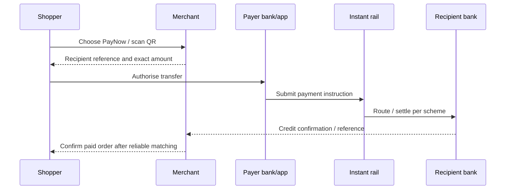

# 18. Real-time payments, open banking and payment initiation

**Part V — Modern and Emerging Payments** · **Estimated study time:** ~24 minutes · **Prerequisites:** [Bank transfers](../02-payment-products-and-infrastructure/09-bank-transfers-real-time-payments-and-bnpl.md), [cross-border FX and treasury](../02-payment-products-and-infrastructure/09a-cross-border-payments-fx-and-treasury.md), [compliance](../03-checkout-authorization-and-fraud/13a-compliance-pci-kyc-aml-and-ownership.md) · **Source review:** 16 November 2026 · **Status:** Working draft

> **Guiding question:** Can a retailer replace cards with instant account-to-account payments and keep the same conversion, refunds, dispute outcomes and customer service?

## Learning outcomes

Distinguish a domestic real-time rail from an alias/QR experience; explain account-to-account (A2A) payment initiation and consumer authorization; compare push-payment finality with card flows; and design merchant confirmation, refund and reconciliation behaviors that depend on the underlying rail.

## 18.1 What the stack actually contains

- **User-facing initiation:** Customer selects bank transfer, scans a QR, chooses a stored account or approves a payment via a bank app.
- **Alias or directory:** Mobile number / business ID / virtual address resolves to a recipient account where supported. Alias lookup does **not** move money.
- **Payment initiation interface:** API or bank interface that asks a payer's account provider to initiate a transfer, subject to applicable consent and strong customer authentication requirements.
- **Rail / clearing / settlement:** Payment system that handles actual inter-institution movement and finality.
- **Merchant matching:** A separate order-to-bank-credit reconciliation process, particularly important for variable amounts, underpayments, duplicates or delayed notifications.

### Singapore working example

PayNow is an alias and QR-supported transfer experience using Singapore's **FAST** infrastructure for participating banks and major payment institutions, as described by the [Association of Banks in Singapore](https://www.abs.org.sg/e-payments/pay-now). **PayNow, FAST, SGQR, and a merchant's own wallet QR are not interchangeable protocols.** A merchant can display SGQR but must know which underlying payment scheme/wallet actually settled the tender.

The diagram simplifies participant messaging and settlement; actual scheme message paths and legal finality rules must be checked in current rulebooks.

## 18.2 Open banking payment initiation is not account data access

Account data APIs may allow a permitted third party to see balances or transactions with consent. **Payment initiation** allows an authorized PISP to ask an account provider to initiate a payment from the payer's account; the account provider and scheme handle the funds transfer. The UK Open Banking standards explicitly describe a PISP initiating a payment with the payment-service user's consent and retrieving status. [UK Open Banking PIS guidelines, March 2026](https://standards.openbanking.org.uk/customer-experience-guidelines/payment-initiation-services/latest/).

A PM must model authorization / consent differently from card credential storage: what exact amount and payee were approved, for how long, whether the user must confirm in a bank-owned interface, when status becomes final, and whether an initiation can be cancelled or recalled.

## 18.3 Card versus push-transfer product consequences

| Product property | Card checkout, typical | Instant push transfer, typical |
|---|---|---|
| Customer action | Authenticate and authorize card payment | Payer approves account debit to recipient |
| Merchant confirmation | Authorization can precede capture/settlement | Bank/rail confirmation of recipient credit may be available quickly |
| Later disputes | Scheme dispute/chargeback models may apply | No universal card-like chargeback; recovery depends on rail and laws |
| Credential risk | PAN, network token, PSP token and scheme rules | Bank account initiation/alias, verified consent, recipient impersonation |
| Refund | Referenced card refund where supported | A **new outbound payment** may be required; do not assume automatic reversal |
| Payout | Acquiring settlement and merchant payout | Credit may go directly to beneficiary bank account depending on scheme |

**PM decision:** whether to treat the bank initiating a payment as sufficient, or to require verified recipient-bank credit / reliable confirmation before releasing goods. Avoid crediting a mobile screenshot as authoritative payment evidence.

## 18.4 Worked example: reconciliation and refunds

**Fictional retailer:** Order `ORD-78` is SGD 35. An instant transfer of SGD 30 appears with the correct order reference, followed by SGD 5 from a different sending account. Your product may choose to require a single exact-value transfer, or explicitly support multi-payment; **neither** should be inferred from two individual bank entries. If you accept both, tie each transfer ID to the order and prevent a duplicate refund.

Customer requests a SGD 10 partial refund. A bank transfer used for purchase cannot be assumed to support a referenced, reversible refund on that rail. Specify a permitted refund path, verified beneficiary details, separate refund ID, approval policies and traceable bank debit. The **merchant's paid-order state** and the **refund transfer state** remain separate.

## 18.5 PM discovery and delivery checklist

1. Identify rail, participating banks, geography, method limitations and cutoffs.
2. Test consent, redirects, bank app return, timeouts, customer cancellation, app-switch interruptions and duplicate notifications.
3. Design tamper-resistant order reference and exact-amount matching; define partial and overpayment behavior.
4. Design recipient changes, refund/return flows and scam escalation separately from card chargeback UX.
5. Agree with treasury/finance on beneficiary confirmation, settlement finality, reconciliation windows, and cash availability.
6. Define SLA/SLO by **confirmed paid order**, not merely payment initiation API success.

## 18.6 Exercise and answer check

**Exercise:** Shopper shows a “transfer successful” screenshot but your merchant bank webhook is delayed. Should a marketplace seller instantly ship a high-value order?  
**Answer check:** Establish what evidence is authoritative for the rail and merchant. Use a clear pending state and permitted reconciliation/status retrieval rather than trusting an unverifiable screenshot. Risk and fulfillment thresholds may differ for low-value versus high-value orders; document the policy.

**Exercises:** [Worked solutions](../../answers/chapter-exercises.md#18-instant-payments-open-banking-and-account-to-account) (companion answer key; review your reasoning before opening).

**Next:** [19. Stablecoins and programmable money](19-stablecoins-and-programmable-payments.md).

## Primary sources

- [ABS — PayNow](https://www.abs.org.sg/e-payments/pay-now) (Singapore rail/alias facts; accessed 16 November 2026).
- [UK Open Banking — Payment Initiation Service guidelines](https://standards.openbanking.org.uk/customer-experience-guidelines/payment-initiation-services/latest/) (UK-specific standard, March 2026).
- [Financial Stability Board — Cross-border payment objectives](https://www.fsb.org/work-of-the-fsb/financial-innovation-and-structural-change/cross-border-payments/g20-targets-for-enhancing-cross-border-payments-2/) (international goals, not all met).
