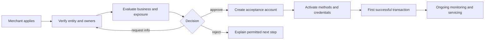

# 5. Merchant acquiring and onboarding

**Part II — Payment Products & Infrastructure** · Prerequisites: Chapters 2 and 4

## Learning outcomes

Explain the acquiring value proposition, differentiate merchant **KYB** from **credit/fraud underwriting**, understand why onboarding and payouts are coupled, and design a merchant lifecycle beyond an application form.

## 5.1 An acquirer makes merchants acceptable to a payment ecosystem

In a card model, an acquiring institution enables a merchant to accept card transactions and participates in the scheme-facing and financial obligations involved. Merchant-facing product capabilities may include application, identity verification, risk classification, MID setup, terminal/API activation, pricing, refunds, dispute operations, reserve handling and payouts. A payment facilitator (payfac) may support sub-merchants under an acquiring arrangement. Details vary by market and program.

**Onboarding is not over at approval.** The product must help the merchant complete integration, receive its first payment, find its fees, reconcile settlements and resolve issues. A KYB completion dashboard measures compliance throughput; it does not tell you whether merchants generated useful payment volume.

## 5.2 Know Your Business versus underwriting

**KYB/KYC/AML checks** establish required identity, beneficial ownership, sanctions screening and risk-based due diligence under applicable laws and institution policies. **Merchant underwriting** asks how the merchant's business could create financial or scheme exposure: will it deliver after being paid; what if a high-ticket purchase is disputed; can refunds be funded; is the business unusually exposed to fraud or chargebacks? These functions overlap in data collection, but their objectives and controls differ.

Common onboarding inputs include legal business name, registered country/address, incorporation or registration number, owners/controllers, bank account for settlement, website/product details, merchant category, anticipated volume and ticket size, delivery/fulfillment model, return policy, prior processing history, and relevant documents. Requirements are jurisdiction- and risk-dependent; do not publish a "universal mandatory list."

## 5.3 Merchant risk and limits

A merchant selling downloadable software and one pre-selling expensive travel packages have different **time-to-fulfillment** and refund risk. An acquirer might use:

- **Transaction/volume caps** to bound exposure while a merchant is new.
- **Payout delay** so that some risk is observed before releasing proceeds.
- **Rolling reserve** withholding an agreed portion of proceeds for a defined period.
- **Risk monitoring** for unexpected spikes, cross-border shifts, high disputes or changed business models.
- **Manual reviews** for exceptions and unusual applications.

A cap is not necessarily a wallet balance; a reserve is not always a cash deposit. Where limits are enforced, the PM needs to define a clear action at breach: decline new transactions, pause payouts, request additional documents or escalate. Each has customer consequences.

### Worked case: faster activation versus loss exposure

A new segment of small merchants has 60% application completion but only 25% reach first payment within seven days. Operations suggests requiring fewer documents; risk wants more. Before changing the policy, segment failures: abandoned before business verification, pending manual review, no terminal delivered, API integration failing, bank account verification pending, or approved but no customer demand. The right intervention could be pre-filling registry data and showing a clear integration checklist rather than relaxing an essential control.

**Metrics:** eligible applications; approval rate by segment; median time-to-decision; time from approval to first successful transaction; 30-day active merchants; processing margin; dispute and negative-balance incidence; manual review hours.

## 5.4 Payout design is part of the product

Merchant questions after the sale: "Where is my money? Why does Tuesday's payout not equal Monday's gross sales?" Payout statements may contain net sales, refunds, chargebacks, processing fees, reserve transfers, prior-period adjustments and FX. A good merchant dashboard provides a transaction-to-payout mapping, not merely a bank transfer amount. If payout is advanced before underlying settlement, treasury and counterparty risk become explicit dependencies.

## 5.5 The PM's decision checklist

For a new merchant segment, define the accepted business models, target countries, sponsor/acquirer relationships, risk appetite, approval policy, activation journey, eligible payment methods, funds flow, payout policy, pricing, dispute support and escalation conditions. Partner with compliance, risk and legal; a PM does not approve merchant exceptions by intuition.

## Practice

Sketch the minimum viable onboarding and monitoring flow for (a) a neighborhood café accepting QR, and (b) a pre-order travel merchant accepting cards. Which controls change, and why?

**Next:** [5A. Marketplaces, PayFacs and funds flow](05a-marketplaces-payfac-funds-flow.md).

## Further reading

- [Visa Accept product overview](https://developer.visa.com/capabilities/visa-accept/overview)
- [MAS Payment Services and e-payments](https://www.mas.gov.sg/development/e-payments)
