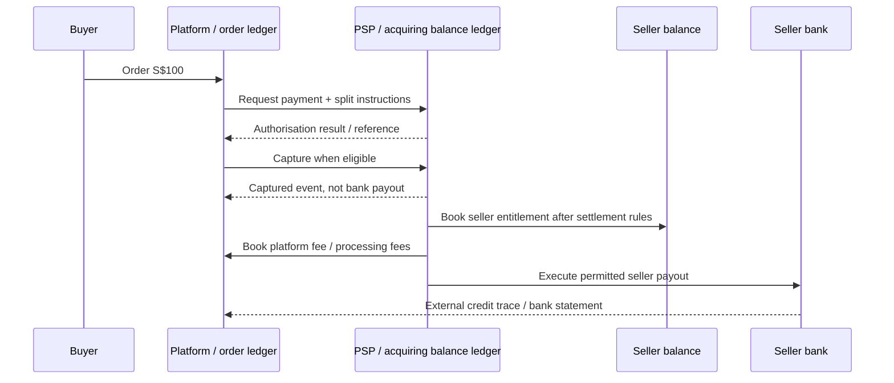

# 5A. Marketplaces, payment facilitators and platform funds flow

**Part II — Payment Products & Infrastructure** · **Reading time:** ~22 minutes · **Prerequisites:** [Merchant acquiring](05-merchant-acquiring.md), [payment economics](../part-1/04-payment-economics.md) · **Reviewed sources:** 16 November 2026 · **Status:** Working draft

> **Guiding question:** When a customer pays a platform, whose money is it, who may hold it, and which party must refund or absorb a chargeback?

## Learning outcomes

You should be able to distinguish a platform, a merchant of record (MoR), a payment facilitator (PayFac), an acquirer and a sub-merchant; map charge, balance, transfer and payout records; explain negative balances and reserves; and write testable requirements for multi-seller payments.

## 5A.1 Business model before API

A **marketplace** connects buyers to sellers. A **PayFac** is a card-acceptance arrangement that supports sub-merchants under scheme/acquirer obligations. A **merchant of record** is the seller responsible for the sale to the buyer. These labels are **not synonyms**. A marketplace could use a provider's connected-account model without itself being the contractual acquiring PayFac; a marketplace could itself be MoR; and a provider may be the PayFac. Roles depend on legal entity, contracts, scheme registration and country.

Ask the questions in this order:

1. Who contracts with the buyer for goods or services? Who appears on the receipt and statement descriptor?
2. Who is the scheme/acquirer merchant or registered sub-merchant? Who underwrites the business?
3. Who can hold or move funds? Into which legally/contractually permitted account?
4. Who owes the seller when a buyer pays? When does that payable become due?
5. Who takes a negative balance after refunds, fraud, disputes, bank payout failures or seller insolvency?
6. Which party performs KYB/KYC, sanctions monitoring, tax reporting, reserves and safeguarding?

A **payment split instruction** is a booking instruction, not a universal declaration of legal beneficial ownership. Provider-ledger balances and the platform's accounting ledger must still reconcile independently.

## 5A.2 Follow the same transaction through four ledgers

**Illustrative S$100 single-seller booking:** Buyer pays S$100; platform fee S$10; processing cost S$2; seller entitlement S$88 **if the commercial contract expressly allocates all processing cost to the seller**. Check: `100 = 10 + 2 + 88`. If the platform absorbs processing, seller entitlement is S$90 and platform net fee revenue S$8: *a different contract and ledger*. Neither example establishes the settlement timing or who holds the balance before payout.

Adyen's platform documentation describes split instructions for seller balances, commissions and fees; without instructions, its default booking may go to the platform liable balance account. That is **Adyen-specific**, not a universal rule. [Adyen — Split transactions](https://docs.adyen.com/platforms/online-payments/split-transactions). [Adyen — Internal vs external transfer](https://docs.adyen.com/platforms/internal-fund-transfers).

## 5A.3 Charge type and seller payout are different choices

Different payment platforms support different charge-on-behalf-of / direct-merchant / platform-merchant arrangements. Stripe Connect describes direct charges, destination charges and separate charges and transfers; those have different fee reporting, dispute and platform-balance implications. You must select a model from your actual provider and jurisdiction rather than copy an API example. [Stripe — Connect](https://stripe.com/en-sg/connect).

For each model the PM should capture a **funds-flow contract**:

| Event | Platform order ledger | PSP/acquirer ledger | Seller payable ledger | Customer / bank |
|---|---|---|---|---|
| Authorization | Pending hold / eligibility | Authorization reference | No earned seller payout yet | May show hold |
| Capture | Payment captured | Capture reference / pending settlement | Seller payable per contract | Posted debit may follow |
| Refund | Refund owed / order adjustment | Refund debit and fee handling | Recover seller share, or platform funds it | Refund credit on applicable rail |
| Chargeback | Dispute case + financial exposure | Debit / fee / representment events | Seller/platform liability per contract | Dispute credit may be provisional |
| Seller payout | Clear eligible payable | External transfer / payout ID | Reduce payable, not sales | Bank credit once received |

Note: Legal and accounting recognition often differ from PSP operational statuses. Get finance sign-off.

## 5A.4 A seller can be owed funds and still be a financial risk

A seller sells a S$500 item, receives an immediate S$450 payout, and fails to deliver. A refund or chargeback can arrive later. The platform or acquirer may have to return money before recovering the seller's negative balance. Merchant **underwriting** can therefore drive payout delays, rolling reserves, transaction/velocity limits, collateral, or seller eligibility—not only a yes/no onboarding decision.

*PM choices:* what to display as available versus pending versus held funds; how to explain reserves to sellers; what users can withdraw; whether one failed seller payout blocks others; how to prevent double-payouts on delayed webhook delivery; how to reverse a split on partial refunds; what makes a payout final in the seller portal.

## 5A.5 Worked failure: one order, two sellers, partial refund

A fictional order contains Seller A's S$60 goods and Seller B's S$40 goods. Platform commission is 10% of each seller's gross; ignore tax and processing fees for the first pass. Initial seller entitlements are S$54 and S$36; platform commission S$10. Seller A later refunds S$20. Assuming fees are proportionately reversed under the contract, adjust A's payable by S$18 and platform commission by S$2. Final entitlement: Seller A S$36, B S$36, platform S$8; customer net purchase S$80. The reconciliation must prove `36 + 36 + 8 = 80` and independently trace refund, settlement and bank movement.

**Bad implementation:** treating a seller balance as equal to the captured amount or automatically retrying a rejected seller payout without a unique payout-operation ID. **Safer design:** durable charge/transfer/refund/payout IDs, explicit exception queue, finance-owned balance adjustments and controlled reissue of bank payouts.

## 5A.6 Product requirements and metrics

- **Acceptance:** first payment to a verified seller, not merely KYB completion.
- **Financial integrity:** unreconciled split amount, negative balance exposure, net payout mismatch, duplicated payout count.
- **Experience:** time from capture to eligible balance, payout failure resolution, understandable reserve disclosure.
- **Commercial:** contribution after fees, reserves, losses, support and funding costs per active seller.
- **Guardrails:** restricted seller categories, prohibited counterparties, sanctions and jurisdictional obligations; never infer licence scope from software integration.

Use the [platform funds-flow specification](../../artifacts/platform-funds-flow-spec.md) before deciding on a provider's split-payment API.

## Exercise and answer check

**Question:** Seller A is due S$80 and Seller B S$40 after commission. The platform sees a S$120 provider-ledger transfer but only S$80 of bank credits. Is the missing S$40 proof of lost money?  
**Answer:** No. Reconcile external payouts and bank dates/IDs separately from provider internal transfer bookings. The S$40 might be pending, held for a reserve, rejected, or incorrectly routed. Do not issue a duplicate payout until its original status is known.

**Next:** [6. Gateways and payment orchestration](06-gateways-orchestration.md).

## Primary references

- [Adyen — Split payments between balance accounts](https://docs.adyen.com/platforms/online-payments/split-transactions) (provider-specific; accessed 16 November 2026).
- [Adyen — Transfer funds internally](https://docs.adyen.com/platforms/internal-fund-transfers) (provider-specific; accessed 16 November 2026).
- [Stripe — Connect platform and marketplace payment solutions](https://stripe.com/en-sg/connect) (provider-specific; accessed 16 November 2026).
