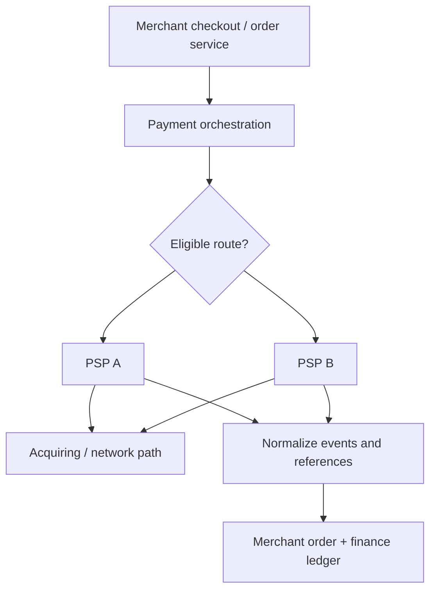

# 6. Payment gateways, processors and orchestration

**Part II — Payment Products & Infrastructure** · Prerequisites: Chapters 2–3

## Learning outcomes

Understand how a payment gateway differs from an acquirer, what an orchestration layer can and cannot solve, and how to assess routing, fallbacks, retries and observability across PSPs.
## 6.1 A gateway is an integration product

A **gateway** exposes interfaces that allow a merchant application to submit payment requests and receive outcomes. It may tokenize credentials, manage client-side components, normalize payment methods, and provide webhooks, reconciliation exports and operational tooling. A **processor** handles transactions; an **acquirer** enables scheme-backed merchant acceptance. Their capabilities may come from one provider but are not conceptually identical.

A merchant usually wants a durable abstraction: create or confirm payment, inspect state, capture, cancel, refund, and retrieve associated records. The gateway's API hides much of the complexity but does not eliminate network-specific constraints.

## 6.2 A simplified gateway request

```json
{
  "order_id": "ORD-1042",
  "amount_minor": 7900,
  "currency": "SGD",
  "payment_method_token": "tok_example_only",
  "merchant_reference": "basket_845",
  "idempotency_key": "pay-ORD-1042-v1"
}
```

This is a **fictional internal API**, not a Stripe or Adyen schema. Never send raw PAN or sensitive authentication data through a generic backend unless the architecture and compliance controls explicitly permit it. Your real contract needs constraints around currency minor units, allowed transitions, idempotency scope, authentication redirects, timeout handling and correlation identifiers.

## 6.3 Orchestration coordinates several providers

An orchestration layer may let a merchant select among several PSP/acquirer connections based on geography, card capability, availability, cost, contractual constraints and observed performance. It typically needs a normalized transaction model, configurable routing logic, connection health, unified payment-method support, token strategy, reconciliation mapping and operational dashboards.



**Important constraint:** failover is not equivalent to "retry at another PSP." A first attempt may be approved while the merchant timed out; blindly creating a second charge through PSP B can duplicate the financial effect. Many card retries also face scheme/provider limitations. Only retry after an appropriately verified state and within applicable rules. See [Chapter 10](../part-3/10-checkout-and-payment-state.md).

## 6.4 A good routing decision considers eligibility first

An example decision order:

1. **Capability:** Is this card/payment method/country/currency/merchant legal and supported on the route?
2. **Risk and compliance:** Does this combination satisfy SCA, token and scheme requirements?
3. **Business and customer constraints:** Is the route allowed for this merchant, order and amount?
4. **Health:** Is the provider operational for this segment?
5. **Expected outcome:** Among eligible routes, what are the expected approved-order probability, latency, cost and dispute risk?

Optimizing the cheapest transaction first is often a poor strategy because ineligible or unreliable routes can destroy conversion or customer trust. Conversely, chasing the last percentage point of authorization can be uneconomic.

## 6.5 The hidden complexity of multi-PSP operations

Provider A might send `AUTHORIZED`; Provider B might have separate `processing`, `requires_action` and `captured` states. One gateway may support multiple partial captures while another does not. Failure codes may have different semantics. A common internal state machine must preserve all material distinctions, including **unknown outcome**, refund pending, partial capture and disputed states.

Other cross-provider issues include: token portability (gateway vault tokens often are not portable); inconsistent BIN/issuer metadata; FX conversion and currency support; reconciliation file timing; reporting cutoffs; retries after timeout; API version migration; status webhook ordering; and support traceability.

### Worked case: PSP incident at checkout

At 10:05, the primary provider times out for 20% of transactions. At 10:08, the team proposes routing all failures to the backup PSP. The PM must demand two categories: **new payment attempts not yet sent** can often be routed to a healthy path if eligible; **already-submitted but ambiguous attempts** require status resolution, not blind replay. Product copy should say "We're checking your payment" where appropriate. Finance monitors duplicate authorizations and captures; support receives a traceable incident queue.

## 6.6 PM scorecard

Track unique orders successfully paid (not just attempts approved), routing share, authorization by eligible cohort, provider error/timeout share, p95/p99 latency, recovery latency for ambiguous states, duplicate-capture incidents, cost per successful order, unmatched settlement items and incident minutes. A routing experiment must compare equivalent cohorts and watch risk.

## Practice

Compare two strategies: (A) route purely by lowest processing cost; (B) route by expected contribution from successfully fulfilled orders minus payment and operational costs. What additional data does B require?

**Exercises:** [Worked solutions](../../answers/chapter-exercises.md#06-gateways-orchestration) (companion answer key; review your reasoning before opening).

**Next:** [7. Issuing and tokenization](07-issuing-tokenization.md).

## Further reading

- [Adyen — Payments lifecycle](https://docs.adyen.com/account/payments-lifecycle)
- [Adyen — Tokenization](https://docs.adyen.com/online-payments/tokenization)
