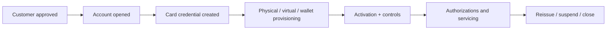

# 7. Card issuing, credentials and tokenization

**Part II — Payment Products & Infrastructure** · Prerequisites: Chapters 2–4

## Learning outcomes

Describe the issuer's responsibilities, distinguish a card account from a physical card and a token, and design a card lifecycle that handles provisioning, approvals, controls and replacement.

## 7.1 What issuing means

An issuer provides cardholders with access to a payment credential under a scheme/program arrangement and maintains the associated account relationship or program obligations. The issuer or its processor receives authorization messages and makes decisions using account status, available funds or credit, limits, fraud controls, merchant category and other signals. Depending on jurisdiction and program, an issuer sponsor, processor, program manager and fintech app may be separate participants.

**A card is not an account.** One account can have multiple credentials; cards can be replaced; a card may have device tokens in wallets; a token can be suspended independently. A PM should model the account, card, token and spending-control objects distinctly.

## 7.2 The issuing lifecycle

Product work includes customer eligibility, KYC, card controls, velocity limits, merchant category restrictions, virtual-card creation, recurring merchant continuity, in-app card freeze, lost/stolen replacement, and dispute support. A card program can fail commercially despite technically successful issuance if activation and sustained usage are poor.

## 7.3 PANs, PSP tokens and network tokens

- **PAN (primary account number):** the card credential identifier; direct handling can increase sensitive-data exposure and compliance scope.
- **Gateway/PSP token:** an identifier that represents stored payment details in a provider's vault. Its scope and portability depend on the provider and contract.
- **Network token:** a token provisioned via a card network/token service, often bound to a particular use context or device/merchant domain under the applicable standards.
- **Device wallet token:** a tokenized credential used by a wallet for eligible transactions; not a generic reusable card number.

Tokenization reduces exposure to raw credentials but does not eliminate fraud, PCI obligations or the need for consent. Lifecycle events matter: token provisioning, activation, suspension, deletion, account updates and device change.

For provisioning flows, **FPAN versus DPAN**, cryptograms, merchant card-on-file tokens, payment account reference (PAR), and independent token lifecycles, continue with the dedicated [Chapter 7A: Network tokenization, FPAN and DPAN](07a-network-tokenization-fpan-dpan.md).

## 7.4 The PM's recurring-payment problem

A subscription merchant stores a customer's credential with permission. Months later the physical card expires. A provider may offer account updater or network-token lifecycle services to reduce involuntary churn. But the PM must distinguish **card-on-file customer-initiated** transactions from **merchant-initiated** transactions and ensure the right consent, disclosures, transaction indicators and authentication handling. A saved card is not blanket permission for arbitrary charges.

### Worked case: lost physical card but subscription should continue

The customer reports a lost card and receives a replacement. The issuer blocks the compromised physical credential; eligible network tokens or merchant-stored credentials may update depending on scheme and issuer rules. The product challenge is protecting the customer while avoiding unnecessary subscription interruption. The PM defines freeze behavior, token suspension policies with risk, what the user sees, and which third-party merchants can be updated.

## 7.5 Issuing PM metrics

Eligible applications → account opening → credential creation → activation → first successful purchase → active spenders → approval rate → disputes/losses → servicing cost. Measure card and token usage separately; a wallet provisioning success event is not proof that a payment was made. Segment declines by insufficient funds, card status, policy control, suspected fraud and technical failures without exposing sensitive details to attackers.

## Practice

Design a virtual card product for employee expenses. Specify two spend controls, account/card/token identifiers, what happens when a card is suspended, and the approval/fraud guardrails.

**Next:** [7A. Network tokenization, FPAN and DPAN](07a-network-tokenization-fpan-dpan.md).

## Further reading

- [Adyen — Tokenization and recurring models](https://docs.adyen.com/online-payments/tokenization)
- [Adyen — Network tokenization](https://docs.adyen.com/online-payments/network-tokenization/)
