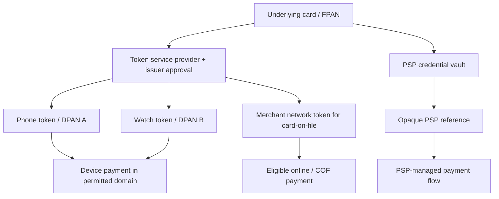
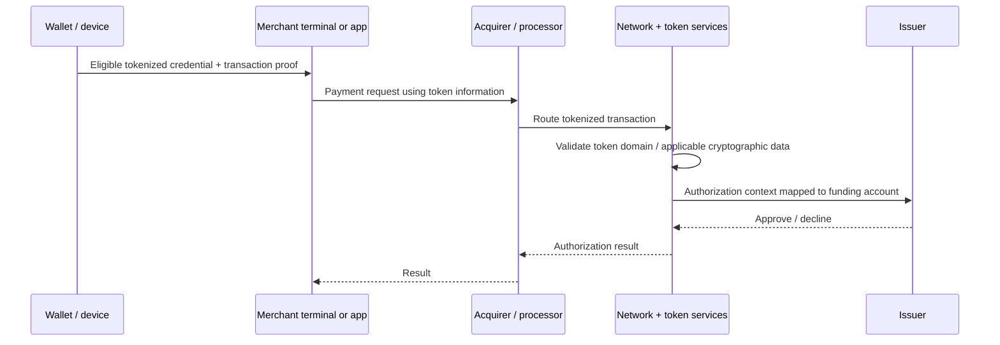

# 7A. Network tokenization, FPAN, DPAN and card-on-file credentials

**Part II — Payment Products & Infrastructure** · Read after [Chapter 7: Issuing and tokenization](07-issuing-tokenization.md)

> **Central idea:** A card account, the card's funding PAN, an EMV network payment token, a device token, and a PSP vault token are related but different objects. Confusing them produces bad designs for recurring payments, card replacement, wallet troubleshooting and fraud controls.

## Learning outcomes

By the end, distinguish FPAN and DPAN, diagram the token provisioning and payment paths, describe a token service provider's role, and decide what to do when a card or device is lost. Explain why a wallet's last four digits can differ from the physical card's.

## 7A.1 One account, several credentials

Think of a customer with one credit-card account and a plastic card. The customer adds that card to a phone and smartwatch and saves it at a merchant. The same underlying funding account can now have **multiple credentials** with different lifecycles. A replacement physical card can change the funding credential while some eligible network-token relationships continue under programme rules. A token can be suspended without necessarily closing the account.

| Term | Plain-English meaning | Typical use / caution |
|---|---|---|
| **PAN** | Primary Account Number used to identify a payment card credential | Its handling creates sensitive-data obligations |
| **FPAN** (funding / financial PAN) | The underlying card PAN associated with the funding card/account; often displayed on the physical card | Distinguish from the bank account number and from device tokens |
| **DPAN** (device PAN) | A device-provisioned network payment token representing the underlying card for eligible transactions | Often has **different last four digits** from the FPAN; device context matters |
| **Network payment token** | EMV payment token issued by a token service programme, used through the payments ecosystem subject to domain restrictions | Can be device-specific or merchant/COF-context-specific; not all network tokens are DPANs |
| **PSP / gateway vault token** | Provider-specific reference to credentials held in a vault | Can be opaque and not routable outside the provider; portability is contractual/technical |
| **Payment Account Reference (PAR)** | Where supported, an identifier that links a PAN to associated payment tokens for permitted use cases | Useful for loyalty/fraud correlation; **not a payment credential** |

The naming of FPAN also varies (funding PAN, financial PAN); in integrations, follow the provider's schema. Never assume a card's display suffix identifies a unique underlying account or that a DPAN works outside its permitted token domain.

## 7A.2 Why network tokenization differs from a vault

A gateway vault can keep raw card data out of merchant systems, but in some setups the gateway retrieves the real PAN and presents it downstream during processing. By contrast, **EMV payment tokens are themselves payment credentials that can travel through compatible acquiring/network infrastructure** under defined restrictions. Token domain controls can limit use to a merchant, device or transaction scenario. The token service provider (TSP) maintains token-to-PAN relationships and lifecycle controls. The issuer and token programme determine eligibility and identity-and-verification needs.

Neither approach alone eliminates PCI DSS considerations, fraud risk or the need to secure transaction keys and authentication data. “Tokenized” is not a synonym for “fraud-proof.”

*Conceptual relationship diagram, not a claim that every account or programme supports all configurations.*

## 7A.3 Provisioning a device token

1. **Cardholder requests provisioning.** For instance, from an issuer app into a supported phone wallet. The wallet or token requestor sends a tokenization request through the relevant scheme/programme.
2. **Token eligibility and identity checks.** Issuer/token systems assess account status and may require cardholder identity verification. The mechanism varies by programme and risk.
3. **TSP provisions a token.** The DPAN (device payment credential) is associated with the FPAN under domain controls and provisioned securely to the device context.
4. **Wallet activation.** The app should distinguish “added to wallet” from “first transaction succeeded.”
5. **Lifecycle management.** Device changes, lost phone, card replacement, issuer account closure, or suspected fraud may trigger token updates/suspension/deletion.

A separate device can receive a separate DPAN associated with the same FPAN. Device-specific tokens explain why customer support cannot safely identify a wallet transaction just by asking for the last four digits printed on the physical card.

## 7A.4 Paying with a token — the money does not come from the token

The authorization ultimately applies to the customer's underlying funding account/credit line. The merchant often does not see the FPAN. Exact data fields and whether detokenization occurs at the network or issuer boundary vary by programme. A token's cryptographic proof is **transaction-specific**; it should not be reused as a generic stored credential or treated as the same object as a 3DS authentication result.

**Network token vs 3DS:** Network tokens reduce the exposure and misuse potential of card credentials. EMV 3DS is an issuer authentication protocol for relevant online payment flows. They are complementary, not interchangeable. A tokenized online payment may still require 3DS depending on the transaction, rules and issuer.

## 7A.5 Merchant tokens are not the same as device tokens

A merchant may migrate eligible card-on-file traffic to network tokens in order to improve credential security and lifecycle continuity. A device wallet's DPAN is usually restricted to a wallet/device context. A merchant COF network token is restricted to the particular merchant or token-user domain and intended use case. The exact cryptogram/data requirements vary. Don't assume a merchant can extract the DPAN from a customer's phone and use it for arbitrary background recurring charges.

A recurring-payment journey also needs consent and correct cardholder-initiated versus merchant-initiated classification. Network tokenization doesn't itself supply a mandate for future charges.

## 7A.6 PM decisions across the token lifecycle

| Event | Bad product assumption | Requirement to specify |
|---|---|---|
| User freezes physical card | “All wallet tokens must always behave the same” | Determine issuer and programme-specific card/token control semantics and communicate clearly |
| Phone lost | “Close the entire account” | Support suspending that device token while considering other credentials separately |
| Card reissued after expiry | “Ask every subscriber to re-enter card” | Evaluate supported lifecycle updates and continuity, with issuer/risk constraints |
| Shopper reports wrong card last four | “Transaction is fraudulent” | Display safe wallet-token context and appropriate provider references |
| PSP migration | “All stored tokens can be exported” | Assess portability, consent, PCI scope, provider token-to-network-token mapping |
| Suspected token theft | “Token can't be abused” | Domain restrictions, event monitoring, suspension/reprovisioning and incident playbook |

### Worked support example (fictional)

The cardholder sees physical card ending `••42` in their banking app, but a phone-wallet receipt shows `••17`. The merchant's support agent must not conclude that a different person's card was charged. They should use a secure payment reference and provider wallet metadata to identify the tokenized transaction, without asking the customer for a full PAN or token. The issuer/token provider can reconcile the DPAN to the underlying funding account in its permitted system context.

### Worked design example: merchant tokens vs vault tokens

A merchant processes 100,000 eligible recurring attempts a month through one provider. It wants multi-PSP routing. A provider vault token may be usable only at that PSP. A network token might support broader acceptance through capable acquirers, but token-requestor permissions, portability agreements, cryptogram generation, merchant-domain restrictions and scheme support still govern reuse. Before budgeting for migration, demand a sample token inventory and map eligible cohorts, token-provisioning success, cost, performance and recovery plans.

## 7A.7 Product metrics

Separate (a) eligible card share; (b) token provisioning attempts / success; (c) active tokens by domain; (d) tokenized payment share; (e) lifecycle updates processed; (f) subsequent authorization success among comparable cohorts; (g) fraud/chargebacks; (h) support contact rates. Do **not** attribute improved approval entirely to tokenization without accounting for issuer mix, cohort selection, transaction type and simultaneous 3DS/routing changes.

## Practice

1. Draw the data model for **account → card credential (FPAN) → token A (phone) / token B (watch) / merchant COF token**. Which statuses should be independently controllable?
2. A customer loses a phone. Which credential(s) should be blocked, by whom, under which risk policy?
3. Why might a wallet's last four digits not match the physical card?
4. Your PSP offers only proprietary vault tokens. What breaks when you introduce a second processor?
5. Name three conditions that would prevent a tokenized payment from succeeding even if the token is active.

**Answer prompts:** Different objects need different status policies; a DPAN is a token; vault tokens may not travel; funding status, domain/cryptogram checks, 3DS/authentication and issuer authorization are independent possible blockers.

**Next:** [8. Wallets, QR and alternative methods](08-wallets-qr-apms.md).

## Further reading

- [EMVCo — Payment tokenisation overview and specification links](https://www.emvco.com/emv-technologies/payment-tokenisation/)
- [Visa — In-app provisioning and FPAN/DPAN](https://developer.visa.com/capabilities/visa-in-app-provisioning/docs-getting-started)
- [Thredd — Support for Financial PANs and Device PANs](https://docs.thredd.ai/More_Information/DPAN_FPAN.htm)
- [Mastercard Gateway — Device-specific number and payment account reference fields](https://ap.gateway.mastercard.com/api/documentation/apiDocumentation/rest-json/version/72/operation/Browser%20Payment%3A%20%20Update.html?locale=en_US)
- [Adyen — Network tokenization](https://docs.adyen.com/online-payments/network-tokenization/)
