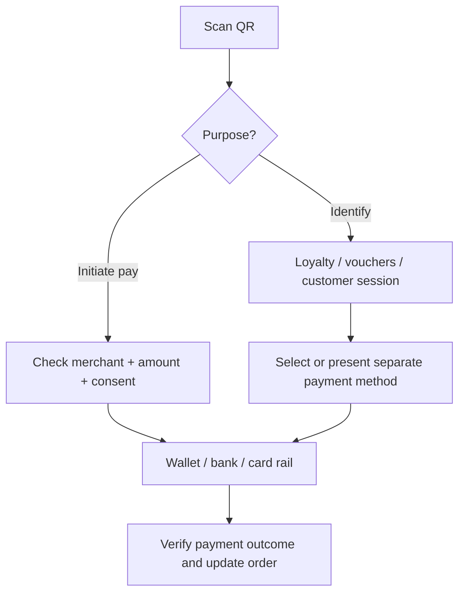

# 8. Digital wallets, QR and alternative payment methods

**Part II — Payment Products & Infrastructure** · Prerequisites: Chapters 1–3

## Learning outcomes

Distinguish a payment instrument from the interface that presents it, understand different QR journeys, and evaluate payment-method coverage through customer, merchant, settlement and economics lenses.

## 8.1 A wallet is not one rail

A wallet could be a user interface for network-tokenized cards, a stored-value account, a bank-transfer initiation app, a QR payment acceptance network or a combination. Two products both called "wallet" may have different funding sources, merchant contracts, settlement schedules, risk controls and dispute mechanisms. Therefore, ask **what funds the payment and what rail settles it** rather than treating a wallet logo as a technical specification.

A merchant sees alternatives such as cards, local wallets, pay-later products, bank redirects, QR, and real-time account transfers. Each has eligibility, conversion, cost, fraud, refund, and reconciliation consequences.

## 8.2 QR conveys information; the funding mechanism is separate

A **merchant-presented QR** may encode a merchant identifier, account/proxy, order reference or dynamic amount. A **customer-presented QR** may encode a payment credential or identifier for the merchant to scan. QR can also be used solely for **identity or loyalty recognition**, with payment completed through another tender. These are different products despite sharing a scanning interaction.

### Static versus dynamic QR

A static QR often identifies a recipient and leaves amount entry to the payer. A dynamic QR can be generated for a specific checkout session with amount/reference information; actual capabilities depend on scheme and implementation. Dynamic QR can help reduce manual amount errors and link payments to orders, but does not remove the need to verify the incoming payment with an authoritative provider event.

## 8.3 Singapore as a learning example

MAS describes **SGQR** as a shared QR code framework, **PayNow** as proxy addressing, and **FAST** as underlying fund-transfer infrastructure. They occupy different layers. A PM working on in-store checkout needs to know which service is doing identity recognition, which one initiates a transfer, and which event confirms receipt. [MAS e-payments](https://www.mas.gov.sg/development/e-payments).

## 8.4 A wallet's real product challenges

1. **Enrollment:** How does the customer link a card/account and consent to use?
2. **Acceptance:** Which merchants and terminals support it; what happens offline?
3. **Selection:** How does the interface surface eligible sources, vouchers, rewards and balance?
4. **Execution:** Can a tokenized card, stored balance and bank transfer share one consistent confirmation screen?
5. **Servicing:** Where do refunds land and how are disputes routed?
6. **Growth:** Does the payment method genuinely increase completed purchases, or merely shift mix from existing methods?

A wallet might create stronger engagement through loyalty linkage but increase payment complexity when rewards, tenders and voucher eligibility have different rules. Product state must preserve each benefit's applied amount and final financial effect.

## 8.5 Worked case: QR identity without QR payment

A grocery shopper scans an app QR to identify their membership, apply vouchers and accrue points, then pays using a separate bank card at self-checkout. If the interface says "QR payment complete" merely because identity was read, it creates a dangerous false confirmation. The PM should model **identity authenticated**, **benefits applied**, **tender chosen**, and **funds authorized** as separate events with independent error handling.

## Practice

Compare a shopper-presented loyalty QR with a merchant-presented PayNow QR. List actor, purpose, data encoded, payment rail, success condition, refund route and highest-risk failure.

**Next:** [8A. Card-present POS and offline acceptance](08a-card-present-pos-and-offline.md).

## Further reading

- [MAS — E-payments and SGQR/FAST/PayNow](https://www.mas.gov.sg/development/e-payments)
- [Adyen — Payment method overviews](https://docs.adyen.com/payment-methods/)
