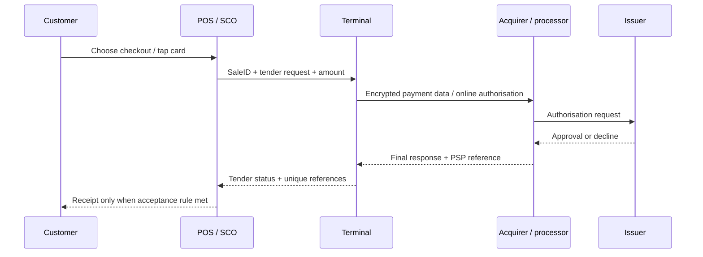
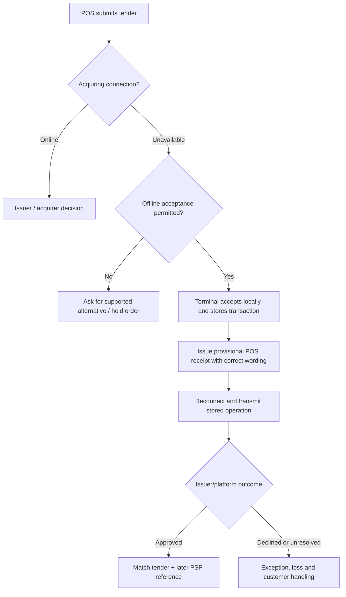

# 8A. Card-present, POS integrations and offline payment risk

**Part II — Payment Products & Infrastructure** · **Estimated study time:** ~20 minutes · **Prerequisites:** [Wallets and QR](08-wallets-qr-apms.md), [payment lifecycle](../part-1/03-card-payment-lifecycle.md) · **Source review:** 16 November 2026 · **Status:** Working draft

> **Guiding question:** A shopper walks out with goods while the terminal is offline. Has the retailer been paid?

## Learning outcomes

Map the terminal–POS–acquirer journey, distinguish card-present from card-not-present authentication, explain offline EMV versus store-and-forward, reconcile tender references with later PSP references, and set product guardrails for in-store acceptance.

## 8A.1 Three systems, three notions of success

A cashier's **sale** belongs to the POS. A **tender** is a payment method and attempt associated with that sale. A terminal can report **accepted locally**, while issuer approval and settlement are still outstanding. The store's inventory and receipt systems may already have moved on.

In **card-present** acceptance the merchant relies on terminal capabilities, EMV chip/contactless interfaces and cardholder-verification methods (CVM); those are different from online EMV 3DS used for many ecommerce transactions. A QR scan that conveys shopper identity, vouchers or loyalty points is **not necessarily** a payment authorization. Record each type of intent independently.

## 8A.2 Terminal payment states belong in the product model

At minimum model: `POS_TENDER_CREATED`, `TERMINAL_SENT`, `ONLINE_APPROVED`, `ONLINE_DECLINED`, `OFFLINE_ACCEPTED_UNCONFIRMED`, `OUTCOME_UNKNOWN`, `SETTLEMENT_PENDING`, `SETTLED`, `REVERSED/REFUNDED`, `RECON_EXCEPTION`. These names are **illustrative**, not standardized EMV or PSP event values.

A POS retry after a timeout is dangerous: the terminal may already have accepted the request. Requery or reconcile using stable tender IDs rather than generating a new payment. The POS can be online while the terminal's acquiring path is down, and vice versa.

### When the store loses connectivity

Adyen describes two distinct modes: **offline EMV** (under permitted card/terminal rules) and **store and forward** (store a transaction for later authorization). A local acceptance **does not necessarily guarantee issuer approval or funds**. There are method, amount, device and provider restrictions; not all QR/local methods support them. [Adyen — Offline payments](https://docs.adyen.com/point-of-sale/offline-payment).

For a store-and-forward attempt, **terminal tender reference** may exist before a **PSP reference** is issued. Reconciliation must match the two after reconnection. Disabling offline mode may increase queues and abandonment; enabling it may shift credit/fraud exposure onto the merchant. This is a **risk-approved business decision**, not a feature toggle controlled solely by PM or store staff.

## 8A.3 Omnichannel edge cases

| Situation | Distinguish | PM requirement |
|---|---|---|
| Scan & Go cart transferred to staffed POS | Cart transfer ≠ payment acceptance | One commercial order ID; separate tender attempts; correct stock decrement |
| Self-checkout scanner times out | Item scan ≠ checkout complete | Resumable checkout state and clear duplicate-sale prevention |
| Terminal approves but POS acknowledgment is lost | Money intent ≠ order state | Recovery by terminal reference; never blindly charge again |
| Mixed tender (voucher + card) | Voucher redemption ≠ card capture | Atomic accounting or explicit reversal/compensation on failure |
| Cashier requests refund offline | Refund initiated ≠ bank credit | Supported terminal flow, permission control, reference to original tender |
| Store returns item bought online | Merchant acceptance architecture differs | Cross-channel refund policy and original instrument traceability |

## 8A.4 Worked product choice: offline sales at a supermarket

**Fictional**: During a 40-minute outage a store has 80 attempted S$30 card transactions. Rejecting offline risks S$2,400 of immediate sales, though not every shopper would leave. Accepting offline might preserve sales but carries **nonzero** eventual issuer-decline exposure and operational reconciliation cost. A PM must not equate S$2,400 with incremental profit or assume the fraud loss is zero. Use historical queue abandonment, gross margin, supported card/terminal limits and risk appetite to define a safe rule.

Proposed policy ingredients: eligible card schemes; per-tender and per-terminal monetary limits; automatic fallback to cellular where permitted; receipt language; store operator visibility of unconfirmed tender count; no offline cashbacks; escalation and daily reconciliation. These are candidate controls, not provider defaults.

## 8A.5 What should the PM measure?

- Tender completion by store/terminal/entry mode; `offline_accepted` as a **separate** numerator from confirmed issuer approvals.
- Unknown tender aging; total offline exposure and forward-retry failures.
- Customer queue time, abandoned baskets, and mixed-tender compensation failures.
- Terminal online availability, p95 tender latency, POS-to-PSP event mismatch and refund traceability.

## Exercise and answer check

**Question:** A terminal displays an offline receipt but the POS has no PSP reference. Should the PM mark this tender `SETTLED`?  
**Answer:** No. Retain the terminal/tender reference and a provisional state, then wait for the documented forwarding outcome, issuer response and settlement evidence. Reconcile later with the provider and correct the customer/merchant outcome if the offline attempt is rejected.

**Next:** [9. Bank transfers, instant payments and BNPL](09-transfers-real-time-bnpl.md).

## Primary references

- [Adyen — Offline payments](https://docs.adyen.com/point-of-sale/offline-payment) (provider-specific; accessed 16 November 2026).
- [Adyen — Terminal API transaction references](https://docs.adyen.com/point-of-sale/design-your-integration/terminal-api) (provider-specific; accessed 16 November 2026).
