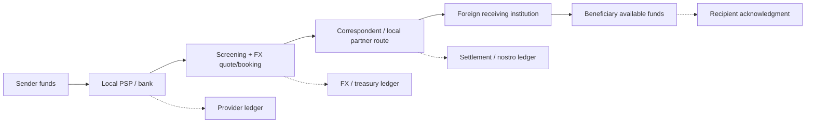

# 9A. Cross-border payments, FX, treasury and payouts

**Part II — Payment Products & Infrastructure** · **Estimated study time:** ~23 minutes · **Prerequisites:** [Bank transfers](09-transfers-real-time-bnpl.md), [payment economics](../part-1/04-payment-economics.md) · **Source review:** 16 November 2026 · **Status:** Working draft

> **Guiding question:** The provider says a cross-border payout is completed, but the recipient has not received their expected amount. Which question do you ask first?

## Learning outcomes

Distinguish remittance from merchant acquiring payouts, quote currency versus settlement currency versus recipient currency, describe FX spread and rate locks, trace liquidity and correspondent-bank dependencies, and build a payout-reconciliation and exception flow.

## 9A.1 A cross-border payment is not one atomic transfer

A cross-border journey may involve a local debit, exchange, compliance screening, one or more intermediary institutions, a foreign local rail, and final beneficiary credit. A **message sent** is not **funds available**. Different legal and operating models hold funds at different stages.

**Payment chain versus FX trade:** Some products guarantee the end-user's converted amount while treasury absorbs rate movement; others disclose a live floating conversion. The **payment** may still be pending after an **FX trade** is booked. Where FX counterparties exchange currencies, payment-versus-payment (PvP) arrangements reduce principal settlement risk. The BIS distinguishes PvP from other methods that only mitigate FX settlement risk. [BIS, June 2026](https://www.bis.org/publ/qtrpdf/r_qt2606c.htm).

## 9A.2 Define the money fields precisely

| Field | Example | What the PM must specify |
|---|---|---|
| Source amount/currency | SGD 100.00 | Gross amount debited from payer |
| Payer fee | SGD 2.00 | Included in or added to source amount? |
| FX quote | 1 SGD = 0.7400 USD | Source, timestamp, expiry, rounding |
| FX base | SGD 98.00 | Which amount is converted |
| Expected recipient amount | USD 72.52 | `98 × 0.74`, before possible beneficiary fees |
| Correspondent/intermediary fee | Unknown or quoted | Who bears it; guaranteed versus estimated |
| Rate-lock reference | FXQ-123 | Which event commits rate and creates exposure |
| Settlement/payout reference | POUT-123 | End-to-end correlation and finality proof |

All numbers are fictional. If the payer's SGD 100 includes a SGD 2 fee, the FX base is SGD 98. At 0.74 USD/SGD, USD 72.52 is the *calculated* result; if an intermediary may deduct fees, do not promise USD 72.52 received. Do not mix minor units or round prematurely.

**Rate-lifecycle product rules:** quote expires; source amount changes; bank screening delays; FX booking confirmed but outgoing transfer fails; target bank rejects beneficiary details; return arrives days later at a different rate; refund amount differs from original debit due to spread, fees or rate movement. All demand explicit policies and disclosures.

## 9A.3 Treasury is not an optional back-office detail

Money movement depends on **prefunding**, cash balances in each currency, intraday exposure, bank cutoff times, holidays, partner limits, reserve requirements, and whether a platform can net incoming/outgoing flows under its contracts. A PM should not promise instant payout if funds availability relies on a future bank credit or a partner's liquidity.

Ask finance/treasury: What balance is legally held by whom? When is it available? Do we pre-fund overseas accounts? What happens when currency liquidity is depleted at 4pm Friday? What provider/rail supports recall? Is the quoted FX rate valid at execution or at initiation? What does finance need to close daily books?

### Treasury worked example: liquidity versus payment obligations

**Fictional USD corridor; same-day figures:** An overseas payout account holds USD **40,000** in confirmed prefunding, and another USD **7,000** has been credited and is available. Treasury policy requires a USD **10,000** minimum buffer. The team has USD **45,000** of valid payouts due before cutoff.

- Available total: USD 40,000 + USD 7,000 = **USD 47,000**.
- Sendable under the buffer: USD 47,000 − USD 10,000 = **USD 37,000**.
- Uncovered due payouts: USD 45,000 − USD 37,000 = **USD 8,000**.

A functioning payment API cannot create the missing USD 8,000. The PM must define an `AWAITING_LIQUIDITY` status, escalation to treasury, permitted payout ordering (rather than arbitrary silent reprioritisation), revised customer ETA, and financial reconciliation. This is a teaching scenario, not a treasury policy recommendation.

### Payment transparency and FATF Recommendation 16

[FATF Recommendation 16's payment-transparency update of June 2025](https://www.fatf-gafi.org/en/publications/Fatfrecommendations/update-Recommendation-16-payment-transparency-june-2025.html) addresses originator and beneficiary information in payment messages. The applicable fields, checks and implementation timetable depend on the type of transfer, national implementation and regulated actors. Virtual-asset **Travel Rule** arrangements require separate assessment; do not assume one universal remittance payload. A Payments PM should make party-data validation, permissible disclosure, screening, record retention and exception handling testable acceptance criteria.

## 9A.4 Worked case: payout marked success before beneficiary credit

A fictional SG platform instructs a USD 500 payout. PSP returns `transfer_submitted`, correspondent reports `in_progress`, foreign bank rejects an account-name mismatch, and the original amount is later returned net of an allowed bank fee. A dashboard keyed only to the PSP submit event overstates success.

**PM-designed lifecycle** (illustrative): `created → validated → compliance_pending → funded → fx_booked → outbound_submitted → beneficiary_credited` or `rejected / returned / manual_review`. A return is **not the same** as a retryable timeout. Record each leg, exception reason, obligations and customer notification. Requote any second attempt only according to approved policy; never silently use a stale rate.

## 9A.5 Product decisions and observability

- **Customer outcomes:** beneficiary-confirmed credit rate; on-time availability; full-price disclosure; refund/return resolution.
- **Treasury outcomes:** liquidity shortfalls; funded-to-unfunded obligations; rate lock exposure and treasury losses.
- **Finance:** FX gain/loss attribution, bank statement match, missing fee items and unallocated returned funds.
- **Risk:** screening hit handling, sanctions obligations, beneficiary verification, prohibited countries/currencies and fraud.
- **Operations:** exceptions per corridor, oldest unresolved payout, partner ack delay and reconciliation cutoffs.

Use the [cross-border payout checklist](../../artifacts/cross-border-payout-checklist.md) to turn this into a launch/readiness review.

**The corridor is the unit of analysis.** A Singapore-to-India payout using one local partner cannot be assumed to behave like a Europe-to-UK payment. Cost, time, laws and returnability vary.

## Exercise and answer check

**Question:** The payout provider returns `processed` on Monday; the recipient says nothing arrived on Wednesday. Which records do you need before promising a refund?  
**Answer:** Contractual meaning of `processed`, local bank/partner references, settlement/FX and beneficiary confirmation or reject, cutoff calendar and return policy. Investigate the destination leg, not merely the API request. Avoid a duplicate send until the first attempt is reconciled.

**Exercises:** [Worked solutions](../../answers/chapter-exercises.md#09a-cross-border-fx-and-treasury) (companion answer key; review your reasoning before opening).

**Next:** [10. Checkout and payment state](../part-3/10-checkout-and-payment-state.md).

## Primary references

- [FATF — Recommendation 16 payment transparency update, June 2025](https://www.fatf-gafi.org/en/publications/Fatfrecommendations/update-Recommendation-16-payment-transparency-june-2025.html) (jurisdictional adoption differs).

- [FSB — G20 cross-border payment targets](https://www.fsb.org/work-of-the-fsb/financial-innovation-and-structural-change/cross-border-payments/g20-targets-for-enhancing-cross-border-payments-2/) (targets, not statements that every corridor meets them; accessed 16 November 2026).
- [BIS — FX settlement risk and PvP, June 2026](https://www.bis.org/publ/qtrpdf/r_qt2606c.htm) (FX wholesale context, not a retail remittance API specification).
- [MAS — Licensing for payment services](https://www.mas.gov.sg/regulation/payments/licensing-for-payment-service-providers) (Singapore only).
