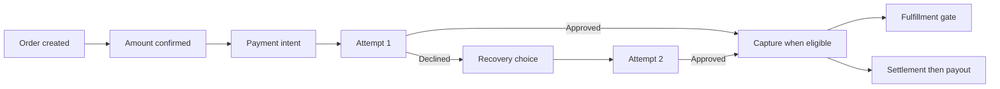

# 10. Checkout design: intent, payment state and customer experience

**Part III — Building Payment Products** · Prerequisites: Chapters 1–6, 8

> **Central idea:** Checkout joins a commerce obligation (an order) to a financial process (a payment). They are related but must not be represented by the same state machine.

## Learning outcomes

Explain why one order can have many payment attempts; diagram authorization/capture/confirmation; specify safe retries and customer messaging; understand what happens when promotion, inventory, tax or fulfillment changes the final amount.

## 10.1 Two journeys behind one Pay button

The **order** has a basket, prices, coupons, delivery option, tax, inventory commitments and fulfillment state. The **payment** has a method, a payment intent, one or more attempts, authorization, possible capture, settlement and subsequent refunds/disputes. A merchant may support a single payment for an order, multiple tenders, partial captures, deposits or late fulfillment. These models require different contracts.

*Simplified flow: an authorization can be followed by later or partial capture depending on the provider and business model.*

Never make `order.status=paid` solely because an authorization request was submitted. Define the authoritative event that permits fulfillment. A successful authorization can expire, a capture can fail or be partial, and funds may settle later. Conversely, a timed-out API call might have been approved by the issuer, requiring status reconciliation before retrying.

## 10.2 The amount is a product contract

A grocery order illustrates variable amount. Suppose the customer authorizes S$100, but an item is unavailable and the final bill is S$93. The merchant must determine what the PSP, scheme, issuer and applicable payment method support: partial capture, authorization adjustment, reversal, separate refund or re-authorization. The PM must ensure the receipt, banking statement, promotions, loyalty redemption and settlement records agree on which amounts are *estimated*, *authorized*, *captured* and *refunded*.

With multiple tenders (voucher + card + points), model **funding components** separately. If a card charge fails, should the voucher reservation be released? If an order is partially cancelled, in what order are instruments refunded? This is a product and finance-policy decision, not merely UI copy.

## 10.3 Error handling as a customer journey

| Payment result | Customer interface | Backend recovery |
|---|---|---|
| Definitive issuer decline | Explain unsuccessful attempt without exposing risk rules; allow eligible alternative | Preserve response category, no blind replay |
| Technical timeout / unknown | “Checking payment status” rather than “Failed” | Query authoritative provider status; wait for events; reconcile before new attempt |
| 3DS challenge interrupted | Offer safe resume or new approved attempt only when status resolved | Restore challenge session and idempotency context |
| Authorized, capture pending | Confirm the current contractual state accurately | Follow capture SLA; alert stuck funds/order states |
| Duplicate callback | No duplicate success, refund or fulfillment | Idempotent event handling by stable keys |
| Split-tender partial failure | Explain which component is held or released | Compensating action for uncompleted tenders |

Idempotency is not a universal magic header. Read provider-specific scoping and retention guarantees, and ensure *your own* systems deduplicate fulfillment, capture, voucher application and refunds.

## 10.4 Metrics a Payments PM should own

Track the full journey: checkout start → order total confirmed → payment intent created → payment method selection → authentication if needed → authorization response → successful capture or final paid-order confirmation. Use **unique orders** and **individual payment attempts** as separate units. One customer retrying three cards can produce three attempts but one paid order.

Balanced metrics include: paid-order conversion, unique-order payment success, authorization approval, 3DS completion, recovery success, timeout/unknown-state share, payment confirmation latency, duplicate capture incidence, customer complaints, processing cost per paid order, fraud loss and reconciliation exception rate. Apply an appropriate mature observation window to delayed metrics.

## 10.5 PM exercise: partial grocery fulfillment

A customer sees S$60 at checkout, applies a S$10 coupon and pays with a card plus S$5 loyalty points. One item is removed after picking. Define: the revised amount and funding allocation; when and how to restore points; the customer receipt; capture/refund behavior; and what finance should reconcile. Include a merchant and provider failure state at every transition.

**Next:** [10A. Subscriptions and dunning](10a-subscriptions-stored-credentials-and-dunning.md).

## Further reading

- [Adyen — Payment lifecycle](https://docs.adyen.com/account/payments-lifecycle)
- [Stripe — Payment Intents](https://docs.stripe.com/payments/payment-intents)
- [Stripe — Idempotent requests](https://docs.stripe.com/api/idempotent_requests)
