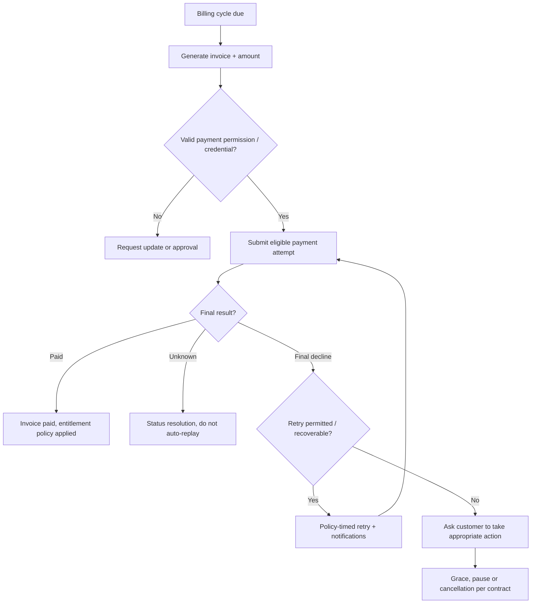

# 10A. Subscriptions, stored credentials and dunning

**Part III — Building Payment Products** · **Reading time:** ~21 minutes · **Prerequisites:** [Checkout state](10-checkout-and-payment-state.md), [network tokens](../part-2/07a-network-tokenization-fpan-dpan.md), [3DS](11-3d-secure.md) · **Source review:** 16 November 2026 · **Status:** Working draft

> **Guiding question:** A subscription is overdue. Should you retry the card, pause the service, ask for authentication, or cancel the contract?

## Learning outcomes

Distinguish customer-initiated transactions from merchant-initiated transactions (CIT/MIT), model invoice versus payment states, design safe retry and dunning strategies, and measure recovery without hiding involuntary churn or fraud cost.

## 10A.1 A subscription consists of several state machines

The **commercial contract** defines what the customer agreed to buy. The **billing ledger** defines which invoice is due. The **payment state** records the attempted financial operation. The **service entitlement** decides whether the product remains available. A single `subscription_active` flag cannot safely replace all four.

## 10A.2 Stored credentials are not unlimited future consent

A card saved for a **customer-initiated** one-click purchase is not automatically authorization to bill an unrelated subscription. For recurring billing, capture and document the mandate/terms, initial authentication where applicable, subsequent credential-on-file indicators, scheme rules, cancellation and notice requirements. Provider implementations differ.

Adyen distinguishes `CardOnFile` (one-click shopper initiated), `Subscription` (scheduled merchant initiated) and `UnscheduledCardOnFile` (event-based top-ups) flows. Do not treat those classifications as universal JSON fields across all PSPs. [Adyen — Token payments](https://docs.adyen.com/online-payments/tokenization/make-token-payments).

A network token may improve credential continuity after card reissue, but cannot make a cancelled mandate valid. A provider vault token is a credential reference, not legal consent; 3DS authentication and issuer authorization remain distinct.

## 10A.3 Designing a legitimate recovery policy

A decline can be **permanent**, **transient**, **requires customer action** or **ambiguous**. Blind periodic retries can create fees, issuer risk signals and confused customers. For a candidate recovery rule, define: eligible decline categories; applicable scheme and provider limits; maximum attempts/time; backoff; issuer instructions; idempotency and re-query policy; when customer authentication is needed; notification/consent; and cancellation/grace logic.

**Dunning** combines payment recovery with respectful communication: an upcoming expiration notice, failure notice, payment-method update, optional grace period, and final service status. A PM should distinguish a cardholder updating billing details from merchant automation retrying without the cardholder present.

## 10A.4 Worked cohort and metric design

**Fictional monthly cohort:** 1,000 invoices become due. On the first due-date attempt, 900 invoices are paid, 60 decline with final results, and 40 remain temporarily unresolved. The **first-attempt paid-invoice rate** is 90% of all due invoices, not necessarily the same as card authorization rate. After approved, properly controlled recovery, 30 of the 60 declined invoices and 35 of 40 unknowns later end as paid; five unknowns remain unresolved. The **eventual paid-invoice rate** is `(900 + 30 + 35) / 1000 = 96.5%`. Confirm that the 35 unknowns did not become double payments through duplicate retries.

Do not compare a 30-day matured recovery cohort against yesterday's due invoices. State the observation window and invoice-cancellation rules.

| Metric | Operational definition | Guardrail |
|---|---|---|
| Involuntary churn | Subscriptions lost due to collection failure / eligible renewals | Do not count voluntary cancellations as failures |
| Matured invoice collection | Paid invoices by defined age / invoices due in same cohort | Credit notes and partial payments defined |
| Recovery incremental lift | Controlled uplift versus eligible holdout, per invoice | Fraud, retries, provider fees, complaints |
| Payment attempts per recovered invoice | Eligible attempts / subsequently paid invoices | Prevent looping non-retryable declines |
| Outstanding receivables | Open invoice value by age and currency | Separate unresolved technical payment outcomes |

## 10A.5 PM deliverables and edge cases

- **PRD:** billing/calendar semantics (time zones, month-end, DST), proration, invoice adjustment, retries, cancellation/grace, entitlement and support exceptions.
- **API requirements:** `subscription_id`, `invoice_id`, payment operation IDs, credential permission and renewal references; deduplicate webhooks and ensure exact one paid-invoice transition.
- **Risk checks:** cloned cards, customer-initiated verification, request validity, amount caps, excessive retries, authorization code classifications and scheme obligations.
- **Customer UX:** clear next collection date and amount; access to cancellation; accurate “payment pending” versus “payment unsuccessful”; payment method update flows.

## Exercise and answer check

**Question:** A processor times out after charging a recurring S$25 invoice. The scheduler runs again. Should it create a new authorization?  
**Answer:** Not based solely on the timeout. Resolve the first operation via permitted status queries and callbacks using a durable invoice/attempt reference, then determine whether a fresh attempt is allowed. An invoice being unpaid in your ledger does not prove the payment never succeeded at the processor.

**Next:** [11. EMV 3-D Secure](11-3d-secure.md).

## Primary references

- [Adyen — Stored-payment tokenization](https://docs.adyen.com/online-payments/tokenization) (provider-specific; accessed 16 November 2026).
- [Adyen — Make token payments and distinguish CIT/MIT](https://docs.adyen.com/online-payments/tokenization/make-token-payments) (provider-specific; accessed 16 November 2026).
