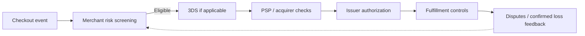

# 13. Payment fraud, risk decisions and controls

**Part III — Building Payment Products** · Prerequisites: Chapters 3, 5, 10, 11 and 12

> **Central idea:** A risk engine should reduce expected losses without rejecting too many legitimate customers. A Payments PM rarely owns the fraud model in isolation but must own the product consequences of its decisions.

## Learning outcomes

Separate merchant fraud decisions, 3DS authentication, issuer authorization and post-transaction disputes; recognize common risk controls; define false-positive trade-offs and guardrails; and design a reviewable rule rollout.

## 13.1 Several layers, several decision makers

Merchant-side risk checks may occur before payment, after authorization but before fulfillment, or during account activity. Acquirers and PSPs may apply their own acceptance and monitoring rules. 3DS gives the issuer authentication context for online payments; issuer authorization uses account, network, velocity and risk signals. Subsequent chargebacks or account abuse provide feedback—but with a delay.

*A teaching simplification; screening order and ownership vary by provider, merchant model and geography.*

## 13.2 What risk rules might observe

Examples include unusually high transaction amount, multiple new cards used from one account, rapid payment retries, unfamiliar geography or device, inconsistent address data, account age and abnormal voucher redemption. These are **risk signals, not proof of wrongdoing**. The same signal can describe legitimate travel, family accounts, promotion spikes or a system retry loop.

Possible actions include allowing, requiring an eligible authentication step, manually reviewing, delaying fulfillment, declining under approved policy or requesting more information. The PM should document which actor may make each decision and under what regulatory, network, privacy and internal-risk constraints.

## 13.3 Why approval rate alone is dangerous

Suppose an extra filter prevents S$8,000 of modeled fraud loss monthly but blocks S$50,000 of legitimate expected gross margin. Without considering costs, recovery pathways, customer lifetime value and confidence in the loss model, calling the filter a success is misleading.

A high-level decision framework compares expected value across **legitimate approvals**, **fraud losses**, **operational review costs**, **customer friction** and **downstream disputed transactions**. Fraud labels mature slowly and can be biased by which transactions were allowed to proceed. “Blocked orders had no chargebacks” is not evidence that all blocked orders were fraudulent.

## 13.4 Rule experimentation and governance

A safe rollout plan specifies: target cohorts, eligibility constraints, approval owner, start and stop dates, expected incremental risk, protected user groups, monitoring, escalation, and rollback criteria. Test in shadow mode where meaningful, compare like-for-like segments and keep a rollback path. Avoid exposing detailed rules to attackers through error messages or customer support templates.

Useful measures: confirmed fraud loss per value and per transactions, review precision where labels exist, false-decline proxies, manual review latency, 3DS challenge share and completion, issuer approval rate, successful paid orders, chargebacks after maturity, repeat customer contacts, and support escalations.

## 13.5 Case: sudden spike in failed payments

The commerce team sees a higher decline rate after a risk rules release. Investigation should distinguish: blocked *before* PSP submission, 3DS challenges abandoned, PSP/acquirer rejections, issuer declines and unknown technical outcomes. A single “payment failure” category collapses distinct causes and makes rollback unsafe. The PM should request a segmented event map and data-quality verification before changing policy.

**Exercise:** Propose a review policy for a first-time, high-value cross-border card payment. Identify eligible actions, required collaboration with risk and compliance, two user-experience guardrails, and how you'd measure false-positive harm over time.

### Dated Singapore case — Shared Responsibility Framework (effective 16 December 2024)

The [MAS/IMDA Shared Responsibility Framework guidelines](https://www.imda.gov.sg/-/media/imda/files/regulations-and-licensing/regulations/consultations/2024/shared-responsibility-framework-for-phishing-scams/guidelines-on-shared-responsibility-framework.pdf) set out duties for specified banks/payment-account issuers and telecom providers relating to defined **seemingly authorised phishing-scam transactions**. Their loss-responsibility model is **not a blanket rule for every scam or every payment rail**. The guidelines specifically state that the SRF liability-sharing framework does **not** apply to transactions using credit, charge and debit cards issued in Singapore, which have other protections.

**Product implications:** define scam type, protected-account eligibility, event audit trail, customer-reporting and blocking paths, notification controls, and specialist review of any responsibility/allocation policy. **Do not** map a card chargeback rule onto bank transfer scam remediation simply because both involve losses. Source checked 16 November 2026; consult MAS/IMDA for current updates.

**Exercises:** [Worked solutions](../../answers/chapter-exercises.md#13-fraud-risk-and-payment-controls) (companion answer key; review your reasoning before opening).

**Next:** [13A. Compliance and control ownership](13a-compliance-and-control-ownership.md).

## Further reading

- [EMVCo — 3-D Secure](https://www.emvco.com/emv-technologies/3-d-secure/)
- [Adyen — Risk management overview](https://docs.adyen.com/risk-management/)
- [Stripe — Radar documentation](https://docs.stripe.com/radar)
