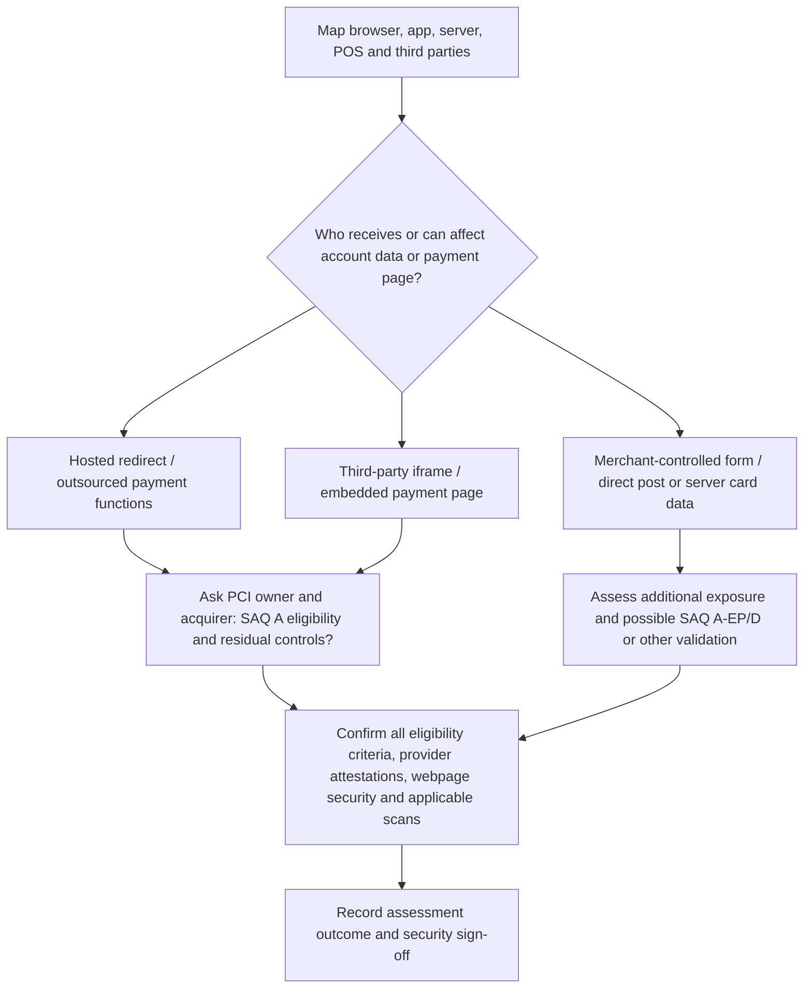
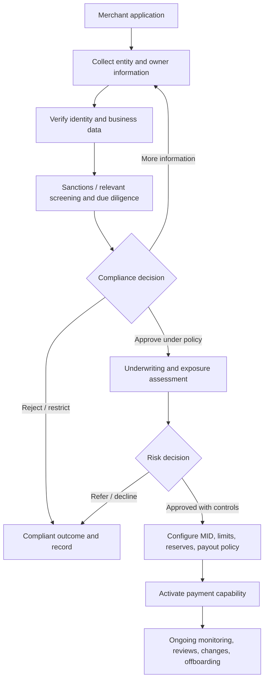

# 13A. Compliance and control ownership for Payments PMs

**Part III — Building Payment Products** · **Estimated study time:** ~30 minutes · **Prerequisites:** [Merchant acquiring](../part-2/05-merchant-acquiring.md), [checkout state](10-checkout-and-payment-state.md), [fraud controls](13-fraud-risk-and-payment-controls.md)  
**Editorial status:** Working draft, 16 November 2026. Regulatory/standards examples below are dated, jurisdiction-specific and require legal, compliance and security review; they are **not a compliance determination**.

> **Guiding question:** Before the team ships a faster payment or onboarding experience, can the PM identify who is legally responsible, what data the product touches, which controls are mandatory, and which evidence must survive an audit?

## Learning outcomes

After this chapter, you should be able to:

1. Separate **legal/regulatory accountability**, **scheme and PCI obligations**, **contractual allocation**, and **day-to-day product delivery**.
2. Trace how a change from hosted payment pages to merchant-controlled fields changes PCI questions; avoid asserting that a hosted integration or PayFac arrangement automatically eliminates obligations.
3. Design a merchant-onboarding journey that can support customer/business due diligence, underwriting and ongoing monitoring without confusing these separate decisions.
4. Produce a control-ownership matrix, evidence checklist and release gates for a concrete payment feature.
5. Explain when the answer belongs to the compliance/security owner—not to the PM.

## 13A.1 Compliance is a product dependency, not a feature checkbox

A PM may build onboarding, payment forms, authorization routing and transaction monitoring. Those interfaces can *collect the evidence used by control owners*, but they do not give the PM authority to change legal obligations. Keep these four levels distinct:

| Level | Example | Who normally interprets/approves? | PM responsibility |
| --- | --- | --- | --- |
| Law and regulation | Which payment services require a licence; AML/CFT measures for covered activities | Legal, regulatory compliance, licensed entity management | Define product scope early; capture regulator/jurisdiction and deadline; design workflows/evidence |
| Card and payment-network rules | Scheme restrictions, dispute timeframes, acceptance conditions | Scheme/acquirer specialists, legal, compliance | Build eligibility, deadlines, reporting and change governance into the product |
| Data/security standard | PCI DSS responsibilities for cardholder data and payment pages | Security/PCI specialist, acquirer and qualified assessor as applicable | Document data flow, third-party dependencies, logging and change controls |
| Contract and product policy | Provider indemnities, reserves, payout holds, risk appetite | Business owner, finance, risk, legal and partner | Express approved rules in API contracts, user journeys, acceptance criteria and dashboards |

**Decision principle:** *delegating a control's execution* (for example to a PSP) does not necessarily delegate the regulated entity's accountability. A contract, PCI attestation or third-party certificate is evidence for assessment—not proof that every obligation has been transferred.

### Which kind of Payments PM are you?

A merchant's checkout PM, a PayFac onboarding PM, an issuer PM and a bank transfer PM have materially different obligations and contacts. Before drafting requirements, document **legal entity**, **jurisdictions**, **service classification**, **customer/merchant relationship**, **merchant of record**, **who touches funds**, **who holds cardholder data**, **third-party processors**, and **the authoritative compliance owner**.

A payment feature can cross boundaries. A marketplace accepting card payments, onboarding sellers and controlling seller payouts might have obligations different from a retailer selling its own inventory even when the front-end checkout looks identical.

## 13A.2 PCI DSS scope: architecture changes your questions

PCI DSS is a payment-card data security standard; its precise scope, validation method and applicability depend on the actual card-data environment, payment channel, payment-brand/acquirer instructions and the current version. **Do not choose an SAQ category by reading a marketing description of a PSP integration.**

### A simplified card-data-flow decision map

These are **questions**, not an SAQ decision tree. Point-of-sale, mail/telephone order, service providers and mixed-channel businesses require separate scoping. Tokenization also does not automatically remove systems from scope when they can access account data or affect payment security.

| Design pattern (illustrative) | What the PM should ask | Mistake to avoid |
| --- | --- | --- |
| Redirect to PCI-compliant provider | Who controls/maintains the redirect page and associated scripts? How is tampering detected? | “We redirect, so our website has no PCI obligations.” |
| Embedded iframe or provider fields | Do all payment-page elements originate from compliant third parties? What protects the merchant page and its scripts? | “An iframe always means SAQ A.” |
| Merchant-created forms/direct post | Can merchant-originated code affect collection/transmission? What validation category applies? | “The merchant server never sees the PAN, so there is no security impact.” |
| Server-side PAN processing | What systems, logs, caches, support tools, and backups receive account data? | “The gateway tokenizes it later, so the raw-data path is irrelevant.” |
| PSP vault token or network token | What token, detokenization and payment authorization permissions exist? Where can a token be replayed? | “A token removes every security and consent obligation.” |

**Dated primary-source anchor — PCI DSS v4.0.1 (checked 16 November 2026):** PCI SSC's [SAQ A FAQ #1588](https://www.pcisecuritystandards.org/faqs/1588/) clarifies the e-commerce script-related **eligibility criterion** for embedded provider pages/forms and distinguishes redirects. PCI SSC's [FAQ #1604](https://www.pcisecuritystandards.org/faqs/1604/) explains that SAQ A merchants with eligible e-commerce webpages, including redirects and iframes, still have applicable scanning responsibilities. See also the [PCI SSC's 2025 explanation](https://blog.pcisecuritystandards.org/faq-clarifies-new-saq-a-eligibility-criteria-for-e-commerce-merchants). Eligibility must be confirmed against the current complete SAQ, applicable payment-brand/acquirer requirements and specialist advice.

### A launch-ready PCI evidence checklist

- Data-flow diagram for browser, mobile SDK, back-end, POS, provider, logs and support tools; include boundaries and applicable card-data classifications.
- Provider compliance evidence for the *specific service used* and integration configuration; renewal owner and due date.
- Documented assessment/SAQ route and acquirer or assessor confirmation as applicable; unresolved scope questions tracked.
- Payment-page integrity controls, vulnerability scanning and change-control evidence as applicable to the assessed environment.
- Least-privilege access, secrets rotation and redacted telemetry; never log PAN, CVV or cryptographic secrets into analytics.
- Incident notification and processor exit/credential portability arrangements where relevant.

## 13A.3 KYB, KYC, AML and underwriting are different decisions

**KYC/KYB and customer due diligence** establish who the customer/business and beneficial owners are, and support risk assessment, screening and ongoing monitoring under applicable rules. **Merchant underwriting** estimates potential credit, fraud, fulfilment, refund and dispute exposure. **Product activation** then makes permitted capabilities available. They can share an onboarding journey and documents, but one approved outcome does **not** prove the others.

The ordering is illustrative. Screening, enhanced due diligence, service activation and monitoring can involve repeated stages. A PM should *not* hard-code a universal customer-verification document list, beneficial ownership threshold, sanctions process or suspicious-activity disclosure behavior.

**Dated source anchors (checked 16 November 2026):** The [FATF Recommendations](https://www.fatf-gafi.org/en/publications/Fatfrecommendations/Fatf-recommendations.html) were updated in June 2026 and frame global AML/CFT standards implemented differently by jurisdictions. In Singapore, [MAS describes the Payment Services Act framework](https://www.mas.gov.sg/regulation/payments); [MAS Notice PSN01](https://www.mas.gov.sg/regulation/notices/psn01-aml-cft-notice---specified-payment-services) includes CDD, recordkeeping, suspicious-transaction reporting, internal controls and other AML/CFT requirements for specified payment services. These do **not** apply identically to every merchant, provider or product. Legal/compliance determines the applicable notices and obligations.

### PM-designed merchant-onboarding states

An onboarding state model is better than a single `kyc_passed=true`:

| Product state | Meaning | UX / operations consequence |
| --- | --- | --- |
| `DRAFT` | Merchant has not submitted all required information | Save/resume; no claims of approval |
| `SUBMITTED` | Application received; checks may be asynchronous | Show expected next step, not fictitious instant approval |
| `NEEDS_INFORMATION` | Specific missing or unverifiable evidence | Clear, permitted request; preserve history and deadlines |
| `UNDER_REVIEW` | Compliance/risk evaluation underway | Avoid disclosing internal screening logic; support status access |
| `APPROVED_WITH_CONTROLS` | Approved subject to configured restrictions | Disclose permitted limits/settlement constraints appropriately |
| `REJECTED` | Final application decision under approved policy | Permitted communication and appeal/retention handling; no activation |
| `ACTIVATING` | Provider setup requested, response not yet final | Show activation pending; do not accept payments before readiness confirmation |
| `ACTIVATION_EXCEPTION` | Provider setup failed or returned unknown outcome | Reconcile provider reference, escalate, recover idempotently; do not falsely mark active |
| `ACTIVE` | Required checks and integration enablement complete | First-transaction monitoring begins |
| `RESTRICTED` / `OFFBOARDED` | Control action or termination | Protect existing balances, refunds, disputes and record retention |

**Do not automatically show exact internal sanctions screening results or suspicious-transaction reports to users**; communications must follow compliance advice and applicable law.

**Companion artifact:** The [merchant-onboarding PRD with compliance and underwriting gates](../../artifacts/sample-prd-merchant-onboarding-controls.md) turns this state model into requirements, transitions and acceptance criteria. It is a teaching example, not a statement of any provider's or regulator's requirements.

## 13A.4 Limits, holds and reserves are product behavior

For an acquirer or PayFac, underwriting may lead to settlement delays, rolling reserves, payout minimums, transaction amount caps, exposure limits or extra review. Not every arrangement uses a merchant deposit, and these controls have distinct purposes. Define the unit and enforcement point explicitly:

| Control | Example unit | Enforcement question | Owner |
| --- | --- | --- | --- |
| Maximum single transaction | S$ per authorization | Reject pre-authorization, refer or limit at processor? | Underwriting + engineering |
| Monthly processing threshold | Approved or captured volume / month | Does it block further capture, trigger review or change pricing? | Risk policy + operations |
| Rolling reserve | Percentage of eligible settlements withheld over a time window | How is withheld balance reported and released? | Finance/treasury + risk |
| Payout delay | Business days after eligible settlement | Which cutoff, currency and holiday calendar apply? | Finance/treasury + provider |
| High-risk merchant review | Event/threshold | Is there a safe grace period and escalation path? | Compliance/risk |

**Fictional example:** HarborCart Marketplace is onboarding a seller with delayed fulfilment. Risk requires a 10% reserve on *eligible settled proceeds* for a defined duration. A PM must specify eligibility exclusions, held amount, release logic, exception visibility, currencies, dispute offsets, seller messaging, and finance reconciliation. Merely setting `reserve_percent=10` does not define a working product.

## 13A.5 A control-ownership matrix that survives launch

Create one row per **control obligation**, not one row per team:

| Control | Accountable specialist | PM deliverable | Evidence to retain | Release gate |
| --- | --- | --- | --- | --- |
| Payment-page security scope | Security / PCI owner | Browser-to-PSP data flow and integration constraints | Approved scope and provider evidence | No unresolved scope questions |
| Merchant identity and ongoing monitoring | Compliance | Intake, document status, re-review UX, data retention controls | Decision trail with restricted access | Applicable CDD flow tested |
| Exposure/reserve setting | Underwriting / risk; finance on cash control | Parameter semantics, merchant messages, override workflow | Rule version and approval history | Limits/holds reconciled |
| Card disputes and scheme deadlines | Scheme/acquirer operations | Evidence UX, alerting, workflow transitions | Case timestamps and submitted evidence | Deadline workflow dry run |
| Customer notification and complaints | Legal/compliance + support policy | Permitted communications and escalation | Templates and delivery/consent logs | Support and legal approval |

The PM owns implementation clarity and cross-team readiness, not universal regulatory sign-off. For new markets, repeat the scope assessment rather than copying an existing launch checklist.

## 13A.6 Release gates and operational acceptance criteria

A compliance-dependent launch should include **fail-closed rules** where required, but must also give teams and customers truthful recoverable states. Example acceptance criteria:

1. A merchant cannot activate a payment method until the applicable compliance and underwriting approvals for that merchant/entity/market are recorded.
2. Any approval override has an authorized actor, reason, timestamp, policy version and immutable audit trail.
3. Reserves, payout holds and refunds are represented by **separate signed financial events** that finance can reconcile; they do not silently modify sales.
4. Missing external-screening responses produce a controlled pending state—not an inferred pass.
5. A provider outage does not expose sensitive screening outcomes through front-end errors or support logs.
6. Compliance owns approval of retention/deletion rules and accesses a tested evidence export.

Use the [control-ownership template](../../artifacts/compliance-control-ownership-matrix.md) before integrating a new PSP, payment method or merchant market.

## 13A.7 Exercise and answer guidance

**Scenario:** HarborCart currently redirects shoppers to a PSP-hosted payment page. The UX team proposes embedding a provider iframe and adding a merchant-controlled script to improve checkout personalization. The acquiring team also wants instant seller activation. As PM, what do you do before committing to dates?

**Answer guidance:** Map the complete browser/script/payment data flow; ask the PCI owner/acquirer to re-evaluate SAQ eligibility and required controls, referencing the current PCI SSC criteria. Split seller verification, compliance decision, underwriting and payment activation into independent states. Request responsible specialists' approval for screening, data retention, underwriting limits, exception handling and launch conditions. Preserve customer-conversion goals without asserting control decisions yourself.

**Exercises:** [Worked solutions](../../answers/chapter-exercises.md#13a-compliance-and-control-ownership) (companion answer key; review your reasoning before opening).

> **Dated PCI source note (16 November 2026):** [PCI SSC FAQ 1588](https://www.pcisecuritystandards.org/faqs/1588/) clarifies a specific PCI DSS v4.0.1 SAQ A embedded-payment-page script eligibility criterion. It does **not** establish blanket SAQ A eligibility; confirm the full environment and applicable controls with the acquirer/assessor. See the [primary-source audit](../../editorial/primary-source-audit-2026-11-16.md).

**Next:** [13B. Scam protection and regulation](13b-scams-and-regulatory-map.md).

## Further reading — authoritative starting points

- [PCI SSC — SAQ A FAQ on script eligibility](https://www.pcisecuritystandards.org/faqs/1588/)
- [PCI SSC — SAQ A and vulnerability scanning](https://www.pcisecuritystandards.org/faqs/1604/)
- [FATF — Recommendations (June 2026 version)](https://www.fatf-gafi.org/en/publications/Fatfrecommendations/Fatf-recommendations.html)
- [MAS — Payment Services Act and payment regulation](https://www.mas.gov.sg/regulation/payments)
- [MAS — Notice PSN01](https://www.mas.gov.sg/regulation/notices/psn01-aml-cft-notice---specified-payment-services)
