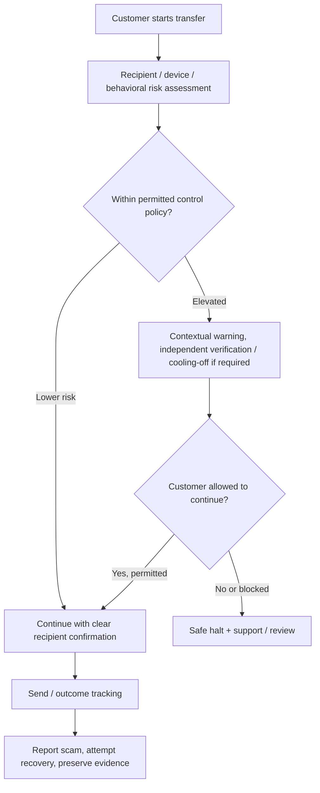

# 13B. Scam protection and a jurisdictional regulation map

**Part III — Building Payment Products** · **Reading time:** ~19 minutes · **Prerequisites:** [Risk controls](13-fraud-risk-and-payment-controls.md), [compliance ownership](13a-compliance-and-control-ownership.md) · **Source review:** 16 November 2026 · **Status:** Working draft

> **Guiding question:** A payment can be properly authorized and still be a scam. What can the product prevent, and who is responsible for the customer's loss?

## Learning outcomes

Distinguish unauthorized-payment fraud from authorized-push-payment (APP) scam patterns; design interventions that preserve legitimate access; map product features to legal/scheme/provider obligations; and avoid applying Singapore guidance globally.

## 13B.1 Not every scam looks like a stolen-card transaction

| Situation | Payment state | Customer's understanding | Product implications |
|---|---|---|---|
| Stolen card CNP purchase | May be cardholder-unapproved | Cardholder did not make purchase | Authentication, fraud signals, dispute routes |
| APP scam / social engineering | Payer may initiate valid bank transfer | Payer deceived about recipient/purpose | Beneficiary checks, warnings, cooling-off, recovery escalation |
| Account takeover | Attacker controls channel/account | Legitimate user did not intend transfer | Account recovery, device/session controls, transaction limits |
| Refund scam / fake support | Customer persuaded to pay or reveal credentials | Misrepresented counterparty | Report flow, verified support channels, communication |

**Fraud indicators are not proof of criminal behavior.** More prompts can stop some losses but also block vulnerable or unfamiliar customers. A PM must measure scam loss **and** false blocks, complaint outcomes, accessibility and customer support burden.

## 13B.2 Build a protection journey, not merely a blocking rule

Design intervention choices with risk/legal approval: beneficiary-name confirmation where available, new-payee friction, unusually large transfer thresholds, device-change protection, time-limited hold for specific approved circumstances, accessible emergency reporting and trusted callback channels. Avoid promising recall/funds recovery on irreversible rails.

## 13B.3 Singapore anchor: the Shared Responsibility Framework

**As of 16 November 2026:** Singapore MAS describes the **Shared Responsibility Framework (SRF)** for a **defined scope of phishing scams**, assigning duties to financial institutions and telcos and an investigation workflow. **Do not extrapolate it to every scam, merchant payment, wallet or QR transfer.** Eligibility and liability depend on the current legal guidance and facts. See the [MAS scam protection overview](https://www.mas.gov.sg/regulation/combatting-scams) and [MAS payments regulation](https://www.mas.gov.sg/regulation/payments).

A product requirement should specify: whether the institution is within the framework; applicable consumer channels and scam types; mandatory controls and reporting; documented investigation/appeal process; data and escalation retention; and who may decide on remediation. Policy interpretation belongs to compliance/legal.

## 13B.4 Regulatory scoping is a product discovery task

For a new payments capability, create an **activity-by-jurisdiction matrix**, rather than choosing a licence label from the API vendor's brochure.

| Product change | Questions to investigate | Product deliverable |
|---|---|---|
| Launch a Singapore consumer wallet | Are we issuing an account or e-money? Who safeguards balances? | Licensed-entity and funds custody map |
| Merchant acquiring | Who processes merchant receipts and underwrites merchants? | Provider/merchant responsibility matrix |
| Cross-border remittance | Are we facilitating inbound/outbound transfers or only providing software? | Currency/corridor partner and licence map |
| Card-on-file recurring checkout | Which merchant, scheme and authentication obligations apply? | Stored-credential consent and retention map |
| AI shopping agent | Who is credential provider, agent, MoR and regulated PSP? | Explicit authorization and liability model |

**Singapore legal anchor:** MAS's [Payment Services Act overview](https://www.mas.gov.sg/regulation/payments) and [licensing page](https://www.mas.gov.sg/regulation/payments/licensing-for-payment-service-providers) distinguish activity classes; actual applicability is fact-dependent and can change. A licence of a PSP does **not** automatically authorize an unrelated platform to provide every underlying service. Other countries require separate mapping rather than copying MAS classifications.

## 13B.5 Test and metrics

Instrument attempted and confirmed scam loss separately, risk-trigger cohorts, false positives, fraction of high-risk transfers with validated recipient confirmation, time to freeze/report, recovery attempt rate and customer support resolution. Use an adequate maturation window: a scam reported after two weeks must be attributed to the original transaction cohort, not solely the report date.

**Worked case:** Fraud operations asks for a 24-hour hold on all newly added beneficiaries. The PM should not accept or reject based only on aggregate loss reduction. Segment by transfer amount, destination and real risk signals; check legal authority and user harm; estimate false positives and urgent bill-payment consequences; design a risk-approved limited experiment and customer-appeal path.

## Exercise and answer check

**Question:** A Singapore customer is tricked into voluntarily sending money to a scammer. Is the bank necessarily liable under SRF?  
**Answer:** No. Determine whether the **specific scam and actors** meet the framework's defined scope and duty-breach conditions. In parallel initiate timely support and recovery processes irrespective of eligibility. Never equate a successful authentication with proof the transfer was not a scam.

**Next:** [14. Payments PM craft](14-payments-pm-craft.md).

## Primary references

- [MAS — Combatting scams and the Shared Responsibility Framework](https://www.mas.gov.sg/regulation/combatting-scams) (Singapore only; accessed 16 November 2026).
- [MAS — Payment Services Act regulatory overview](https://www.mas.gov.sg/regulation/payments) (Singapore only; accessed 16 November 2026).
- [MAS — Licensing for payment service providers](https://www.mas.gov.sg/regulation/payments/licensing-for-payment-service-providers) (Singapore only; accessed 16 November 2026).
