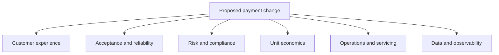

# Chapter 1 — What a Payments Product Manager actually does

**Reading time:** ~15 minutes · **Prerequisites:** None

## Learning objectives

By the end, you should be able to:

1. Explain why "Payments PM" describes several different roles, not one universal job.
2. Separate decisions a PM **owns**, **influences**, and **cannot make unilaterally**.
3. Frame a payment problem as a customer outcome, operating risk, economic trade-off, and measurable product decision.
4. Draft a simple payment decision record and identify the stakeholders it needs.

## 1. The job in one sentence

A Payments PM is responsible for choosing and improving **how a payment product creates customer and business value**, within the technical, financial, operational, contractual, and regulatory constraints of moving money.

That definition is deliberately wider than "improve checkout conversion." A checkout may be fast while creating double charges. A bank transfer may be inexpensive while taking too long to confirm. A fraud rule may prevent losses while rejecting good customers. A payments feature can look successful in the app while creating months of unreconciled financial entries.

**The central habit:** For each proposal, ask *What customer problem changes? Which system changes? Who takes on risk? How will we know it worked?*

## 2. Payments PM is not one role

| PM context | Product/customer | Common outcomes | Typical decisions |
| --- | --- | --- | --- |
| Merchant checkout | Shopper and merchant | Completed orders, acceptance, speed | Payment-method ordering, fallbacks, error handling, payment UX |
| Gateway / orchestration | Merchant or internal teams | Acceptance, reliability, cost | Routing rules, provider integrations, failover, transaction observability |
| Acquiring / payfac | Merchant | Onboarding, payment acceptance, funds access | KYB flow, underwriting UX, risk controls, payout experience |
| Card issuing | Cardholder, business, program manager | Card usage, approval, fraud loss | Card controls, token provisioning UX, limits, auth policy and servicing |
| Wallet / QR | Consumer and acceptance network | Adoption, active usage, successful redemption | Identity/pay flow, linking, funding sources, merchant acceptance, loyalty |
| Payment risk / platform | Multiple product teams | Fraud-adjusted success, resilience | 3DS trigger policy, dispute tooling, risk decisions, status/reconciliation contracts |

These categories overlap. A PSP may also be an acquirer; a merchant PM may also own an internal payment-orchestration platform. **The employer's operating model determines the role boundary.**

### PM ownership is not the same as controlling the money movement

Consider three groups of decisions:

- **PM commonly owns the product decision:** Which customers to serve, which failure modes to prioritize, the experience and system requirements, the target metric, and how a capability rolls out.
- **PM co-decides with specialists:** Routing strategies, risk thresholds, SCA/3DS behavior, retry policies, network-token adoption, and refund or dispute operations. Engineering, risk, compliance, finance, and partner teams have legitimate vetoes in their domains.
- **PM does not simply dictate:** Whether an issuer approves a transaction, what a card scheme permits, a regulator's requirements, the correct financial ledger balance, or a bank partner's contractual risk appetite.

A good PM makes the boundaries visible instead of hiding them behind a roadmap.

## 3. The six lenses behind every payments product decision

### Customer experience

Can a shopper understand a decline and recover? Can a merchant know whether a transaction is paid? Is the refund status visible? Does an in-store QR identity flow work without requiring an unnecessary payment step?

### Acceptance and reliability

What fraction of eligible attempts are approved? What happens if the gateway returns a timeout? What are the provider and issuer latencies? Does a failed callback leave an order in limbo?

### Risk and compliance

Could this change increase friendly fraud, account takeover, duplicate charges or AML exposure? Do relevant data-handling rules and partner requirements permit it? The PM should involve qualified specialists rather than interpreting regulations alone.

### Economics

Does an improved approval rate justify the additional PSP cost? Are there interchange, network, chargeback, FX, refund or operational costs? **Revenue retained is not automatically profit created.**

### Operations

Can support agents trace a payment end-to-end? Do finance teams know which source is authoritative for settlement? Can exceptions be repaired without editing a ledger by hand?

### Data and observability

Can the team distinguish a checkout session, order, payment intent, authorization attempt, capture and payout? Without identifiers and clear denominators, dashboards may contradict one another while each appears internally correct.

## 4. What the PM does in a typical problem cycle

Imagine the merchant's payment authorization rate decreases this week.

**Step 1 — Define the customer and business problem.** "More customers see payment failure" is a symptom. Which customers? What changed? Does the failure affect first purchases, saved cards, cross-border payments, a particular issuer, or a mobile-app version?

**Step 2 — Make the metric precise.** For example: `approved card authorization attempts / card authorization attempts submitted to the PSP` is not the same as `orders with at least one successful payment / orders with a payment initiation`. An order with three attempts affects these measures differently.

**Step 3 — Investigate the system.** Ask engineering and partners for request and response identifiers, decline codes, risk decisions, 3DS results, routing/version changes, and provider incident timelines. Distinguish issuer decline, pre-PSP validation failure and timeout.

**Step 4 — Prioritize hypotheses, not favorite solutions.** A new routing rule is not the answer if issuer rejection stems from expired credentials. A retry can make metrics worse if it repeats irreversible declines or creates duplicates.

**Step 5 — Define the product change.** An intervention should have owners, eligibility rules, state-machine behavior, safeguards, experiment design, rollout and rollback criteria.

**Step 6 — Measure full consequences.** Look at accepted orders, risk-adjusted margin, latency, customer complaints, refunds, disputes, and unmatched ledger entries—not authorization uplift alone.

Read [Chapter 3](12-authorization-optimization.md) and the [worked case](../../cases/01-authorization-rate-drop.md) for a complete diagnosis.

## 5. Who the PM works with

| Partner | Why they matter | A useful PM question |
| --- | --- | --- |
| Payment engineers and architects | Integration and state correctness | "Which events are authoritative, and what happens if they arrive late or twice?" |
| Risk/fraud | Financial loss and false positives | "What fraud guardrail must stay stable if we increase acceptance?" |
| Compliance/legal | Regulatory, scheme, privacy constraints | "Which requirements apply to this market and this merchant model?" |
| Finance/treasury | Settlement, ledger, fees, payouts | "How will we reconcile authorizations, captures, refunds and the bank statement?" |
| Operations/support | Exception handling and customer trust | "What does an agent see when the customer says they paid but the order failed?" |
| PSPs/acquirers/banks | External execution and dependencies | "Which failure reasons and IDs can you expose, and what is our escalation SLA?" |
| Design/analytics | Clarity and measurement | "What recovery action should we show, and how will we measure unique successful orders?" |

Notice that the PM's leverage is often **decision quality and alignment**, not writing the core processor code or changing issuer systems.

## 6. Artifact: the payment decision record

Before creating a big PRD, capture the decision in a page:

> **Problem:** Mobile checkout shows a generic payment-failed screen when the PSP response times out.
>
> **Customer impact:** Some shoppers retry without knowing whether the first attempt succeeded.
>
> **Decision to make:** Should we hold in a pending state, query status, and restrict retry until the first outcome is resolved?
>
> **Options:** (A) Immediate retry; (B) pending + status query; (C) pending + alternative method after controlled expiry.
>
> **Trade-offs:** Speed versus duplicate-charge risk, support load, and provider capabilities.
>
> **Required reviewers:** Payments engineering, risk, PSP integration, support, finance.
>
> **Success:** Fewer unresolved outcomes and duplicate captures; stable payment completion and latency.
>
> **Unknowns:** PSP status API guarantees, idempotency scope, webhook delivery, capture behavior.

A decision record is useful because a future incident reviewer can see **why** a behavior exists, not just what code was shipped. See the [sample PRD](../../artifacts/sample-prd-payment-recovery.md).

## 7. Common PM mistakes

- **Treating all payment failures as declines.** Timeouts, integration errors, risk rejects and issuer declines demand different actions.
- **Optimizing a percentage without knowing its denominator.** Repeated attempts can increase or decrease attempt-based approval while order outcomes remain unchanged.
- **Prescribing retries too early.** A retry is safe only when the payment state and provider/network retry rules support it.
- **Ignoring post-payment work.** The customer journey continues through capture, settlement, refund, disputes, and servicing.
- **Confusing provider API behavior with an industry standard.** A Stripe PaymentIntent status isn't a universal payment state machine; provider models differ.
- **Leaving financial reconciliation to "later."** An apparently successful checkout without traceable money movement isn't a complete product.

## 8. Exercises

1. A merchant wants to add a second PSP. Identify two customer outcomes, two economic guardrails, two reliability requirements and the stakeholders who should approve routing.
2. A card transaction is approved but an order fails to be created. Who owns the customer experience? Who owns reconciliation? What should the PM specify?
3. A wallet team proposes a new QR payment flow that also redeems loyalty points. What are the minimum state and failure cases the PM should document?
4. Write a decision record for adding an alternative payment method to a checkout page. Identify at least one thing you *cannot* assume about settlement or refunds.

### Suggested self-check

A complete answer distinguishes **authorization from fulfillment and financial settlement**, includes explicit decision ownership, and names at least one guardrail the feature could worsen. There is rarely a single correct organizational ownership chart.

## Sources and further reading

- [Adyen — Payments lifecycle](https://docs.adyen.com/account/payments-lifecycle) (provider example of authorization, capture, and settlement states)
- [Stripe — Payment Intents](https://docs.stripe.com/payments/payment-intents) (provider example of a payment-intent abstraction)
- [PCI SSC — Document Library](https://www.pcisecuritystandards.org/document_library/) (card-data security reference)

**Next:** [How a card payment works →](../part-1/03-card-payment-lifecycle.md)
