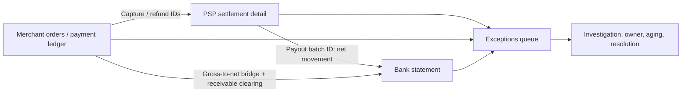

# 16. Three-party payment reconciliation: merchant, provider and bank

**Part IV — Operating and Scaling Payments** · Prerequisites: Chapters 3, 4, 5 and 15

> **Central idea:** A green checkout success screen is not proof that every financial ledger agrees. Reconciliation compares independent records, explains timing/fee differences, and identifies missing, duplicated or incorrectly posted money movements.

## Learning outcomes

Explain three-way reconciliation in a merchant-acquiring context, design join keys and matching rules, reconcile gross captured sales to net bank payout, and classify exceptions without hiding real financial losses behind timing differences.

## 16.1 What are the three “parties”?
For a merchant receiving PSP-managed card payments, a useful three-way model is:

| Source | What it records | Why it differs |
|---|---|---|
| **1. Merchant order/payment ledger** | Orders, payment intents, successful captures, refunds, expected fees, outstanding receivables | Operational truth: what the merchant thinks happened |
| **2. PSP/acquirer settlement ledger** | Settled captures, refunds, chargebacks, fees, rolling reserves, payout-batch allocations | External processing and payout truth, often event + batch based |
| **3. Bank statement / cash ledger** | Actual credits/debits into the merchant's bank account | Cash movement truth, usually net and batched |

This is one common definition of **three-way / three-party reconciliation**. In other business models, the three records may be *merchant vs gateway vs acquirer* or *PSP transaction ledger vs scheme settlement vs bank*. The PM must name the entities and identifiers in **their** architecture rather than treating “three-way” as a universal fixed set. For marketplace/payfac flows, there may be additional submerchant, platform, reserve and transfer ledgers.

**Not every authorized transaction will appear in settlement.** Authorization is a commitment to potentially fund a charge; capture and clearing/settlement follow separate lifecycle events. A temporary hold or an expired authorization belongs in operational monitoring, not settled sales.

## 16.2 Why matching all three matters

1. **Merchant ↔ provider:** Did every captured payment land in the expected settlement ledger? Are failed captures, partial captures, refunds, disputes and duplicate payment events recognized?
2. **Provider ↔ bank:** Do provider payout batches, after fees/adjustments/reserves, reconcile to actual credits or debits on the bank statement?
3. **Merchant ↔ bank:** Does recorded cash and outstanding provider receivable reflect actual net cash after agreed deductions, timing and exceptions?

These are not three independent equal-value comparisons: **gross merchant transactions do not normally equal the net bank deposit.** Build a bridge using settlement components and batch mapping. Differences can be *valid timing* or *actual exceptions*; the job is to classify them.

## 16.3 Worked three-way example: reconcile S$10,000 in captured sales

**All amounts below are illustrative**, and the accounting treatment depends on contract, legal entity, fee model and reporting conventions.

### Day 1: merchant captures

Merchant payment ledger shows **100 successful captures of S$100 each = S$10,000 gross**. There are no earlier opening balances in this simplified example. The merchant therefore expects S$10,000 of settled-sale receivable *before* subsequent deductions and payout timing.

### Day 2: PSP reports a payout batch

| PSP settlement item | Signed amount (SGD) |
|---|---:|
| 100 settled captures | +10,000 |
| Refunds | -500 |
| Chargeback debit | -200 |
| Processing fees | -250 |
| Reserve held | -300 |
| **Net payout owed** | **8,750** |

The bridge is: `10,000 - 500 - 200 - 250 - 300 = 8,750`. The bank statement shows a credit of **S$8,750** with a matching provider payout reference. The net cash matches the PSP payout, but the merchant still needs to record the **S$300 reserve** as a separate balance/receivable rather than treating it as a processing expense. The refund and chargeback need their own reference-linked ledger events.

### Why a naive three-way match fails

`Merchant S$10,000 ≠ Provider payout S$8,750` is **not** automatically a S$1,250 missing-money incident. The discrepancy is explained by S$500 refunds, S$200 dispute debit, S$250 fees, and S$300 reserve. The merchant should verify whether those deductions were authorized and attributed correctly. A matching payout does not prove every underlying transaction was valid; transaction-level reconciliation remains necessary.

### Day 3: bank transfer delayed

Suppose the PSP marked the payout as initiated, but the bank credit is absent at cutoff. This is initially a **timing/outstanding-in-transit exception** with a due date, not proof that the S$8,750 was lost. Escalate if it exceeds the provider/bank SLA or bank investigation confirms failure. If the bank receives S$8,700 instead, that's a **S$50 unresolved payout variance** until explained; do not book a “reconciliation plug” to hide it.

## 16.4 Matching keys and data contracts

**Minimum normalized data model** (examples; replace with actual provider fields):

| Record | Useful keys and fields |
|---|---|
| Order | `order_id`, `merchant_legal_entity`, `currency`, expected amount, fulfillment status |
| Payment attempt | `payment_id`, `attempt_id`, `psp_reference`, authorized amount, timestamps |
| Capture / refund | `capture_id` or `refund_id`, original payment link, signed amount, currency, effective date |
| Dispute | `dispute_id`, original capture/payment link, reason and financial adjustment ID |
| Settlement line | `provider_journal_id`, transaction reference, type, gross, fees, net, settlement date, batch ID |
| Payout batch | `payout_id`, bank account, currency, net amount, settlement/payout cutoff |
| Bank statement | bank transaction ID, value date, bank narrative/reference, credit/debit, currency |

Provider references may be unique only **within an account or legal entity**; include the appropriate namespace. Keep original currencies and FX separately. Avoid joining solely on amount + date: two payments of S$49.90 on the same day are not the same transaction.

**Matching order:**

1. Deduplicate source events with stable provider event/journal IDs.
2. Match capture/refund/dispute line items to the merchant's original payment/order references (many-to-one is normal for partial captures/refunds).
3. Check amount, currency, lifecycle status and legal entity; allow documented processing windows.
4. Roll settlement lines into payout batches, accounting for fees, reserve movements and adjustments.
5. Match payout IDs/bank references to actual bank statement credits and debits.
6. Classify unmatched lines and maintain an aging queue with owner, reason and financial materiality.

## 16.5 Exception taxonomy

| Exception | Example | PM/design implication |
|---|---|---|
| Missing merchant transaction | Provider shows capture, no merchant order | Trace an orphaned payment; protect fulfillment/refund decision |
| Missing provider settlement line | Merchant marks captured, provider has none | Verify actual capture state and cutoff before recognizing revenue |
| Duplicate processing | Two captures linked to one order | Detect accidental double charging and remediation workflow |
| Timing difference | Provider payout initiated; bank credit tomorrow | Separate pending cash from genuine unmatched variance |
| Fee variance | Contract says one fee, settlement shows another | Versioned pricing plan, fee rule, provider line item |
| Refund / chargeback mismatch | Customer already refunded, later disputes | Linked dispute and refund events; avoid double adjustments |
| FX / currency mismatch | Presentment in USD, settlement in SGD | Preserve original, conversion rate, settlement amount and fees |
| Reserve adjustment | Provider withholds funds | Reserve balance reconciliation and release schedule |
| Wrong legal entity | One merchant account, another bank account | Entity- and account-specific mapping; audit controls |

## 16.6 Three-way reconciliation is a product feature, not an end-of-month spreadsheet

A PM designs event identities, reporting exports, operational ownership and how financial exceptions are surfaced. A mature product exposes **separate states** for payment authorization, capture, settlement and payout; makes transaction lineage inspectable; supports partial refunds; enforces idempotent webhooks and journal entries; and reconciles external records on an agreed frequency.

Suggested scorecard: percentage of settled volume matched transaction-by-transaction; percentage of payout batches matched to bank; unresolved aged variance by amount and age; orphaned capture/refund/chargeback events; latency from payout date to reconciliation; and number of manual journal adjustments. Report **currency and value**, not only event counts.

### Product requirements example

**User story:** As a finance operations analyst, I need to search a bank payout reference and see every settlement line, fee and adjustment so I can explain the credited amount and identify any outstanding variance.

**Acceptance criteria:**

- Each bank credit must map to a payout batch (or an explicit unmatched state) with legal entity and currency.
- A payout's calculated net equals the sum of included signed settlement journal entries, within documented rounding/FX rules.
- Every nonzero mismatch has a named reason category, owner, created date, last updated date and escalation threshold.
- Chargebacks and reversals never overwrite the original capture; they produce separate linked financial events.
- Manual overrides require a reason and reviewer; source records remain immutable.

## 16.7 A note on accounting ownership

Finance owns financial policy and general-ledger treatment; treasury/bank operations own cash movement investigation; the PSP/acquirer owns its external ledger; engineering owns system integrity; the PM ensures the product offers reliable records, workflows and visibility across the process. The PM **does not** unilaterally decide accounting recognition or waive financial controls.

## Exercises

1. A PSP shows S$5,000 settled but only S$4,740 paid out. Describe at least four legitimate reconciliation bridge items.
2. Two different orders have the same amount and settlement date. Which reference protects against false matching?
3. An order shows `authorized` and `payment_success=true` but no capture exists. Where should it appear?
4. A chargeback reversal is credited in next month's payout. Do you modify the original sale's capture entry?
5. A bank transfer matches the payout net, but 5 refunds have no merchant-side reference. Is the three-way reconciliation complete?

**Answer guidance:** (1) fees, refunds, chargebacks, reserves, adjustments. (2) Stable capture/provider and payout references, scoped by entity. (3) Operational unresolved/authorization monitoring, not settled gross. (4) No, append a reversal event and clear outstanding balances. (5) No, transaction-level mismatches remain.

**Next:** [16A. Payment metrics and observability](16a-payment-metrics-and-observability.md).

## Further reading

- [Adyen — Settlement reconciliation](https://docs.adyen.com/reporting/settlement-reconciliation/)
- [Adyen — Settlement details report and journal types](https://docs.adyen.com/reporting/settlement-reconciliation/transaction-level/settlement-details-report)
- [Adyen — Dispute lifecycle and financial outcomes](https://docs.adyen.com/risk-management/understanding-disputes/dispute-process-and-flow)
