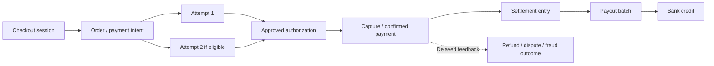
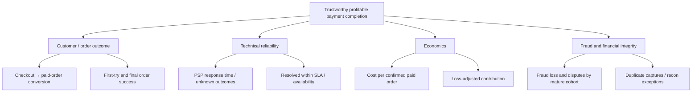

# 16A. Payment metrics and observability: measuring the right thing

**Part IV — Operating and Scaling Payments** · **Estimated study time:** ~30 minutes · **Prerequisites:** [Payment lifecycle](../part-1/03-card-payment-lifecycle.md), [authorization optimization](../part-3/12-authorization-optimization.md), [three-party reconciliation](16-three-way-reconciliation.md)  
**Editorial status:** Working draft, 16 November 2026. Every figure below is **synthetic teaching data**, not a benchmark or provider performance claim.

> **Guiding question:** If a Payments PM says “our success rate increased,” can they prove exactly which customer outcome improved without hiding higher fraud, duplicate charges, more retries or a growing settlement gap?

## Learning outcomes

You should be able to: (1) build a payments metric tree, (2) specify precise numerators and denominators, (3) separate attempt, order, transaction and payout entities, (4) design observability and alerting around trustworthy financial states, (5) reason about maturity delays and cohort selection, and (6) specify a dashboard with a measurable, safe response path.

## 16A.1 Start with entities and clocks—not dashboards

There are several clocks in payments: **checkout session**, **payment initiation**, **authorization attempt**, **authentication**, **capture**, **settlement**, **payout**, and **dispute/fraud feedback**. These often fall into different reporting days or time zones. They are not interchangeable populations.



**Never divide an attempt count by an order count unless the metric deliberately measures attempts per order.** Even when amounts match, dates and currencies may not; an authorization on Monday might settle on Wednesday and appear in a payout on Friday. Reconciliation of the three records is a different metric from checkout success.

### Minimal metric contract

Every production metric must have: *name*, *business question*, *unit*, *event source*, *numerator*, *denominator*, *eligibility rules*, *exclusions*, *time basis and timezone*, *attribution key*, *dimensions*, *freshness*, *owner*, *guardrails*, and *known limitations*. If the metric has a monetary numerator, also specify *currency, FX conversion source and value-date convention*.

## 16A.2 The Payments PM metric tree



**Primary outcome** depends on the product archetype. Merchant checkout teams may use *confirmed paid orders per eligible checkout*, issuing teams *legitimate approved spend*, acquiring teams *active merchants and loss-adjusted processing contribution*, and payment-platform teams *successful operations with financial integrity*. Don't impose a single north-star metric across all roles.

### Definitions worth standardizing

| Metric | One explicit possible formula | Grain and interpretation | Critical guardrail |
| --- | --- | --- | --- |
| Checkout-to-paid conversion | Distinct checkout sessions with confirmed paid order / eligible checkout sessions | Session-level; exclude explicitly defined test/internal traffic | Duplicate paid orders, unfulfilled captures |
| Initiated-order success | Distinct orders with at least one confirmed paid result / distinct orders initiating payment | Order-level; measure through a fixed observation window | Late successful payments; canceled orders |
| Attempt authorization rate | Approved authorization attempts / eligible submitted authorization attempts | Attempt-level; identify pre-PSP validation and timeouts separately | Fraud, retries, issuer mix, order success |
| First-attempt approval | Approved first eligible auth attempts / first eligible auth attempts | Distinct payment operation's first attempt | Selection bias and cohort composition |
| Technical timeout rate | Attempts ending in gateway/network timeout / submitted technical requests | Request-level; **timeout ≠ definitive decline** | Pending-status backlog, reconciled outcomes |
| Unknown-outcome aging | Unknown payment operations unresolved beyond X minutes / unknown operations entering cohort | Operation-level, with clear SLA clock | Duplicate charges, customer communications |
| 3DS challenge completion | Eligible completed challenges / initiated challenges | Authentication-session-level | Fraud outcomes and conversions by challenged cohort |
| Confirmed fraud loss rate | Confirmed fraud loss in currency / captured sales in **corresponding mature cohort** | Monetary; define loss basis and lag | False positives, disputable vs undisputable loss |
| Dispute rate | Qualifying dispute events / qualifying transactions under named scheme/reporting rule | **Scheme-specific**, do not mix bespoke rates with formal network monitoring | Scheme program definitions and reporting lag |
| Processing cost per paid order | Payment processing costs attributable to cohort / confirmed paid orders | Financial per-order cost; disclose fee categories | Authorization and fraud changes |
| Transaction-level recon match | Eligible source financial entries matched by IDs and signed amounts / entries due for match | Finance event/batch dependent | Unmatched value and aging |
| Payout-bank match | Bank payout credits reconciled to PSP payout batches / credits due | Payout-level, currency/legal-entity scoped | Aged unexplained net differences |

**Never claim the listed formulas are universal standards.** Some schemes and providers define reporting populations differently. Every dashboard should expose the metric version and definition.

## 16A.3 Worked example: HarborCart's payment funnel

*HarborCart is a fictional Singapore omnichannel retailer. These numbers represent one synthetic month and one consistent reporting scope.*

| Event | Count or amount | Meaning |
| --- | ---: | --- |
| Eligible checkout sessions | 100,000 | Unique eligible sessions that reached checkout |
| Distinct orders initiating payment | 80,000 | Order payment operations begun |
| Submitted eligible card authorization attempts | 82,000 | Includes 2,000 additional attempts |
| Approved authorization attempts | 73,800 | Includes attempts not necessarily captured |
| Confirmed paid orders | 72,000 | Each counted once, with payment-confirmed evidence |
| Captured sales for this scoped cohort | S$3,600,000 | Synthetic gross captured amount |
| Processing costs allocated to cohort | S$70,560 | Acquiring/processing fees in this exercise |
| Confirmed fraud losses on a mature comparable cohort | S$3,600 | Separate **mature** observation window |

The calculations are:

- **Checkout-to-paid conversion** = `72,000 / 100,000 = 72.0%`.
- **Initiated-order payment success** = `72,000 / 80,000 = 90.0%`.
- **Attempt authorization rate** = `73,800 / 82,000 = 90.0%`.
- **Cost per confirmed paid order** = `S$70,560 / 72,000 = S$0.98`.
- **Fraud loss rate** in a *separately defined mature cohort* = `S$3,600 / S$3,600,000 = 0.10% = 10 bps` **only if** that denominator is the matched captured-sales amount for that mature cohort. For the teaching exercise, assume it is; do not casually combine current-month sales with later loss labels.

**What the calculations cannot establish:** How many customers saw multiple approved authorizations, how many payments were captured then refunded, how many orders were legitimately canceled, or why successful approvals did not produce paid orders. Those require order/attempt/capture IDs and state histories. In particular, **73,800 approvals are not the same as 73,800 paid orders**.

### Why a blended approval rate can conceal damage

| Authorization cohort | Eligible attempts | Approved attempts | Approval rate |
| --- | ---: | ---: | ---: |
| Domestic issued cards | 62,000 | 57,000 | 91.94% |
| Cross-border issued cards | 20,000 | 16,800 | 84.00% |
| **Combined** | **82,000** | **73,800** | **90.00%** |

Investigate issuer/BIN grouping (aggregated securely), network, PSP route, currency, merchant category, device/app version, token type, authentication outcome, amount band, and time. Be careful about small cohorts, statistical noise and unequal risk profiles. The example's segment difference is **not proof** that changing PSP routes improves approval.

The [authorization-cohort CSV](../../cases/data/harborcart-metrics.csv), [full-funnel CSV](../../cases/data/harborcart-funnel.csv), and [verification script](../../scripts/verify_metrics.py) reproduce the case from data, including processing cost and mature fraud loss. The script also runs simple mutation checks to detect hard-coded, data-insensitive calculations.

## 16A.4 Measure failures in the right stage

A practical event taxonomy distinguishes:

| Stage | Distinct event/state | What the PM asks |
| --- | --- | --- |
| Checkout | `checkout_started`, `payment_initiated` | Did users even attempt to pay? |
| Merchant validation | `request_rejected_pre_psp` | Was data invalid before reaching the PSP? |
| Authentication | `3ds_started`, `3ds_challenged`, `3ds_completed` | Was authentication triggered, completed, or abandoned? |
| Processor / issuer | `auth_submitted`, `auth_approved`, `auth_declined`, `outcome_unknown` | Was it an issuer refusal, technical error, or unresolved result? |
| Merchant order | `capture_requested`, `capture_confirmed`, `order_paid` | Did the customer buy, and is fulfilment authorized? |
| Settlement | `settlement_entry_posted`, `payout_created`, `bank_credit_matched` | Is money accounted for, not just approved? |
| Post-payment | `refund_*`, `dispute_*`, `confirmed_fraud_loss` | Do delayed outcomes overturn apparent success? |

**Minimum join keys:** `merchant_id`, `legal_entity_id`, `order_id`, `payment_operation_id`, `attempt_id`, `provider_payment_id`, `capture_id`, `settlement_line_id`, `payout_id`, and `dispute_id` as applicable. Every event needs an *event-time* and *ingestion-time*; store currency and signed amount on financial events. Use a mapping table for PSP-specific statuses. Keep PAN/CVV and other sensitive credentials out of this data platform.

### Synthetic event record (never a card credential)

```json
{
  "event_name": "authorization_outcome_unknown",
  "event_time": "2026-11-16T03:02:17Z",
  "ingested_at": "2026-11-16T03:02:18Z",
  "merchant_id": "fictional-harborcart",
  "order_id": "ord_demo_421",
  "payment_operation_id": "pop_demo_421",
  "attempt_id": "att_demo_421_1",
  "provider": "fictional-psp-a",
  "provider_payment_id": "psp_demo_87",
  "amount_minor": 5000,
  "currency": "SGD",
  "result_status": "UNKNOWN",
  "source_event_id": "evt_demo_72"
}
```

**Data quality controls:** stable IDs across retry chains; missing event / late-arriving event rate; duplicate deliveries; state regression; inconsistent currencies; time zone cutoffs; gaps between capture and settlement reports; and event-schema version drift. Reconciliation is a *control* on observability, not just a finance report.

## 16A.5 What to alert on, and what not to page for

| Signal | Illustrative response | Why a raw fixed threshold is insufficient |
| --- | --- | --- |
| PSP technical errors above baseline, by market | Alert on-call and provider operations; consider permitted graceful degradation | Planned maintenance, low volume, data gaps or a single bad merchant can distort totals |
| Unresolved unknown operations past SLA | Page when customer harm or financial ambiguity crosses severity policy; open exception queue | A short-lived pending state may be expected |
| Confirmed duplicate captures | Financial-integrity incident; contain and reconcile first | Even a small absolute count may matter more than a percentage |
| Capture-to-settlement mismatches | Finance exception dashboard with aging, amount and cutoff | Reporting settlement lag is often normal |
| Cross-border auth rate drop | Investigation with cohort and composition checks | Traffic-mix changes or risk-rule updates may explain it |
| Dispute or fraud rise | Review on **mature** cohort and relevant network windows | Labels lag and scheme program thresholds are rule-dependent |

**Alert on actionability.** A chart changing is not automatically a production page. Each alert needs an owner, a decision, a response window, a safe mitigation and a runbook. For official network monitoring programs, follow current scheme-specific definitions and dates rather than applying a bespoke dispute rate.

### Dashboard design: three audiences

- **PM/business view:** paid orders and checkout conversion, authorization and authentication funnel, cost per paid order, fraud-adjusted contribution, experiment cohorts and confidence.
- **SRE/provider operations:** provider error and latency distribution (including p95/p99), unknown-outcome queues, callback freshness, circuit-breaker status, recovery success, availability by critical operation.
- **Finance/risk:** settled versus captured signed amounts, payout-bank reconciliation, reserves/fees, exception age and exposure, mature fraud/dispute outcomes.

Give each audience the same identifiers and definition links even when they see different aggregations. See the [dashboard specification artifact](../../artifacts/payments-metrics-dashboard-spec.md).

## 16A.6 Experimentation: improve one metric without gaming another

**Bad experiment:** “Increase authorization rate by increasing retries.” This can reduce first-try success, inflate attempt volumes, introduce unwanted network fees and risk duplicate charges.

**Better experiment:** For eligible transient failures where the provider and scheme permit recovery, compare an explicit recovery treatment with a valid control. Primary metric: **incremental confirmed paid orders per eligible payment-started orders**. Guardrails: duplicate captured charges, fraud-adjusted contribution, customer complaints, provider cost per paid order, dispute maturation, technical error rate and recovery time. State allowed retry categories, idempotency and a holdout strategy before rollout.

Use *intention-to-treat* where possible; don't condition the treatment cohort only on customers who eventually succeeded. Report sample sizes, uncertainty and cohort composition; avoid claiming causal uplift from uncontrolled route comparisons.

## 16A.7 Practice and answer check

**Exercise A:** If a team shows `74,000 approved attempts / 82,000 submitted attempts` and `72,000 paid orders / 80,000 initiated orders`, can you infer the number of successful customers recovered by retries?  
**Answer:** No. You need joined order/attempt history, first-attempt outcomes, distinct customer/order IDs, captures and duplicate handling. Approval attempts do not equal distinct customers or confirmed paid orders.

**Exercise B:** HarborCart's cost per paid order falls while total processing cost increases. Is that inconsistent?  
**Answer:** Not necessarily. More paid orders may grow volume faster than absolute costs; fixed/variable fee mix, cost attribution and cross-border/FX exposure need review.

**Exercise C:** A small PSP returns `HTTP 200` but marks the payment refused in its payload. Should the team classify it as approved?  
**Answer:** No. A successful API response is not necessarily an approved payment. Inspect the provider's documented payment status/result, then normalize merchant and provider event mapping.

**Next:** [17. Payment reliability and operations](17-reliability-and-payment-operations.md).

## Further reading

- [Stripe — Maintaining payments performance: comparing raw, first-attempt and deduplicated authorization](https://stripe.com/guides/maintaining-payments-performance-when-adopting-stripe)
- [Stripe — Authorization rate optimization](https://stripe.com/en-sg/guides/optimizing-authorization-rates)
- [Adyen — Refusal reasons](https://docs.adyen.com/development-resources/refusal-reasons)
- [Adyen — Settlement and invoice reconciliation](https://docs.adyen.com/reporting/invoice-reconciliation/)
