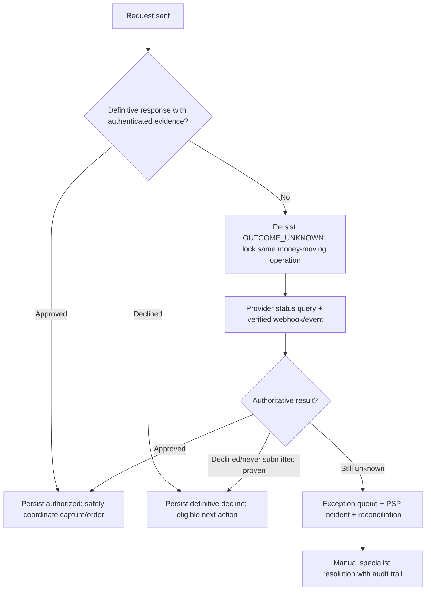

# 17. Payment operations, incident response and financial integrity

**Part IV — Operating and Scaling Payments** · **Estimated study time:** ~30 minutes · **Prerequisites:** [Checkout and payment state](../part-3/10-checkout-and-payment-state.md), [3DS](../part-3/11-3d-secure.md), [authorization](../part-3/12-authorization-optimization.md), [disputes](15-chargebacks-and-disputes.md), [reconciliation](16-three-way-reconciliation.md), [metrics](16a-payment-metrics-and-observability.md)  
**Editorial status:** Working draft, 16 November 2026. All incident examples and timings are illustrative. Actual procedures, loss limits and reporting obligations require organization-specific approval.

> **Guiding question:** When a payment system breaks, can the team minimize customer harm **without inventing a payment outcome, moving money twice, or losing the audit trail**?

## Learning outcomes

A reader should be able to distinguish an issuer decline from an uncertain technical outcome; classify a payment incident by customer and financial impact; define response roles; write runbooks for PSP outages, duplicate charges, payout delays and reconciliation mismatches; set operational SLOs; and run a blameless post-incident review with permanent-control actions.

## 17.1 Why uptime is only one dimension of payment reliability

A provider can respond in milliseconds while downstream events remain unprocessed. An API can be healthy while bank payout batches are late. A checkout can show `payment_failed` while an authorization actually succeeded. Treat reliability as the ability to **accept legitimate instructions, communicate truthful states, recover safely, and reconcile all financial consequences**.

| Failure class | Example | User-visible state | Immediate product concern |
| --- | --- | --- | --- |
| Definitive business decline | Issuer refuses an authorization | Payment not approved; safe eligible alternatives | Never silently retry a non-retryable decline |
| Technical failure with proven non-submission | Pre-PSP request validation fails | Payment not submitted; correct data/retry | Distinguish API failure from issuer refusal |
| **Unknown outcome** | PSP times out after forwarding to issuer | Pending / checking status | Avoid duplicate charge and premature fulfilment |
| Authorization succeeded, order confirmation failed | PSP says approved, order service timed out | Order processing, not simply “declined” | Confirm payment intent/order correlation; avoid second charge |
| Capture/settlement delay | Authorized, captured, not in expected provider batch | Customer may already have a valid paid order | Finance explanation, accounting exceptions and SLAs |
| Payout/bank mismatch | PSP shows payout 10,000 but bank credit 9,800 | Merchant-finance issue | Identify fees/holds/FX versus actual shortfall |
| Dispute workflow failure | Deadline missed, evidence not transmitted | Merchant loss/exposure | Restore evidence process; assign accountable owner |

**Idempotency is necessary but insufficient.** Key reuse policies, retention windows and provider semantics vary; it can protect an individual API call but not automatically protect the entire order → authorization → capture → fulfilment lifecycle. Build stable operation IDs and a monotonic business state machine, with explicit manual resolution for irreconcilable cases.

## 17.2 Incident command: who does what?

A concrete response structure is more useful than a vague statement that “PM and engineering collaborate.” In the example below, incident command is a role—not necessarily the PM.

| Role | Decision/response responsibility | Must not do unilaterally |
| --- | --- | --- |
| Incident commander (IC) | Severity, response cadence, clear owner, coordination and communications | Declare unknown financial outcomes resolved without evidence |
| Engineering/SRE lead | Logs, deployment/rollback, circuit breakers, safe mitigations, recovery and verification | Trigger unchecked financial retries or override fraud policy |
| Payments PM | Customer impact and product priority, pending-state behavior, accepted degraded UX, evidence-based rollout/recovery decisions | Override scheme, compliance, finance or risk sign-off |
| PSP/acquirer operations | External status, incident reference, settlement/reporting fixes, escalation | Claim merchant state correctness without merchant evidence |
| Finance/treasury | Monetary exposure, recon, payouts, reserve and ledger adjustments, release decisions | Treat an API callback as a bank statement |
| Fraud/risk/compliance | Control thresholds, incident reporting and permitted risk changes | Remove mandatory controls for conversion convenience |
| Customer support/comms | Approved messaging and case handling, complaint escalation | Tell customers “no charge occurred” when status is unknown |

**Severity should be anchored to measurable impact**, not just a failure-rate percentage. Examples of escalation factors: number of affected unique orders/merchants, duplicate settled amounts, blocked payout value, unresolved unknowns past the approved limit, harm to vulnerable customers, mandatory reporting, and inability to reverse unsafe state.

### First-response checklist

1. Open an incident with UTC start time, local business date, responsible legal entity, impacted market/method/route and current confidence level.
2. Establish the **last known correct transaction** and a trustworthy list of affected payment operation IDs.
3. Freeze or gate risky changes: new retries, rerouting uncertain operations, automatic capture/refund loops, and unauthorized rule changes.
4. Decide **safe degraded UX**: pending, alternative method for new payments, explicit maintenance, or controlled refusal—not false success/failure.
5. Assign an IC, technical lead, provider escalation owner, finance owner, risk/compliance contact and support contact.
6. Define the next status check, rollback trigger, finance cutoff, customer-notification criteria and evidence location.

## 17.3 Runbook A — authorization/PSP failures and unknown outcomes

**Trigger (illustrative):** A spike in PSP request timeouts for eligible card attempts in one region. Do **not** equate timeouts with declined authorizations.

**Detect:** PSP API success/error distributions, p95/p99 latency by method/market, unknown-operation queue age, missing callback lag, status-query error rate, unique orders with pending states.

**Investigate:** Correlate `order_id → payment_operation_id → attempt_id → PSP reference`; check recent releases, PSP status page and provider incident ID, error family, affected cohorts, signed callback sequence and evidence of payment submission.

**Contain:** Disable **new eligible traffic** to broken route if supported, without unconditionally replaying already-submitted unknown operations. Status-query and verified callback processing are normally safer than new authorization requests. Any rerouting policy needs documented provider/scheme/merchant eligibility and risk approval; token portability and cross-provider idempotency are not assumed.

**Recover:** Resolve known results, keep pending exceptions visible with age and owners, match later settlement records, and confirm that no duplicate captures or fulfilments occurred. Customer wording should be approved: *“We're confirming the status of your payment; please don't submit another payment for this order yet.”* Only use this wording if support and engineering can actually fulfil the promised follow-up.

**Close:** Confirm affected order count, unresolved exception value, duplicate captures, PSP postmortem and owner for long-tail status repairs. A green API status is not an incident close criterion by itself.

## 17.4 Runbook B — duplicate authorizations, captures or refunds

**Trigger:** Two financial operations appear for the same intended order, or a customer reports double charge.

**First establish the fact pattern:** Two pending **authorization holds** are not necessarily two posted card charges; two capture operations may have two financially settled debits; duplicate refunds are a different failure mode. Never promise an immediate reversal before checking scheme/provider state and refund windows.

**Detect:** Duplicate `capture_id` correlation, same order and amount with multiple *confirmed captures*, repeated event delivery causing duplicated downstream side effects, financial event uniqueness violations, customer tickets and dispute evidence.

**Contain:** Stop unsafe retry/replay paths and prevent new duplicate fulfilment. Engineering freezes affected handler or feature flag; finance identifies captured/settled value; risk monitors possible abuse.

**Remediate:** Determine whether void/reversal is possible before clearing, or refund is required after capture/settlement according to provider status. Record **new financial events**, never rewrite original ledger rows. Coordinate customer communication, timing and additional fees. Verify that the refund/void actually completed and was reconciled.

**Prevent recurrence:** Idempotency at order/payment/capture boundaries, durable deduplication of webhook event and operation IDs, out-of-order event tests, failpoint tests for lost responses and at-least-once delivery, and a reconciliation exception when source systems disagree.

## 17.5 Runbook C — settlement report or payout delay

**Trigger:** Captured transactions expected in a particular settlement cycle are absent, or a payout is not received by the agreed cutoff.

**Don't confuse:** `captured`, `settled`, `payout initiated`, `payout received`, and `bank reconciled`. Holidays, currency conversion, merchant contractual funding terms, rolling reserves and cutoff periods can explain timing differences without an error.

**Detect:** Aging of capture-to-settlement entries by acquirer, merchant legal entity, batch/currency and provider; payout late versus documented cutoff calendar; provider-file freshness; payout amount and bank-credit timing.

**Investigate:** Confirm the *correct business calendar and timezone*, capture date, provider settlement batch ID, expected payout amount after signed fees/adjustments, reserve policy, refunds, disputes and bank reference. Ask the provider for a batch/transfer trace rather than relying only on portal screenshots.

**Contain:** Keep merchant-facing payout status truthful; do not fabricate “paid” when only “scheduled.” Escalate liquidity exposure to finance/treasury, especially where the platform guarantees merchant funding independent of acquirer settlement.

**Recover:** Obtain missing provider reports, remap known delayed entries, document the new contractual ETA with caveats, reconcile actual bank value, communicate approved resolution, and create corrective entries through finance-approved processes.

## 17.6 Runbook D — three-party reconciliation mismatch

**Trigger:** Merchant capture records ≠ PSP settlement lines ≠ bank payout credits after expected cutoffs and valid timing adjustments.

**Detect:** Signed variance by `merchant/legal_entity/currency/batch`, missing capture/settlement/payout identifiers, unexplained fee and FX entries, unreconciled negative adjustments, growing manual journals, false matches of same-value orders.

**Investigate in order:**

1. Define the eligible financial cohort and cutoffs; do not join different transaction days blindly.
2. Reconcile **merchant expected captures/refunds/disputes** to **provider settlement lines** by stable IDs and signed amounts.
3. Build the **PSP gross-to-net payout bridge**, including fees, reserves, refunds, disputes, adjustments and FX where applicable.
4. Match each expected payout to the **bank statement** by payout/bank references, entity, amount, currency and date window.
5. Assign missing/extra records to known timing, transformation, legitimate adjustment or unresolved cases. Do not auto-write off the difference.

**Illustrative variance:** PSP expects S$9,880 net but the bank statement shows S$9,680. Open a **S$200 unexplained variance** with evidence and owner. A subsequent fee adjustment could explain it, but it is not an acceptable assumption without a traceable settlement line/contractual fee.

**Recovery:** Finance approves adjustment handling, partner operations requests corrected reports, engineering fixes field mapping or event ingestion, and the PM ensures the workflow supports reason codes, evidence, aging, escalation and review.

## 17.7 Runbook E — chargeback/evidence workflow outage

**Trigger:** Disputes cannot be imported, deadlines are missing, or representment submissions fail.

**Detect:** Dispute webhook/report freshness, cases without due dates or required evidence, approaching deadlines, rejection/error acknowledgements, duplicate cases and exposed disputed value.

**Contain:** Escalate to scheme/acquirer operations and legal/risk; create a controlled manual intake route if approved. Do not assume a missed deadline can be extended, and don't promise merchant recovery until acceptance is verified.

**Recover:** Reconstruct cases with provider dispute IDs, preserve customer/service evidence, submit with provider acknowledgement when allowed, track outcome, and reconcile any financial debit or reversal. Prioritize by actual, time-sensitive deadlines and money at risk—not by a generic ticket severity.

## 17.8 Observability, incident SLOs and honest communications

**Technical telemetry:** request success by endpoint and response family, provider timeout and latency distribution, retry attempts with idempotency keys, webhook signature failures, duplicate event counts, circuit-breaker state, queue age, and API/version changes.

**Business telemetry:** unique orders paid, unknown statuses older than agreed windows, duplicate captures, payout and refund aging, unsettled value, reconciliation mismatch value, incidents affecting customer-support contacts, and dispute deadline compliance.

**SLO examples, not commitments:** 99.95% status-query technical availability in a **defined 30-day window**; 99% of verified provider events processed within an **agreed processing window**; zero *unexplained* duplicate settled charges attributable to the same merchant operation; finance exceptions triaged within an **approved business-day SLA**. Use geography, eligible volume, data freshness and exception categories in the definitions.

A high authorization rate can coexist with terrible financial integrity. A low mean latency can coexist with a damaging p99. **Page humans when a specific mitigation is needed** and use dashboards or tickets for non-urgent variance reviews.

### Customer messaging principles

- State what is actually known: *payment pending*, *authorized*, *captured*, *refunded*, *payout initiated*, *payout bank-confirmed*.
- Give the customer an actionable next step and a realistic contact path; never say “failed” merely because the PSP did not answer.
- Avoid revealing decline, screening, risk-rule or account identifiers beyond permitted policy.
- Prepare templates for status unknown, delayed refunds, merchant payout delay and confirmed duplicate capture, subject to legal/support review.

## 17.9 Worked case: checkout successful, order unconfirmed

*HarborCart, hypothetical.* At 09:00 SGT a deployment causes the order service to miss callbacks. PSP authorization and some captures still succeed; customers see payment failures and reattempt.

| Time (SGT, fictional) | Observation | Safe product response |
| --- | --- | --- |
| 09:04 | `payment_unknown` backlog rises; no definitive issuer decline spike | Declare incident; display pending state, correlate attempts |
| 09:09 | Provider confirms some auths succeeded | Stop automatic resubmission; query status by original payment operation |
| 09:20 | 27 orders have captured payments but no confirmed order state | Freeze duplicate fulfilment, establish finance/operations exception queue |
| 09:30 | Callback consumer rollback restored | Replay only with authenticated event IDs and idempotent order transitions |
| 10:15 | All but two orders reconciled to authoritative payment/capture status | Keep two tracked exceptions open; targeted support communications |

**Success is not “the endpoint is green.”** Required closeout: verified order/payment states for all affected operations or an owned outstanding queue, no duplicate settled charges, customer remediation, measurable post-deploy checks, and a tested change to prevent recurrence. Counts and times are invented only to illustrate the response sequence.

A downloadable [incident-review template](../../artifacts/payment-incident-review-template.md) supports the follow-up. The [metrics chapter](16a-payment-metrics-and-observability.md) explains its denominators and cohort guards.

## 17.10 Exercise with answer guidance

**Exercise A:** PSP A does not respond for a S$120 purchase. PSP B is healthy. Should checkout immediately retry on B?  
**Answer:** Not until the original outcome is resolved or a documented, provider-/scheme-permitted and risk-approved exception applies. Preserve the original operation ID, query status, ingest verified callbacks, check captures/settlement later, and explain the pending state to the shopper. Two PSPs do not imply cross-provider idempotency.

**Exercise B:** A customer sees two card lines for the same order. Which records must be checked before concluding two charges occurred?  
**Answer:** Order IDs, individual authorization attempts/holds, capture IDs, PSP transaction status, settlement postings, any reversals/refunds, and customer bank postings. Customer-visible holds can outlast reversals and do not always represent two settlements.

**Exercise C:** A bank credit is S$200 below expected net, but a provider CSV with a new fee category arrived after close. What is the safe response?  
**Answer:** Reopen the corresponding exception, validate the fee's contract/source batch and sign, recompute the gross-to-net bridge, record any finance-approved accounting change and close only with bank-reference evidence.

**Operational case lab:** [PSP failover when the original authorization outcome is unknown](../../cases/02-ambiguous-authorization-routing.md). Run the incident playbook on O101–O104, including duplicate callbacks, two distinct provider approvals and pending-state customer messages.

**Exercises:** [Worked solutions](../../answers/chapter-exercises.md#17-reliability-and-payment-operations) (companion answer key; review your reasoning before opening).

**Next:** [18. Real-time payments and open banking](../part-5/18-real-time-open-banking-payment-initiation.md).

## Further reading

- [Stripe — Idempotent API design](https://stripe.com/blog/idempotency)
- [Stripe — API idempotent requests](https://docs.stripe.com/api/idempotent_requests)
- [Adyen — Webhook best practices](https://docs.adyen.com/development-resources/webhooks/best-practices)
- [Adyen — Settlement reconciliation](https://docs.adyen.com/reporting/settlement-reconciliation/)
- [OWASP — Webhook Security Cheat Sheet](https://cheatsheetseries.owasp.org/cheatsheets/Webhook_Security_Cheat_Sheet.html)
