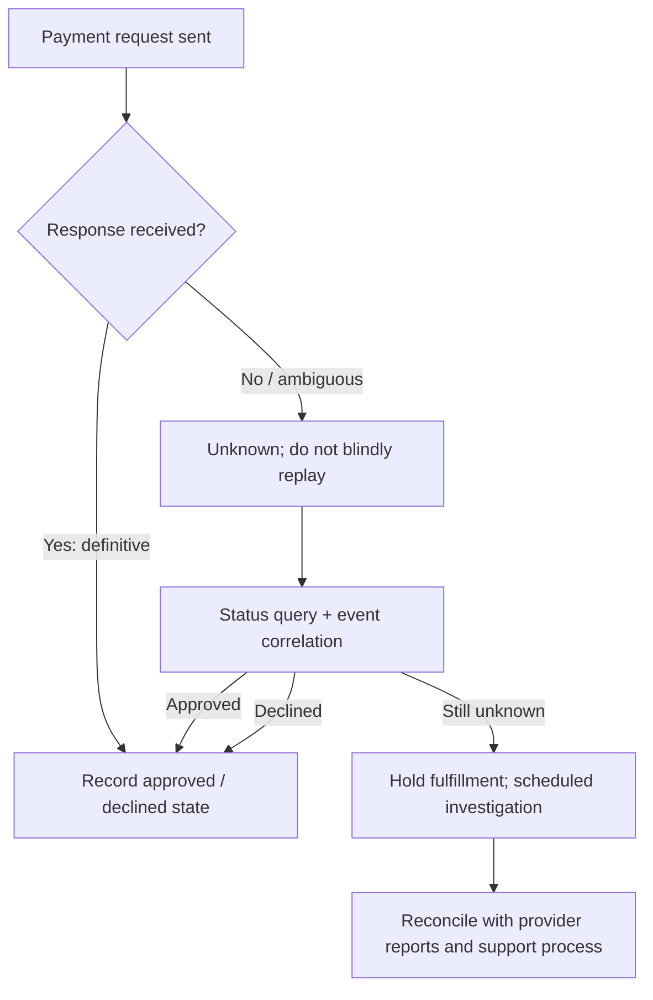

# 17. Payment reliability, incidents and operations

**Part IV — Operating and Scaling Payments** · Prerequisites: Chapters 10, 12, 15 and 16

> **Central idea:** Payments have ambiguous failures. A well-designed payment product doesn't only prevent outages; it can recover safely from an outage without creating new money errors.

## Learning outcomes

Explain idempotency and unknown outcomes, build a payment incident playbook, identify transaction-level reliability metrics, and specify safe fallback behavior when a payment provider is unavailable.

## 17.1 Not all failures mean declined

Distinguish **business decline** (issuer says no), **technical failure** (a process failed), **unknown outcome** (request could have succeeded despite a lost response), and **downstream delay** (authorization/capture completed but settlement or payout is late). Reporting all four as `payment_failed` invites dangerous automatic retries and misleading service dashboards.

**Idempotency** means safe handling of repeated operations within a defined scope. Provider idempotency windows and semantics vary; merchant systems also need stable operation IDs for capture, refund, voucher redemption and fulfillment. A retry of a read-only status query is different from a retry of a potentially money-moving capture.

## 17.2 Incident response is cross-functional

An authorization provider times out across one market. Engineering owns service restoration and technical mitigation; partner operations coordinates the provider; customer support handles current customers; finance watches for incomplete captures and later discrepancies; risk approves any exceptional policy change. The PM owns customer impact, prioritization and business decision-making within governance.

A good incident brief has: first seen time and timezone, affected merchant/payment-method/PSP segments, unique orders vs attempts affected, last known good transaction, hypotheses, verified status, safe degraded behavior, owner, next check, and rollback trigger. Never claim all payments failed when only callback delivery failed.

## 17.3 Resilience patterns and hidden costs

- **Provider failover:** Only when eligible by method, geography, token portability, underwriting, contract, state and authorization semantics. Unknown outcome on provider A must be resolved before creating a duplicate charge on provider B.
- **Circuit breaker:** Stop sending requests to a degraded dependency under defined error thresholds while maintaining clear user messaging.
- **Asynchronous processing:** Queue events and retries with durable identifiers, but do not assume every payment operation can safely be retried.
- **Reconciliation queue:** Use provider events and settlement reports to close unknown outcomes; time-based expiration is not proof of financial failure.
- **Observability:** Span order, payment attempt, provider request, webhook, capture, refund, dispute and payout events. Limit sensitive credential logging.

## 17.4 Metrics and an exercise

Report successful paid orders, payment attempts, PSP timeout rate, proportion of unknown outcomes unresolved after defined SLAs, time to recovery, incident-related duplicate charges, reconciliation exceptions and customer support burden. Include cost/complexity guardrails for failover.

**Exercise:** Two PSPs are integrated. Provider A does not respond for a S$120 transaction. Design a decision tree that prevents repeat charges while offering a usable customer recovery experience. State what evidence allows you to route to provider B, who approves that policy, and how finance closes the outcome.

**Next:** Part V — Emerging Payments (chapters planned in the roadmap).

## Further reading

- [Stripe — Idempotent requests](https://docs.stripe.com/api/idempotent_requests)
- [Adyen — Webhook best practices](https://docs.adyen.com/development-resources/webhooks/best-practices)
- [Adyen — Settlement reconciliation](https://docs.adyen.com/reporting/settlement-reconciliation/)
