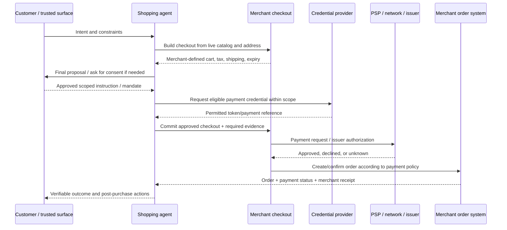

# 20. Agentic commerce, delegated credentials and customer consent

**Part V — Modern and Emerging Payments** · **Estimated study time:** ~35 minutes · **Prerequisites:** [Network tokens](../part-2/07a-network-tokenization-fpan-dpan.md), [3DS](../part-3/11-3d-secure.md), [checkout state](../part-3/10-checkout-and-payment-state.md), [compliance](../part-3/13a-compliance-and-control-ownership.md), [disputes](../part-4/15-chargebacks-and-disputes.md) · **Source review:** 16 November 2026 · **Status:** Working draft. Rapidly evolving standards; version-check before implementation.

> **Guiding question:** The customer asks an AI agent to “buy my usual groceries under S$60.” Who decides what “usual” means, what exactly was authorized, and what happens if the agent buys the wrong items?

## Learning outcomes

Distinguish product discovery, commerce orchestration, delegated user intent, credential issuance and payment execution; compare ACP/UCP/AP2 and network-led approaches without conflating them; specify an auditable consent envelope; and design a product that rejects unauthorized substitution, overspend, duplicate payment and false fulfillment success.

## 20.1 Five different problems often collapsed into “agentic checkout”

1. **Discovery:** An assistant finds the right products from structured catalog information, availability, attributes, variants, claims and merchant eligibility.
2. **Commerce orchestration:** It creates/updates a cart or checkout, checks shipping, taxes, promotions, inventory and return policy, and submits an order.
3. **Authority:** It demonstrates the customer's permission for a specific purchase or a bounded future task (goods, merchant, amount, time, shipping, substitutions).
4. **Credentials and authentication:** It obtains an eligible payment method or scoped token, optionally routes the customer to required issuer authentication, and safely handles sensitive data.
5. **Execution and aftercare:** Merchant/PSP initiates payment through existing rails, deals with issuer approval, capture and settlement, and supports cancellation, refund, disputes, fulfillment and accounting.

**These layers are complementary, not synonyms.** A structured catalog doesn't grant permission to pay. A network token doesn't prove the customer intended a particular product. A signed instruction doesn't guarantee the issuer will approve. A successful authorization doesn't prove the order was fulfilled.

## 20.2 Actors and accountability

| Actor | Typical role | Critical boundary |
|---|---|---|
| Customer | Defines goal and spending/substitution constraints | Can inspect, revoke or amend permission under supported policy |
| Shopping agent / AI surface | Discovers, negotiates cart, obtains approval, calls merchant | Must not silently broaden user intent |
| Merchant / merchant of record | Defines price, stock, shipping, terms, order/refund | Must validate each checkout against real inventory and its own policies |
| Commerce interface | Checkout sessions, tax, shipping, versioning, status | Does not itself create payment consent or issuer approval |
| Trusted consent surface | Authenticates customer and captures permission | Evidence should be scoped, tamper-evident where protocol supports it |
| Credential provider / wallet / token provider | Issues permitted credential or token to eligible actor | No unconstrained raw PAN exposure to arbitrary agent |
| PSP / acquirer | Executes payment request, status and settlement | Responsible for processing under specific contract and scheme rules |
| Card network / issuer | Network controls and authorization, authentication as applicable | May reject even an approved customer mandate |
| Customer support / disputes | Resolves wrong items, unauthorized actions and post-payment claims | Evidence must connect consent, order, payment and fulfillment |

**A Payments PM must draw the exact arrangement**, not assume the AI provider, PSP and merchant are the same entity. Who is merchant of record? What are the return policies? Which party collects evidence and services disputes?

## 20.3 A careful, version-dated protocol map

**As of 16 November 2026**, examples of public approaches include:

| Approach | Publicly documented focus | What it does **not** automatically solve |
|---|---|---|
| **ACP** — Agentic Commerce Protocol, co-developed by OpenAI/Stripe | Programmatic checkout integration between AI surfaces and businesses; Stripe describes scoped Shared Payment Tokens within its commercial offering | Not identical to every network token, does not eliminate merchant inventory/fulfillment or all payment disputes |
| **UCP** — Universal Commerce Protocol | Commerce discovery, checkout and related standardized capabilities/interfaces; protocol versions and capability scope evolve | UCP alone is not proof that the customer authorized a specific payment |
| **AP2 v0.2** — Google Agent Payments Protocol | Cryptographically verifiable **Checkout Mandates** and **Payment Mandates**; open/closed permission forms and rule verification | Does not replace commerce product catalog, issuer authorization, or general card chargeback rules |
| **Visa Intelligent Commerce / Trusted Agent Protocol** | Visa-specific agent identity and tokenized credential/payment controls, including permission-aligned instructions | Not a universal protocol for all cards/rails; participation and certification apply |
| **Mastercard Agent Pay / Agentic Tokens** | Mastercard network program and tokenization approach for agent-initiated commerce | Network-specific; not a substitute for merchant checkout, consent UX or post-purchase operations |

**Sources:** [Stripe ACP announcement](https://stripe.com/blog/developing-an-open-standard-for-agentic-commerce), [Stripe Agentic Commerce Suite](https://stripe.com/blog/agentic-commerce-suite), [UCP project announcements](https://github.com/Universal-Commerce-Protocol/ucp/blob/main/docs/documentation/announcements.md), [AP2 v0.2 specification](https://github.com/google-agentic-commerce/AP2/blob/main/docs/ap2/specification.md), [Visa Intelligent Commerce](https://developer.visa.com/capabilities/visa-intelligent-commerce/overview), [Mastercard Agent Pay](https://www.mastercard.com/sg/en/news-and-trends/press/2025/april/mastercard-unveils-agent-pay-pioneering-agentic-payments-technology-to-power-commerce-in-the-age-of-ai.html).

**Governance anchor (as of 16 November 2026):** Google released **AP2 v0.2.0 on 28 April 2026** with support for human-not-present flows, and contributed the AP2 core specification to the **FIDO Alliance** for broader standards work. FIDO also announced work incorporating Mastercard's **Verifiable Intent** contribution. Google's repository now focuses future contributions on SDKs and examples while core standards work moves through FIDO. Do not equate this standards process with universal PSP/issuer production support. [AP2 releases](https://github.com/google-agentic-commerce/AP2/releases); [FIDO announcement, 28 April 2026](https://fidoalliance.org/fido-alliance-to-develop-standards-for-trusted-ai-agent-interactions/); [AP2 contribution guidelines](https://github.com/google-agentic-commerce/AP2/blob/main/CONTRIBUTING.md).

**Important version note:** Older AP2 examples use **CartMandate** terminology. The AP2 v0.2 specification uses **Checkout Mandate**. Always pin a protocol revision and review its current validation rules before implementing or quoting exact field semantics. Public standards and pilots must not be presented as universally available production functionality. [AP2 v0.2](https://github.com/google-agentic-commerce/AP2/blob/main/docs/ap2/specification.md); [UCP protocol announcements](https://github.com/Universal-Commerce-Protocol/ucp/blob/main/docs/documentation/announcements.md).

### Which one should a merchant choose?

First ask which AI channels and markets the merchant is actually targeting, what their commerce backend supports, who processes their payments, and whether the protocol/partner is accessible under current onboarding. The choice may be **multiple adapters** to a single canonical order/payment state machine. A cross-merchant checkout integration is not the same as an issuer/network token issuance program. Treat a provider feature request, protocol experiment and production commitment as different roadmap investments.

**Settlement is a separate question:** AP2's published samples include both card payments and a **human-not-present x402 payment example**. This does not make x402 a mandatory settlement rail or imply that every AP2 transaction uses a stablecoin. A verifiable mandate is not itself an issuer approval, token transfer or merchant fiat payout. See [Chapter 19: stablecoins and settlement](19-stablecoins-programmable-money.md) and the [AP2 project overview](https://github.com/google-agentic-commerce/AP2/blob/main/docs/index.md).

## 20.4 Two purchase modes require different authorization models

**Human present:** Agent proposes a final checkout, a trusted surface shows price, merchant, items and terms, and the customer authorizes a specific action. The result is scoped to that confirmed checkout; additional issuer/PSP authentication or authorization may be required.

**Human not present:** The customer approves **constraints in advance**. The agent may execute only if the eventual offer remains within the permitted envelope; otherwise it must obtain renewed permission. AP2 explicitly distinguishes open and closed mandate constraints and binds payment authority to a checkout. Credential providers and payment processors must verify as the applicable specification requires. [AP2 specification](https://github.com/google-agentic-commerce/AP2/blob/main/docs/ap2/specification.md).

Examples of permission dimensions a PM should consider (not all are mandatory fields in every protocol):

- Eligible merchant identities and categories; merchant of record; prohibited sellers.
- Specific SKU/variant/quantity versus permitted substitutions and minimum quality constraints.
- Per-order maximum and cumulative budget; **currency**; tax, shipping, tips and FX handling.
- Shipping address and delivery deadline; allowed fulfillment alternatives.
- Valid-from and expiry time; frequency; maximum number of purchases; idempotency.
- Eligible payment instrument; when customer re-authentication is mandatory.
- Revocation, partial execution, cancellations, and notification/receipt requirements.

**Rule:** Do not substitute a prose prompt alone for deterministic validation. The agent may interpret customer intent, but the system must enforce its hard boundaries in code with authoritative checkout amounts and identities. This is a product design principle, not a claim that one particular protocol currently enforces every dimension.

## 20.5 End-to-end purchase and evidence chain

This illustrates possible roles; **the exact flow is provider/protocol dependent**. For some A2A payments the credential provider or PISP initiates payment differently. Preserve versioned cart/checkout references, signed authorization evidence where applicable, PSP operation IDs, final receipt, and fraud/privacy-compliant retention. Don't expose full card credentials to the agent if the design can use scoped references.

## 20.6 What should happen when the agent changes the cart?

**Worked example — fictional HarborCart.** Customer instructs: “Buy two 500g packs of Brand A oatmeal for delivery tomorrow, don't substitute, and spend **no more than S$24 including delivery**.”

- Live price: S$9 per 500g pack, shipping S$4, total S$22. Eligible, subject to merchant, address and delivery conditions.
- Before commit, inventory disappears and agent substitutes two 750g Brand B packs priced S$8.50 each. Even if the price is lower, **substitution is explicitly prohibited**: reject and ask customer.
- Merchant keeps original item but raises shipping from S$4 to S$8; total becomes S$26. **Amount constraint violated**: reject and request renewed permission.
- PSP authorization succeeds but merchant order creation times out. **Payment outcome is not order success**: preserve pending state, query status and reconcile before retry/fulfillment.
- Agent issues a duplicate checkout request. The merchant must enforce idempotency and ensure one authorized commercial operation isn't unintentionally captured twice.

These are failures of **intent preservation**, not simply API availability. Use the [Agentic Checkout Intent & Permission Test](../../artifacts/agentic-checkout-intent-test.md) to define expected outcomes.

## 20.7 When a cryptographic mandate helps—and where it stops

AP2 v0.2 describes **Checkout Mandates** for authorized contents of a merchant checkout and **Payment Mandates** for payment authority. It specifies verification and linked evidence useful in a dispute. This does **not** automatically decide consumer liability or remove the issuer/merchant obligations of an underlying card scheme. [AP2 spec](https://github.com/google-agentic-commerce/AP2/blob/main/docs/ap2/specification.md).

For a PM, separate:

1. **Integrity:** Has the signed object been altered? Was it signed by an authorized key?
2. **Scope:** Does the current merchant, product, amount and time fall inside the customer's permission?
3. **Lifecycle:** Was the token/mandate already consumed, revoked, expired or superseded?
4. **Execution:** Did issuer/acquirer authorize and capture? Were any retries created?
5. **Fulfillment:** Did the merchant deliver the promised goods or service?
6. **Remedy:** Can customer cancel/return? What does the scheme, applicable law or merchant contract provide?

A technically valid signature is not evidence that the goods were correctly delivered or the shopper's account had sufficient funds. A token should be scoped, monitored and revocable as supported; do not assume all credentials offer identical restrictions.

## 20.8 Agent identity, authentication and fraud controls

Traditional risk models expect a human browser/device session and known history. Agents may not look like normal shoppers. A legitimate agent might place purchases frequently and use different execution infrastructure; a malicious bot may imitate it.

Risk strategy should separate **trusted agent identity**, **user permission evidence**, **transaction context**, **merchant acceptance**, and **issuer authorization**. A site detecting automation does not prove delegation. A verified agent identity does not prove buyer permission for this amount. Networks and providers may offer agent signals and specialized credential controls; validate their availability, certification, and fraud liability with each party. [Visa Trusted Agent Protocol specification](https://developer.visa.com/capabilities/trusted-agent-protocol/trusted-agent-protocol-specifications/); [Mastercard Agent Pay](https://www.mastercard.com/sg/en/news-and-trends/press/2025/april/mastercard-unveils-agent-pay-pioneering-agentic-payments-technology-to-power-commerce-in-the-age-of-ai.html).

**Risk/PM requirements:** proper retry classifications; prevent card testing; merchant/product eligibility; sanction and restricted goods policy; privacy and evidence minimization; 3DS challenge handoff to the customer when required; rate limits and anti-replay controls; clear support escalation for unauthorized agent actions.

## 20.9 After purchase is still a commerce product

- **Order status:** Merchant systems remain the source for accepted order, shipping, cancellation and return eligibility.
- **Refund:** Merchants/PSPs initiate the permitted refund. A shopping agent should not claim to reverse a payment based on a text instruction alone.
- **Dispute:** Preserve the customer instruction, checkout changes, displayed terms, token scope, issuer authorization, receipts and actual fulfillment evidence, subject to privacy laws and scheme time windows.
- **Reconciliation:** Match agent checkout session → merchant order → PSP attempt/capture → settlement → bank payout. Agents create new correlation IDs, not replacement for financial books.
- **Customer support:** Who does the customer contact: agent platform or merchant? Provide merchant identity, order reference, channel details and service history.

## 20.10 Product metric tree, experimental guardrails, and a 90-day plan

**North star:** **Customer-authorized, correctly fulfilled paid orders** per eligible agent-shopping intent, measured over a matured cohort—not raw agent calls or number of checkout sessions.

| Stage | Metric | Guardrail |
|---|---|---|
| Discovery | Verified in-stock relevant SKU coverage | Unsupported product claims / wrong variants |
| Negotiation | Checkouts within budget/delivery/substitution constraints | Silent cart mutations, unknown shipping fee |
| Consent | Correctly scoped approvals / required approvals | Overbroad permissions, non-revocable state |
| Credential | Eligible credential issuance and token use | Unscoped tokens, raw PAN exposure, replay |
| Payment | Confirmed paid orders / eligible approved intents | Duplicate captures, fraud loss, 3DS failures |
| Aftercare | Order correctness, refund resolution | Disputes, customer support contact, wrong items |

**Days 1–30:** Map existing checkout, order, PSP and refunds; select one non-sensitive catalog and one prototype AI channel; define a versioned intent envelope.  
**Days 31–60:** Implement simulation-only checkout session and deterministic policy checks; test inventory/price mutations, card authentication handoff and idempotency without production money.  
**Days 61–90:** Run a restricted partner sandbox pilot with consent and legal/risk review; instrument evidence chain and refund/aftercare, then decide whether to pursue formal provider/network onboarding.

**Go/no-go:** every test passes for denied substitutions/overspend, token scope, expiry/revocation where supported, duplicate requests, final payment status and post-purchase support. Any real-credential production integration requires separate security, compliance, merchant and payment partner approvals.

## 20.11 Exercises with answer checks

**A.** The buyer approves “up to S$100”, but merchant replaces a product with an unrelated item costing S$30. Is it authorized?  
**Answer:** The monetary bound alone is insufficient. Check merchant, product, substitution and other approved constraints. If the approved intent disallowed the product, require renewed consent even if total is below budget.

**B.** The AI agent returns a payment token and no order ID after a timeout. Can the app say “order placed”?  
**Answer:** No. Resolve merchant checkout and PSP status; hold a truthful pending state. A credential issuance event isn't authorization, capture or order creation.

**C.** An agent uses a signed checkout mandate and a shopper later disputes non-delivery. Does the signature settle the dispute?  
**Answer:** No. The signature can help show what was approved; delivery/merchant performance and relevant scheme/law/contract evidence are separate.

**D.** What is the difference between ACP and AP2?  
**Answer:** ACP describes commerce/checkout interoperability (with provider integrations supporting payment), while AP2 emphasizes cryptographic evidence of delegated checkout and payment authorization. They solve different layers and should not be conflated. Always state protocol revision and integration maturity.

**Exercises:** [Worked solutions](../../answers/chapter-exercises.md#20-agentic-commerce-delegated-payments) (companion answer key; review your reasoning before opening).

**Next:** End of the current textbook. Use the [roadmap](../../ROADMAP.md) for pending reviews and further chapters.

## Primary sources (checked 16 November 2026)

- [AP2 v0.2.0 — official GitHub release, 28 April 2026](https://github.com/google-agentic-commerce/AP2/releases).
- [FIDO Alliance — agentic commerce/authentication standards initiative, 28 April 2026](https://fidoalliance.org/fido-alliance-to-develop-standards-for-trusted-ai-agent-interactions/).
- [AP2 — official x402 and card examples](https://github.com/google-agentic-commerce/AP2/blob/main/docs/index.md).

- [Stripe — ACP standard announcement, September 2025](https://stripe.com/blog/developing-an-open-standard-for-agentic-commerce).
- [Stripe — Agentic Commerce Suite and scoped Shared Payment Tokens, December 2025](https://stripe.com/blog/agentic-commerce-suite).
- [Google — UCP architecture, January 2026](https://developers.googleblog.com/under-the-hood-universal-commerce-protocol-ucp/).
- [UCP GitHub — Announcements/version updates, August–September 2026](https://github.com/Universal-Commerce-Protocol/ucp/blob/main/docs/documentation/announcements.md).
- [Google AP2 v0.2 specification](https://github.com/google-agentic-commerce/AP2/blob/main/docs/ap2/specification.md).
- [AP2 Payment Mandate constraints](https://github.com/google-agentic-commerce/AP2/blob/main/docs/ap2/payment_mandate.md).
- [Visa — Intelligent Commerce](https://developer.visa.com/capabilities/visa-intelligent-commerce/overview) and [Trusted Agent Protocol](https://developer.visa.com/capabilities/trusted-agent-protocol/trusted-agent-protocol-specifications/).
- [Mastercard — Agent Pay and Agentic Tokens](https://www.mastercard.com/sg/en/news-and-trends/press/2025/april/mastercard-unveils-agent-pay-pioneering-agentic-payments-technology-to-power-commerce-in-the-age-of-ai.html).
