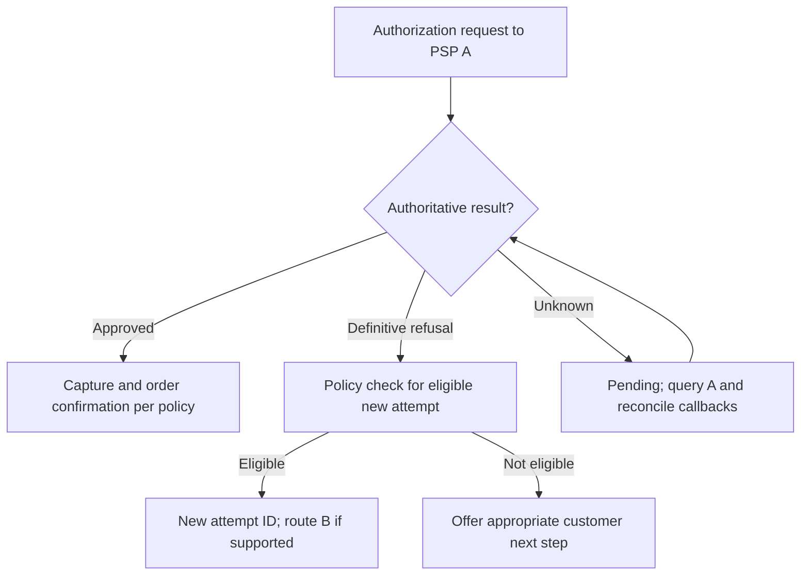

# Case lab 02 — PSP timeout, failover and duplicate-charge risk

**Synthetic case, not implementation guidance.** Merchant CNP card checkout; two unrelated PSPs; source review 16 November 2026. Independent scheme/provider review pending.

## The situation

HarborCart routes card payments to PSP A. During an incident, 100 authorization requests **time out after submission**. Engineering proposes immediately routing all 100 orders to PSP B. Both PSPs have a status API; their idempotency-key scopes are independent.

After investigation of the original A attempts: **60 were issuer-approved, 25 definitively declined, 15 remain unresolved.** These are authorization outcomes, *not* capture, payout, or order-completion outcomes.

| Order | Evidence | PM requirement |
|---|---|---|
| O101 | A timeout, then late A approval; identical webhook twice | One authorization record, at most one eligible capture and one fulfillment; deduplicate event side effects |
| O102 | A definitive issuer decline | Follow risk/scheme/merchant retry policy; a new attempt is separately identified |
| O103 | A timeout, B incorrectly attempted, then *two distinct* approvals | Hold fulfillment/capture decisions, reconcile both provider references, request permissible reversal where supported |
| O104 | Successful 3DS challenge followed by issuer decline | Record authentication and authorization separately; do not call it a paid order |

**Important difference:** Duplicate delivery of the *same provider event* is not necessarily a second money movement. Two distinct provider authorization references may reflect two real holds. The merchant's shared order reference does **not** create cross-provider idempotency.

## What the metrics actually say

One synthetic day shows:

| Grain | Numerator | Denominator | Result |
|---|---:|---:|---:|
| Authorization attempts approved / submitted | 9,300 | 10,500 | **88.57%** |
| Distinct paid orders / payment-initiated orders | 9,100 | 10,000 | **91.00%** |
| Completed 3DS challenges / initiated challenges | 600 | 800 | **75.00%** |
| Original A timeouts with a known issuer outcome at snapshot | 85 | 100 | **85.00%** |
| Original A timeouts still unresolved | 15 | 100 | **15.00%** |

The 3DS cohort is a *separate sampled population*, so these percentages cannot be multiplied together. Neither the 60 subsequently approved attempts nor the 85 resolved timeouts prove any additional paid orders. Capture and order confirmation require their own evidence.

## The safest product behavior

**Do not auto-failover an unknown submitted payment.** Route *new, not-yet-submitted* operations to B if risk, provider contracts, credential/token-domain support, authentication, and operational controls permit. For retries to A, follow **A's** documented idempotency window/error semantics. An idempotency key reused at B has no demonstrated protection against a second authorization at A.

### PM incident decision record

1. **First response:** contain risky failover, identify first affected minute/cohorts, assign incident commander and notify PSP operations, risk, finance and support.
2. **Truth:** preserve order ID, payment-operation ID, attempt ID, PSP references, capture ID, 3DS ID/result, issuer code, callback event ID and timestamps.
3. **Customer UX:** present **pending** when ambiguous; a definitive decline should not be disguised as a network error.
4. **Recovery:** status query / verified webhook / provider report, then any authorized reversal or refund *at the correct financial state*.
5. **Release gates:** two approvals on one order are investigated; duplicate webhook cannot trigger duplicate capture, accounting or fulfillment; unresolved queue and exception aging are monitored.
6. **Scorecard:** track *distinct paid-order success*, duplicate holds/captures, long-pending statuses, fraud-loss maturation, cost, complaints and reconciliation exceptions—not only attempt approval.

## Acceptance tests

| Input | Expected behavior |
|---|---|
| PSP A response lost, original auth later approved | Remain pending until authoritative evidence, then progress once; **never** blindly submit to B |
| Same signed callback delivered twice | Exactly one financial/order side effect, assuming an authenticated idempotent handler |
| Two PSPs approve different attempts on one order | Record both references; do not count two paid orders; escalate remediations |
| 3DS challenge completed, issuer declines | Authentication success recorded; payment not marked successful |
| 15 status-unknown A attempts | Unknown queue remains 15 until new evidence changes it; no invented declines |

## Exercise and solution

**Question:** A proposes that reusing the merchant order ID at B makes rerouting all timed-out attempts safe. Is this correct? How many paid orders can you infer from the 60 late approvals?

**Solution:** No. The original request may have succeeded, and distinct PSPs do not share the same request deduplication. **Zero new paid orders are proven** by late authorization approvals alone. Correlate capture/payment and merchant order evidence.

## Primary-source anchors and review limits

- [Adyen API idempotency](https://docs.adyen.com/development-resources/api-idempotency): its documented scope, retention and transient-error handling are provider-specific.
- [Adyen duplicate payments](https://help.adyen.com/en_US/knowledge/payments/payment-statuses/why-are-there-duplicate-payments): a merchant reference need not be a uniqueness control for sessions.
- [EMVCo 3-D Secure](https://www.emvco.com/emv-technologies/3-d-secure/): payer authentication and card authorization are separate stages.

**Required specialist checks:** actual provider retry windows and status-query behavior, reversal rules, token portability, 3DS result handling, acquirer liability, and duplicate-event guarantees.

**Related chapters:** [Gateways](../book/02-payment-products-and-infrastructure/06-payment-gateways-routing-and-orchestration.md) · [3DS](../book/03-checkout-authorization-and-fraud/11-3d-secure-and-customer-authentication.md) · [Authorization](../book/03-checkout-authorization-and-fraud/12-improving-payment-authorization-rates.md) · [Incidents](../book/04-disputes-reconciliation-and-operations/17-payment-outages-incidents-and-operations.md).
