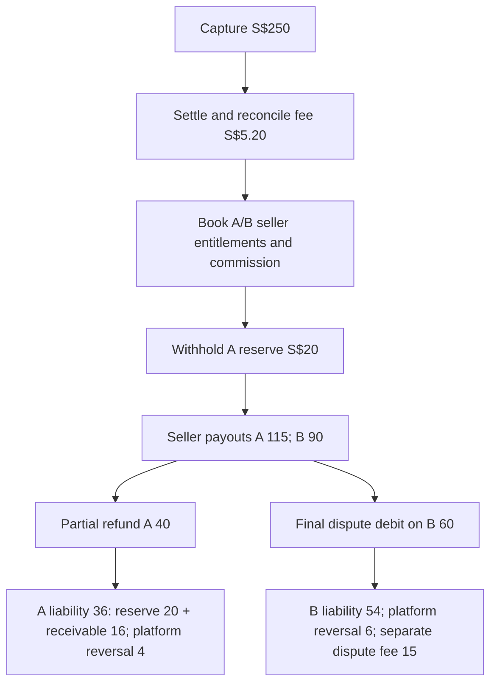

# Case lab 03 — Marketplace seller reserves, refunds and a negative balance

**Synthetic accounting case** · Currency SGD · All amounts fictional · **Independent acquiring, finance and legal review pending.** This is a model for learning, **not** a claim about Stripe, Adyen, scheme allocation, local custody rules or any real contract.

> **PM problem:** Two sellers have received payouts. A partial refund and a later dispute arrive. Can the platform show a reliable seller balance without treating a reserve as profit or silently transferring Seller A's reserve to Seller B?

## Contract and system assumptions

HarborMarket is a fictional platform whose documented contracts make it responsible for the PSP processing fee. The platform retains **10% commission on each seller's gross sale**. It holds a **S$20 seller-specific reserve for A** against A's entitlement and releases it only under an approved policy. There is **no reserve for B**. The hypothetical model assumes one successful S$250 capture and its settlement, no taxes, no prior balances, and all initial disbursements and payouts settle in the same illustrated cycle.

Who is legally merchant of record, liable to an acquirer and authorized to hold money is **not established by the arithmetic**. Legal/compliance and finance must validate the actual business model.

## 1. Initial purchase — trace gross to cash

The customer buys **S$150 from Seller A** and **S$100 from Seller B** in a single captured S$250 order. Platform commission is 10% per seller. The provider's fictional processing charge is **2% of S$250 + S$0.20 = S$5.20**, entirely borne by the platform.

| Allocation | Seller A | Seller B | Total |
|---|---:|---:|---:|
| Gross captured sale | 150.00 | 100.00 | **250.00** |
| Platform commission (10%) | 15.00 | 10.00 | **25.00** |
| Seller entitlement before reserve | 135.00 | 90.00 | **225.00** |
| Seller-specific retained reserve | 20.00 | 0.00 | **20.00** |
| Seller disbursement (assumed completed) | **115.00** | **90.00** | **205.00** |

**Three independent reconciliations:**

1. **Customer gross → PSP net:** S$250.00 − S$5.20 provider fee = **S$244.80** assumed settled cash.
2. **PSP net → beneficiary allocations:** S$205.00 seller disbursements + S$20.00 retained A reserve + S$19.80 platform net margin = **S$244.80**.
3. **Commission bridge:** S$25.00 gross commission − S$5.20 processing cost = **S$19.80**. The S$20 reserve is **a liability/held seller amount**, not platform earnings.

**Accounting caution:** The allocation table is a simplified sub-ledger reconciliation, not prescriptive statutory debit/credit entries. A provider may settle, book balance-account transfers and remit bank payouts on different dates. Never post a bank credit merely because the API says capture succeeded.

## 2. Event timeline — money does not move atomically

| Event | Evidence and resulting state | What is *not* proven |
|---|---|---|
| Customer order captured | PSP capture reference and merchant order/seller allocations | Final PSP settlement or a seller bank credit |
| PSP settles S$244.80 net | Settlement batch and S$5.20 fee entries | Every seller has been disbursed |
| Seller A receives S$115, B receives S$90 | Individual seller payout/bank acknowledgments | S$20 A reserve has been released |
| Seller A's line receives S$40 partial refund | Linked refund reference and executed refund outcome | That the platform recovered the seller share |
| Seller B's line later receives a S$60 **final dispute debit** | Scheme/acquirer case and a financial adjustment | The seller has already repaid or that dispute fees are reversible |

This case **assumes** a final S$60 dispute debit for teaching. Real disputes can involve notification, provisional debits, representment, reversals, different fee events and rule deadlines. Do not book every 'dispute opened' event as a final loss.

## 3. Refund Seller A's item after payout

A S$40 partial refund is made against the **A** line only. The fictional contract reverses commission proportionately: S$4 platform commission reversal and **S$36 seller-side refund liability**. The refund is not assumed to reverse the original S$5.20 PSP fee.

With Seller A's remaining **S$20 held reserve** (still unreleased), the *seller debt funding bridge* is:

| Source for S$40 customer refund | Amount |
|---|---:|
| Apply Seller A reserve toward A's S$36 liability | 20.00 |
| Seller A receivable / negative balance still to recover | **16.00** |
| Reverse platform commission earned on refunded A line | 4.00 |
| **Total refund allocation** | **40.00** |

**Critical difference:** *Allocating liability* does not generate cash. The platform may need to finance the S$16 seller receivable temporarily. Whether reserve application or recovery is permitted depends on the exact contract, safeguarding requirements and accounting policies. Product must show **reserve applied S$20**, **seller debt S$16**, **platform commission reversal S$4**, with supporting refs. It may not quietly debit B's balance to clear A's debt.

## 4. Later Seller B dispute

A separate **S$60 final chargeback debit** is attributed to B's line. The same fictional contract reverses 10% of B's commission for that portion: **S$6 platform reversal** and **S$54 seller liability**. Suppose the provider separately charges a **nonrefundable S$15 dispute fee** to the platform.

| B event | Amount | Treatment |
|---|---:|---|
| Cardholder dispute principal debit | 60.00 | Record a distinct financial adjustment, not a refund event |
| Seller B's contractual share | 54.00 | Seller receivable or negative balance, subject to recovery rights |
| Reversed B platform commission | 6.00 | Reduction of platform commission |
| Provider dispute fee | 15.00 | Additional platform expense if actually charged |

B was already paid S$90 and holds **no reserve**. The platform needs a cash funding/recovery policy for the S$60 debit (plus S$15 fee), while separately recording B's S$54 obligation. **Do not book S$54 as collected just because a negative balance exists.**

The platform must not automatically assume Seller B bears all scheme liability, or net the dispute against Seller A. An acquirer/PSP might contractually debit a platform liable account before seller recovery; that is a provider/contract reality, **not** the same thing as legal merchant-of-record status.

## 5. PM state machine and exception design

**Required data keys:** capture ID, order ID, seller-line ID, seller account ID, split allocation ID, provider transaction/settlement batch, fee entry ID, payout ID and beneficiary bank reference, reserve ledger movement, original capture linked to refund and dispute, case/debit ID, negative-balance receivable ID, legal entity and currency.

**Required states:** captured; provider-settled; split-booked; reserve-held/applied/released; payout-submitted vs paid; refund-requested vs executed; dispute-notified vs debit-posted vs reversed/final; seller-receivable-open vs recovered or written off.

### Acceptance criteria

- A refund of **S$40** produces exactly **S$36** A liability plus **S$4** platform reversal. Retry/duplicate webhooks cannot create a second refund posting.
- Reserve usage of **S$20** reduces **A's** held reserve and A's refund exposure by the same amount; **S$16** remains receivable until recovered or written off.
- The B dispute produces separate **S$60 principal**, **S$54 seller receivable**, **S$6 commission reversal** and **S$15 provider fee** evidence; none of these are silently double-counted as a customer refund.
- A completed seller transfer needs bank/provider payout evidence; split booking alone is not bank payment.
- Finance can reconcile S$250 gross sale through S$5.20 fees to S$244.80 original net settlement, regardless of later separately timestamped adjustment cycles.
- Seller-level available balance, held reserve, recoverable debt, disbursement and eventual net revenue are separately addressable in support tools and reports.

## 6. Exercise and answer check

**A.** Does the platform initially make S$39.80 because it kept S$25 commission plus S$20 reserve minus S$5.20 fee?  
**B.** After refunding A S$40, how much seller debt is outstanding if S$20 reserve is applied?  
**C.** Can a B dispute event immediately be counted as permanent loss and as a S$54 completed seller recovery?

**Answers:** A: No—initial platform net commission is **S$19.80**, and the S$20 reserve remains owed/held under the approved reserve arrangement. B: **S$16**; the platform may need to front cash pending actual recovery. C: No—distinguish provisional and final debit stages, case outcomes and an open seller receivable from collected funds.

## 7. Source anchors and unresolved reviewer questions

- [Adyen Platforms — split transactions](https://docs.adyen.com/platforms/online-payments/split-transactions): separate instructions for sales, commissions, processing fees, refunds and chargebacks.
- [Adyen Platforms — liable balance accounts](https://docs.adyen.com/platforms/manage-liable-accounts/): platform liable balances and booking depend on product configuration.
- [Stripe Connect — platform reserves and negative connected balances](https://support.stripe.com/questions/reserves-for-connect-platforms-and-connected-accounts?locale=en-GB): a provider-specific example of platform-owned loss exposure.
- Specialist reviewer must verify: merchant-of-record and PayFac contract boundaries; whether, where and for how long reserves may legally be held; payout timing; dispute principal/fee booking; refund fee treatment; recourse against sellers; safeguarding and tax treatment.

**Related reading:** [Chapter 5A — Marketplace funds flow](../book/part-2/05a-marketplaces-payfac-funds-flow.md) · [Chapter 15 — Disputes](../book/part-4/15-chargebacks-and-disputes.md) · [Chapter 16 — Three-party reconciliation](../book/part-4/16-three-way-reconciliation.md).
